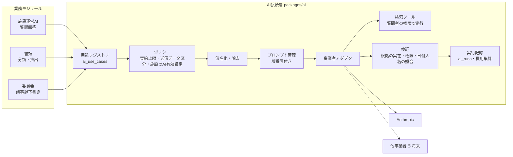

# AI アーキテクチャ

## 1. 基本方針

| No | 方針 |
|---|---|
| A-1 | AI は**独立した接続層**として実装し、業務モジュールは「用途」を指定して呼び出すだけ。事業者名・モデル名を業務コードに書かない |
| A-2 | 事業者ごとの**アダプタ（差し替え部品）**で接続。初期は1社【仮定 Q4：Claude API】、後から追加・切替可能 |
| A-3 | AI の出力は「回答」「下書き」「抽出」「分類」「提案」として**正式データとは別に保存**。人が採用して初めて正式データになる |
| A-4 | 回答には根拠（参照データ）を付ける。根拠のない記述は表示しないか「AIの推測」と明示 |
| A-5 | 情報がない場合は「登録情報からは確認できません」と表示し、推測で埋めない |
| A-6 | 行政提出物・法令解釈・職員情報・重要な業務完了は、必ず人の承認を経る |
| A-7 | AI が実行できる操作は用途ごとの許可リストで制限。**今回は自律実行を実装しない** |
| A-8 | AI が止まっても全業務を手作業で継続できる |

## 2. 構成



### 2.1 アダプタの共通インターフェース（概念）

```ts
interface AiProviderAdapter {
  id: string;                          // 'anthropic' など
  generate(req: {
    model: string;
    system: string;
    messages: AiMessage[];
    tools?: AiToolDefinition[];        // 検索ツール（読み取り専用）
    outputSchema?: JsonSchema;         // 構造化出力（抽出・分類）
    maxOutputTokens: number;
  }): Promise<{ content: AiContent[]; usage: { inputTokens: number; outputTokens: number }; stopReason: string }>;
}
```

- 業務側は `ai.run('assistant.qa', { facilityId, userId, input })` のように用途コードで呼ぶ
- 用途ごとに事業者・モデル・上限・送信可能データ区分を `ai_use_cases` で設定（コード変更なしで切替）
- 事業者固有の機能（例：特定の拒否応答・代替モデル指定）はアダプタ内に閉じ込める

## 3. AI 機能と処理の流れ

| 機能 | 用途コード | 入力 | 出力 | 人の確認 | フェーズ |
|---|---|---|---|---|---|
| 施設運営に関する質問回答 | `assistant.qa` | 質問文 | 回答＋根拠 | 回答は参考情報（承認不要）。操作は提案として別途確認 | 4 |
| 業務の説明 | `task.explain` | 業務・テンプレート | 説明文＋根拠 | 同上 | 4 |
| 文書分類 | `document.classify` | 書類テキスト | カテゴリ候補 | 登録者が確定 | 4 |
| 情報抽出・期限候補抽出 | `document.extract` | 書類テキスト | 項目・期限候補（原文の位置付き） | 担当者が確認して業務登録 | 4 |
| タスク抽出 | `task.extract` | 議事録・通知文 | 業務候補 | 確認画面で採否 | 4 |
| 議事録生成 | `minutes.draft` | メモ・（将来）文字起こし | 議事録下書き・決定事項候補 | 議事録承認者が承認 | 4 |
| 業務改善提案 | `ops.suggest` | 業務の集計データ | 提案＋根拠データ | 参考情報 | 4 |
| 文書読み取り（OCR） | `document.ocr` | PDF・画像 | テキスト | 重要項目は人が確認 | 4 |

## 4. 質問回答（根拠付き）の仕組み

1. 利用者が質問
2. AI 接続層は、AI に「検索ツール」（例：業務検索、提出状況検索、書類検索、委員会検索）だけを渡す
3. AI がツールを呼ぶと、アプリが**質問者の権限・施設範囲**で検索し、結果（ID・更新日時付き）を返す
4. AI は回答と参照IDを返す
5. 検証：
   - 参照IDが実在し、質問者が閲覧可能か
   - 回答中の日付・人名・件数が参照データに含まれるか（自動照合）
   - 不一致は「根拠と一致しない記述」として警告表示し、`ai_outputs.verification` に記録
6. 画面表示：回答本文に「AIの回答」の表示、根拠リンク、対象期間、データ更新日時
7. 利用者は「回答が正しくない」報告ができ、記録して改善に使う

検索結果が0件の場合、AI に自由作文させず「登録情報からは確認できません」と定型表示（必須テスト9の一部）。

## 5. 期限・担当者・規則を推測させないための仕組み

| 対象 | 仕組み |
|---|---|
| 期限 | AI が抽出した期限は「候補」。原文の該当箇所を並べて表示し、人が確定 |
| 担当者 | AI は担当者を決めない。候補表示も「原文に記載がある場合」のみ |
| 法令上の義務 | AI は `requirement_items` の確認状態を変更できない。法令解釈の質問には登録済みの根拠情報のみ提示し、「専門家・行政への確認が必要」を併記 |
| 業務完了 | AI は業務状態を変更しない |

## 6. 品質評価（AI評価テスト）

- 架空の施設データと「質問と期待結果」の評価セット（初期50問、PHASE 4 で作成）
  - 根拠がある質問：正しい根拠を付けて回答するか
  - 根拠がない質問：「確認できません」と答えるか（推測しないか）
  - 権限外のデータ：回答に含めないか
  - 誤誘導の質問（存在しない委員会について等）：作り話をしないか
- 合格基準（案）：推測による誤回答 0件、権限外データの露出 0件、根拠付き回答率 95%以上
- プロンプト・モデル・事業者を変更したら評価を再実行（モデル切替時の品質確認）

## 7. 利用料の管理

- 実行ごとに入力・出力トークン数と推定費用（事業者・モデルの単価表から算出、単価はデータで管理）を `ai_runs` に保存
- `usage_counters` に法人・月単位で集計し、管理者画面で表示（今月の利用量・推定費用・上限まで）
- 契約の上限（`limit.ai_monthly_units`）到達時は AI 機能のみ停止し、管理者に通知

## 8. AI 処理の状態

| 状態 | 意味 |
|---|---|
| queued（未処理） | 受付済み |
| running（AI処理中） | 実行中 |
| succeeded（AI処理済み） | 出力あり。`ai_outputs.review_status = unreviewed`（人間確認待ち） |
| — | 人が `accepted`（採用）/ `modified`（修正して採用）/ `rejected`（却下） |
| failed（エラー） | 失敗。利用者には手作業での継続を案内 |

## 9. 将来の AI エージェント化への備え

- 「提案（proposal）」出力型で、業務登録・依頼・通知の案を構造化データとして出せるようにしておく
- 実行は「提案カード」を権限者が確認して押した場合のみ。用途ごとに実行可能な操作の許可リストを持つ
- 無制限の自律実行は行わない。将来導入する場合も、操作の上限・承認・記録を必須とし、別途設計・承認を得る
