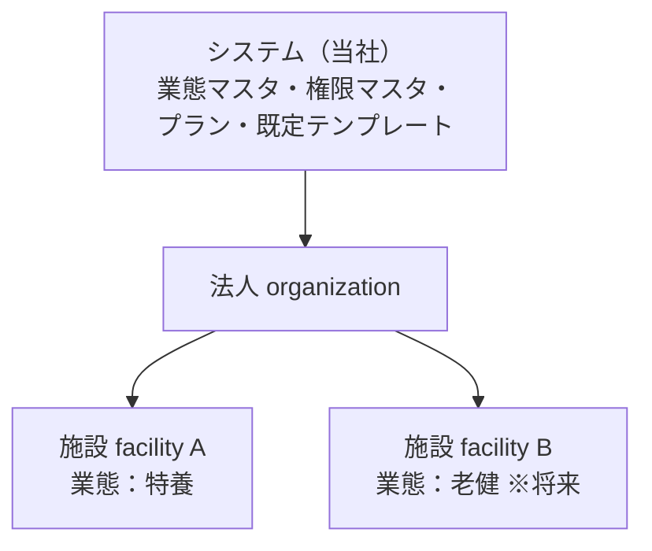
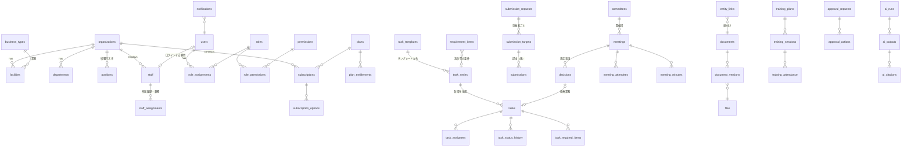
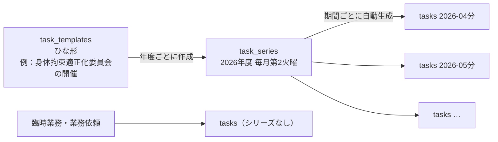

# データベース設計・マルチテナント設計

- DB：PostgreSQL 16 以上（国内リージョン）【仮定 Q2】
- 変更管理：すべてマイグレーション（DB構造の変更手順をコードで記録したもの）で行い、手作業でDBを変更しない
- 表記：`PK`＝主キー、`FK`＝外部キー（他テーブルへの参照）、`UQ`＝一意制約

---

## 1. 設計原則

| No | 原則 | 内容 |
|---|---|---|
| D-1 | テナント列 | 施設に関するデータは `organization_id` と `facility_id` を必ず持つ。法人共通データは `facility_id` が空 |
| D-2 | RLS | すべてのテナントデータに行レベルセキュリティを設定。接続ごとに「法人ID・閲覧可能な施設ID一覧」をDBに渡し、それ以外の行は取得・更新できない |
| D-3 | ID | UUID v7（時刻順に並ぶランダムID）。連番を外部に出さない |
| D-4 | 共通列 | `created_at, created_by, updated_at, updated_by, version`（同時編集の上書き防止用の版番号） |
| D-5 | 削除 | 業務データは論理削除（`deleted_at`）。物理削除は保存期限を過ぎたデータの削除処理のみ |
| D-6 | 履歴を消さない | 状態変更・承認・操作は**追記のみの履歴テーブル**に記録。業務の各回は別行として残し上書きしない |
| D-7 | 固定値を持たない | 施設ID・業態・料金・カテゴリをコードに書かない。業態別の違いはマスタとテンプレートで表す |
| D-8 | 列挙値 | ステータス等はコード値（英字）で保存し、表示名は画面側の辞書で管理（多言語・名称変更に対応） |
| D-9 | 日時 | `timestamptz`（時差付き）で保存。期限日は `date`、時刻付き期限は `timestamptz`。表示は Asia/Tokyo |
| D-10 | 年度 | 施設ごとに年度開始月を設定（既定4月）。業務・研修・委員会計画に `fiscal_year` を持つ |
| D-11 | 要配慮情報 | 入居者情報・職員の健康情報など要配慮個人情報のテーブルは MVP では作らない |
| D-12 | テナント整合 | 参照先も同じ法人・施設であることを DB で保証する。参照は `(id, organization_id)` の複合外部キーで行い、例えば業務の担当者に他法人の職員を設定できないようにする（アプリの確認に加えた二重の防止） |
| D-13 | 論理削除と一意制約 | 一意制約は「削除されていない行」だけを対象にする（部分一意索引）。削除後に同じ名前で再登録できる |
| D-14 | 履歴を持つ属性 | 所属（部署・役職）のように時期によって変わる属性は期間付きの別テーブルで持ち、上書きしない（「当時の担当者は主任だった」が分かる） |

---

## 2. マルチテナント設計

### 2.1 階層

| データの種類 | `organization_id` | `facility_id` | 例 |
|---|---|---|---|
| システム共通 | 空 | 空 | 業態マスタ、権限マスタ、プラン、システム既定テンプレート |
| 法人共通 | あり | 空 | 法人共通テンプレート、法人規程の書類、役職マスタ |
| 施設データ | あり | あり | 業務、提出依頼、委員会、施設の書類 |

### 2.2 アクセス制御の流れ

1. ログイン後、利用者は「作業中の法人・施設」を1つ選ぶ（所属が1施設なら自動）。1人のユーザーが複数法人に所属することも構造上は可能（例：法人をまたぐ兼務）だが、同時に扱うのは1法人のみ
2. API層がユーザーの役割割当（`role_assignments`）から「アクセス可能な法人・施設」を確定
3. リクエストごとに DB のトランザクションを開始し、その中で `set_config('app.org_id', …, true)`、`app.facility_ids`、`app.user_id` を設定（`true`＝トランザクション終了で自動消去）。接続を使い回す仕組み（コネクションプール）でも、別の利用者の設定が残らない
4. RLS ポリシー：`organization_id = app_org_id() AND (facility_id IS NULL OR facility_id = ANY(app_facility_ids()))`（設定値を読む関数は索引が効く形で定義）
5. 設定値が空のまま実行された SQL は**全件拒否**（設定漏れで全件が見える事故を防ぐ）
6. さらにアプリ側で操作単位の権限（`permission-design.md`）と適用範囲（本人・部署・施設・法人）を判定
7. 管理用のDB接続（マイグレーション用）とアプリ用接続は別のDB利用者にし、アプリ用はRLSを迂回できない。テーブル所有者もアプリ用とは別にする
8. 当社の障害対応アクセス（`support_access_grants`）も同じ仕組みで、承認された施設だけを設定値に入れる。RLS を無効化する経路は作らない

### 2.3 設定の階層

`settings` テーブルで「システム既定 → 業態 → 法人 → 施設」の順に上書きする。アプリは解決済みの値を取得する共通関数を使う。

設定項目は**コード内の設定定義表（レジストリ）**に登録したものだけを保存できる。定義表には、項目名、値の型と検証ルール、既定値、どの階層で上書きできるか、変更に必要な権限を書く。登録されていない項目や不正な値は保存を拒否する（自由な項目が増えて管理できなくなるのを防ぐ）。法人が「施設での変更を禁止」（ロック）できる項目も定義表で指定する。

例：提出期限の通知タイミング
- システム既定：期限3日前・1日前・当日・超過翌日
- 法人で変更：期限7日前を追加
- 施設で変更：なし → 施設の有効値は「7日前・3日前・1日前・当日・超過翌日」

---

## 3. ER図（全体）

---

## 4. テーブル定義

列は主要なもののみ。全テナントテーブルに共通列（D-4）と `organization_id`／`facility_id`（D-1）がある。

### 4.1 テナント・設定

| テーブル | 主な列 | 説明・制約 |
|---|---|---|
| organizations | id, name, corporate_type（社会福祉法人等）, status | 法人 |
| business_types | id, code（tokuyo / chiiki_tokuyo / roken / yuryo …）, name, active | 業態マスタ（システム共通）。コードで業態名による分岐はしない |
| facilities | id, organization_id, business_type_id, name, facility_code, capacity, fiscal_year_start_month（既定4）, timezone, status | 施設 |
| departments | id, organization_id, facility_id（空＝法人部署）, name, parent_id, sort_order | 部署（介護、看護、事務等） |
| positions | id, organization_id, name, rank | 役職マスタ（施設長、事務長、主任等）。**権限は役職ではなく役割で決める** |
| settings | id, scope_type（system / business_type / organization / facility）, scope_id, key, value(jsonb) | UQ(scope_type, scope_id, key)。設定の階層 |

### 4.2 ユーザー・職員

| テーブル | 主な列 | 説明・制約 |
|---|---|---|
| users | id, auth_subject（認証サービス側ID）, login_id, email（任意）, display_name, status（active / suspended / deleted）, mfa_enabled, last_login_at | ログインする人。メールのない職員はログインIDで認証【仮定 Q3、認証サービス選定は TD-016】 |
| staff | id, organization_id, staff_code, family_name, given_name, kana, employment_type, hired_on, left_on, status（在籍 / 休職 / 退職）, user_id（任意） | 職員台帳（法人単位）。ログインしない職員も登録可。**健康情報・家族情報等は持たない**。UQ(organization_id, staff_code) |
| staff_assignments | id, organization_id, staff_id, facility_id（空＝法人本部）, department_id, position_id, is_primary, valid_from, valid_to | 所属（施設・部署・役職）の期間付き履歴。兼務は複数行。異動は旧行に終了日を入れて新行を追加 |
| staff_private_fields | staff_id, field_key, value | 将来の機密項目（連絡先等）を分離保存し、閲覧権限を別にする。MVPでは未使用 |
| login_history | id, user_id, occurred_at, result（success / failure / locked）, ip, user_agent, mfa_used | ログイン履歴（追記のみ） |

### 4.3 権限

| テーブル | 主な列 | 説明・制約 |
|---|---|---|
| permissions | code（例 `task.approve`）, module, description | 権限マスタ（システム共通、マイグレーションで追加） |
| roles | id, organization_id（空＝システム標準）, code, name, is_system, based_on_role_id | 標準6役割＋法人のカスタムロール |
| role_permissions | role_id, permission_code, scope（own / department / facility / organization） | 役割に含まれる権限と適用範囲 |
| role_assignments | id, user_id, role_id, organization_id, facility_id（空＝法人単位）, department_id（任意）, valid_from, valid_to, granted_by | 「誰に・どこで・どの役割」。法人管理者は**許可された施設ごとに1行** |
| support_access_grants | id, organization_id, facility_id, granted_to_user_id（当社）, approved_by, reason, expires_at | 当社が障害対応で一時的に閲覧する場合の許可記録 |

### 4.4 契約・プラン

| テーブル | 主な列 | 説明・制約 |
|---|---|---|
| plans | id, code, name, monthly_price, currency, is_public, valid_from, valid_to | 料金プラン（価格はデータ） |
| plan_entitlements | plan_id, key（例 `module.m04` / `limit.staff` / `limit.ai_monthly_units` / `limit.storage_gb` / `limit.facilities`）, value(jsonb) | プランの権利・上限 |
| options | id, code, name, monthly_price | 追加オプション |
| option_entitlements | option_id, key, value | オプションで増える権利 |
| subscriptions | id, organization_id, plan_id, status（trial / active / suspended / ended）, starts_on, ends_on, notes | 法人の契約 |
| subscription_options | subscription_id, option_id, quantity, starts_on, ends_on | 契約したオプション |
| entitlement_overrides | subscription_id, key, value, reason, valid_to | 個別条件 |
| usage_counters | organization_id, period（YYYY-MM）, key, value | AI利用量・保存容量などの集計 |

権利の判定：`plan_entitlements` ＋ `option_entitlements` ＋ `entitlement_overrides` を合算する共通関数 `getEntitlements(organizationId)`。

### 4.5 業務・期限（MODULE 02）

業務は「テンプレート（ひな形）」「シリーズ（繰り返し設定）」「各回の業務」の3層に分ける。

| テーブル | 主な列 | 説明・制約 |
|---|---|---|
| task_categories | id, scope_type, scope_id, name, is_government_submission, sort_order | カテゴリ（行政提出、委員会、研修、点検、人事、会計等）。階層設定 |
| task_templates | id, scope_type（system / business_type / organization / facility）, scope_id, title, description, category_id, occurrence_type, recurrence_rule(jsonb), default_department_id, default_due_offset, completion_criteria, required_items(jsonb), requires_approval, **basis_type**, basis_note, basis_url, basis_verified_by, basis_verified_at | ひな形。根拠種別：`law`（法令）/ `notice`（行政通知）/ `corporate_rule`（法人規程）/ `facility_rule`（施設ルール）/ `unverified`（未確認）。**既定は `unverified`** |
| task_series | id, organization_id, facility_id, template_id（任意）, fiscal_year, title, occurrence_type, recurrence_rule(jsonb), generation_mode（`calendar`＝暦ベース / `after_completion`＝前回完了から○日後）, start_on, end_on, generate_ahead_days, default_assignees(jsonb), approver_staff_id, active | 年間業務の登録単位。年度ごとに作成し、過去年度は変更しない。同じテンプレートから同じ年度に2つ目のシリーズを作る場合は警告 |
| tasks | 下表参照 | 業務の各回・臨時業務・業務依頼 |
| task_assignees | task_id, staff_id, role（primary / secondary） | UQ(task_id, staff_id)。主担当は1名まで（部分一意制約） |
| task_required_items | id, task_id, name, accepted_file_types, is_required, fulfilled_by_document_id | 必要提出物 |
| task_status_history | id, task_id, from_status, to_status, changed_by, changed_at, comment | 追記のみ |
| comments | id, organization_id, facility_id, target_type, target_id, kind（comment / progress / completion_report）, body, created_by | コメント・進捗報告・完了報告。編集履歴は監査ログ |

**tasks の列**

| 指示書の項目 | 列 | 型・値 |
|---|---|---|
| 業務ID | id | uuid |
| 法人ID・施設ID | organization_id, facility_id | uuid |
| 業務名・業務説明 | title, description | text |
| 業務カテゴリ | category_id | FK |
| 業務発生区分 | occurrence_type | `daily` / `weekly` / `monthly` / `quarterly` / `semiannual` / `annual` / `ad_hoc`（臨時） |
| 担当部署 | department_id | FK |
| 主担当者・副担当者 | task_assignees（role） | — |
| 開始日・期限 | start_on, due_on, due_time（任意） | date / time |
| ステータス | status | `not_started`（未着手）/ `in_progress`（進行中）/ `awaiting_submission`（提出待ち）/ `awaiting_approval`（承認待ち）/ `returned`（差し戻し）/ `completed`（完了）/ `on_hold`（保留） |
| 優先度 | priority | `high` / `normal` / `low` |
| 必要提出物 | task_required_items | — |
| 完了条件 | completion_criteria | text |
| 関連書類 | entity_links | — |
| 承認者 | approver_staff_id, requires_approval | — |
| 完了日時 | completed_at, completed_by | — |
| 作成者・更新日時 | created_by, updated_at | — |
| （追加）種別 | kind | `task`（業務）/ `request`（業務依頼） |
| （追加）依頼者 | requested_by_staff_id | 業務依頼のみ |
| （追加）シリーズ・期間 | series_id, period_key, fiscal_year | 例 period_key=`2026-04`、`2026-Q1`、`2026-W15`、`2026-04-12` |
| （追加）発生元 | source_type, source_id | `manual` / `series` / `decision`（委員会の決定事項）/ `ai_proposal`（AI提案を人が承認） |
| （追加）根拠 | basis_type ほか | テンプレートから複写。未入力は `unverified` |
| （追加）取消 | cancelled_at, cancel_reason | 取消は状態ではなく記録として持つ（指示書の7状態を維持） |

主な制約・索引：
- **UQ(series_id, period_key)**：同じシリーズの同じ期間の業務は1件だけ（繰り返し業務の二重生成防止）
- 索引：(facility_id, due_on, status)、(facility_id, status)、担当者別 (staff_id) — ダッシュボードの集計用
- 期限超過は状態として保存せず「`due_on < 今日` かつ `status` が完了・取消以外」で算出（二重管理を避ける）

### 4.6 提出物回収

| テーブル | 主な列 | 説明・制約 |
|---|---|---|
| submission_requests | id, organization_id, facility_id, title, instructions, due_at, task_id（任意）, required_items(jsonb), target_rule(jsonb：全員 / 部署 / 役職 / 個別), reviewer_staff_id, status（draft / open / closed） | 提出依頼 |
| submission_targets | id, request_id, staff_id, status（`not_submitted` / `submitted` / `approved` / `returned` / `excluded`）, last_submitted_at, decided_at | UQ(request_id, staff_id)。対象者は依頼作成時に確定して保存（後から職員が増減しても履歴が変わらない） |
| submissions | id, target_id, version, comment, submitted_by, submitted_at | 再提出は版を追加。上書きしない。ファイルは entity_links で document_versions に紐付け |

### 4.7 承認（共通）

| テーブル | 主な列 | 説明・制約 |
|---|---|---|
| approval_requests | id, organization_id, facility_id, target_type（task / submission / minutes / document / requirement_item / ai_output）, target_id, target_version, step, approver_staff_id, status（pending / approved / returned / cancelled）, requested_by, requested_at | 承認依頼。対象の版番号を保存し、承認後に内容が変わったことを検知 |
| approval_actions | id, approval_request_id, action（approve / return / cancel / reassign / comment）, actor_user_id, comment, acted_at | **追記のみ**（承認・差し戻し履歴）。承認者の退職・不在時は管理者が承認者を付け替え（reassign）、理由を記録 |

承認者は「特定の職員」または「役割（例：その時点の施設長）」で指定でき、承認依頼の作成時点で具体的な職員に確定して保存する（後から役職者が交代しても、誰に依頼したかが残る）。

### 4.8 書類・証拠（MODULE 03）

| テーブル | 主な列 | 説明・制約 |
|---|---|---|
| files | id, organization_id, facility_id, storage_key, original_name, mime_type, size_bytes, sha256_original, sha256_stored, metadata_removed, uploaded_by, uploaded_at, scan_status（pending / clean / infected） | 原本ファイル。保存先は `org/{法人ID}/fac/{施設ID}/{推測できないID}`（法人単位の出力・削除を確実にするため法人IDで区切る）。ハッシュ値は受領時と保存時の両方を記録（位置情報を除去した場合も、受領した内容との対応が分かる） |
| document_categories | id, scope_type, scope_id, name, default_access_level, default_retention_years | 書類カテゴリ（階層設定） |
| documents | id, organization_id, facility_id（空＝法人共通）, title, category_id, access_level（`all_staff`＝全職員 / `managers`＝`document.read_managers` を持つ人 / `restricted`＝閲覧者リストの人のみ）, retention_until, owner_staff_id, current_version_id, status | 書類台帳 |
| document_versions | id, document_id, version, file_id, note, created_by, created_at, extracted_text, extraction_status（`none` / `ai_extracted` / `human_verified`） | 版管理。更新は新しい版を追加 |
| document_acl | document_id, principal_type（role / department / staff）, principal_id, permission（read / write） | `restricted` の書類の個別閲覧権限 |
| entity_links | id, organization_id, facility_id, from_type, from_id, to_type, to_id, relation（`evidence`（証拠）/ `attachment`（添付）/ `related`（関連）） | 業務・委員会・研修・提出物と書類の紐付け（汎用） |
| retention_policies | id, scope_type, scope_id, category_id, retention_years, basis_note | 保存期限ルール（施設が設定、根拠を記録） |

### 4.9 委員会・研修（MODULE 04）

| テーブル | 主な列 | 説明・制約 |
|---|---|---|
| requirement_items | id, scope_type（business_type / organization / facility）, scope_id, item_type（committee / training / drill / report / inspection / other）, name, required_frequency, basis_type, basis_note, basis_url, effective_from, effective_to, source（`system_candidate`＝当社提供の候補 / `facility`＝施設が登録）, candidate_ref, version, **verified_status（unverified / verified / needs_recheck）**, verified_by, verified_at | 「法令上必要な委員会・研修等」の一覧。**確認済みにできるのは `requirement.verify` を持つ人のみ。AI は変更不可**。当社の候補が改定されたら、それを採用している施設の行を `needs_recheck` にして通知（施設の記録は自動で書き換えない） |
| committees | id, organization_id, facility_id, name, purpose, frequency, chair_staff_id, secretary_staff_id, requirement_item_id（任意）, active | 委員会の定義 |
| committee_members | committee_id, staff_id, role（chair / member / secretary） | 委員 |
| meetings | id, organization_id, facility_id, meeting_type（committee / general）, committee_id（任意）, task_id（開催業務）, fiscal_year, title, scheduled_at, held_at, location, status（`scheduled` / `held` / `cancelled` / `postponed`） | 開催回。MODULE 06（会議）でも同じテーブルを使う |
| meeting_attendees | meeting_id, staff_id, attendance（present / absent / excused） | 出席者 |
| meeting_minutes | id, meeting_id, version, body, source（manual / ai_draft）, status（draft / approved）, approved_by, approved_at | 議事録（版管理）。AI下書きは承認まで draft |
| decisions | id, meeting_id, content, improvement_detail, owner_staff_id, due_on, status（`open` / `in_progress` / `done` / `dropped`）, task_id | 決定事項・改善内容。task_id で業務（改善業務）と連携 |
| training_plans | id, organization_id, facility_id, fiscal_year, title, category, target_rule(jsonb), requirement_item_id（任意）, planned_month | 研修計画 |
| training_sessions | id, plan_id, scheduled_at, held_at, instructor, format（集合 / 動画 / 外部）, status | 研修の開催回 |
| training_attendance | session_id, staff_id, attendance（present / absent / makeup / excluded）, completion_status（未確認 / 受講確認済）, confirmed_by, confirmed_at | 出欠・受講確認。証拠（レポート等）は entity_links |

委員会の「実施完了」の判定：開催済み **かつ** 議事録承認済み **かつ** 決定事項がすべて `done` または `dropped`（理由付き）。開催しただけでは完了にしない。

### 4.10 通知

| テーブル | 主な列 | 説明・制約 |
|---|---|---|
| notification_policies | id, scope_type, scope_id, event_type（submission_due / task_due / task_overdue / approval_requested …）, offsets(jsonb：例 `["-P3D","-P1D","P0D","P1D"]`), channels（in_app / email）, recipient_rule | 通知タイミング（管理者が変更可能、階層設定） |
| notifications | id, organization_id, facility_id, recipient_user_id, type, title, body, target_type, target_id, channel, sent_at, read_at, **dedupe_key** | UQ(dedupe_key)：例 `submission_due:{target_id}:{期限日}:-P1D:email` で二重送信を防ぐ |

通知は**事前に予約しない**。15分ごとの定期処理が「その時点の最新データ」と通知ポリシーを照合して、送るべき通知を算出する。
- 期限が変更された場合：重複防止キーに期限日を含めるため、新しい期限に対して改めて通知される。古い期限の通知は送られない
- 提出済み・完了・対象外になった人：照合時に対象から外れるため送られない
- 送信時刻帯：施設設定（既定 8時〜19時）の外では送らず、次の送信可能時刻にまとめて送る
- 定期処理が止まっていた場合：再開時に「本来送るべきだった通知」のうち期限切れでないものを送る

### 4.11 AI

| テーブル | 主な列 | 説明・制約 |
|---|---|---|
| ai_provider_configs | id, provider（anthropic / openai …）, model, purpose, region, enabled, priority | 使用するAI事業者・モデル（システム管理） |
| ai_vendor_terms | id, provider, data_retention, training_use, processing_region, zero_retention_available, contract_ref, checked_by, checked_at | AI事業者の条件の確認記録（管理画面で閲覧可能） |
| ai_use_cases | code（例 `assistant.qa` / `document.classify` / `minutes.draft` / `task.extract`）, allowed_data_classes, model_config_id, requires_human_review, enabled | 用途ごとの設定 |
| ai_runs | id, organization_id, facility_id, user_id, use_case, provider, model, status（`queued` / `running` / `succeeded` / `failed`）, data_classes_sent, input_tokens, output_tokens, estimated_cost, started_at, finished_at, error_code | **全AI実行の履歴**（AI実行履歴・利用料の根拠） |
| ai_outputs | id, run_id, output_type（answer / draft / extraction / classification / proposal）, content(jsonb), verification(jsonb：根拠照合結果), review_status（`unreviewed` / `accepted` / `modified` / `rejected`）, reviewed_by, reviewed_at | AIの出力。正式データとは別保存 |
| ai_citations | output_id, source_type, source_id, source_version, quoted_text | 根拠 |
| ai_conversations / ai_messages | id, user_id, facility_id, role, content, run_id | アシスタント画面の会話 |

### 4.12 操作履歴・ジョブ・入出力

| テーブル | 主な列 | 説明・制約 |
|---|---|---|
| audit_logs | id（bigint）, occurred_at, organization_id, facility_id, actor_type（user / system / ai / support）, actor_user_id, action（read / create / update / delete / approve / export / login …）, target_type, target_id, changes(jsonb：変更前後), request_id, ip, user_agent, prev_hash, row_hash | **追記のみ**。アプリ用DBアカウントには UPDATE / DELETE 権限を与えない。月単位で分割保存。各行に直前の行のハッシュ値を含めて連鎖させ、改ざん・欠落を検出可能にする。閲覧の記録は一覧表示では残さず、書類のダウンロード・提出物の閲覧・職員詳細・出力・操作履歴の閲覧など**機密性の高い閲覧に限定**（記録量の爆発を防ぐ）。操作履歴自体に個人情報が含まれるため閲覧は `audit.read` のみ。保存期間は【要決定 TD-022】 |
| jobs | （ジョブキュー用ライブラリのテーブル） | 繰り返し業務生成、通知送信、AI処理 |
| job_runs | id, job_type, scope, started_at, finished_at, result, error | 定期処理の実行記録 |
| import_jobs / export_jobs | id, organization_id, facility_id, type, file_id, status, summary(jsonb), requested_by | CSV取込・出力の記録 |

---

### 4.13 検索

- MVP の書類・業務の検索は、名称・カテゴリ・紐付け先・期間による絞り込みと、名称の部分一致
- 日本語の本文検索（PHASE 4 の抽出テキスト）は、ホスティング先で使える日本語対応の全文検索拡張（pg_bigm または PGroonga）で実装する。どちらになっても業務側のコードが変わらないよう、検索処理は1か所にまとめる（TD-021）

## 5. 繰り返し業務の生成

- 毎日深夜に定期処理が、有効なシリーズについて「今日から `generate_ahead_days` 日先まで」の各期間の業務を作成
- 作成は `INSERT … ON CONFLICT (series_id, period_key) DO NOTHING`：同じ期間は何度実行しても1件（二重生成防止、必須テスト5）
- 祝日・土日の扱い（前倒し・後ろ倒し）は recurrence_rule の設定で指定。祝日データはシステム共通マスタ（内閣府公表の祝日を年1回登録）
- 期間キーは**移動前の本来の期間**で決める（例：4月分が祝日で3月31日に前倒しになっても期間キーは `2026-04`）。前倒し・後ろ倒しで二重にならない
- 年次業務の期間キーは年度（例：`FY2026`）、四半期・半年は年度基準（例：`FY2026-Q1`＝4〜6月）
- シリーズを変更しても、生成済みの過去の業務は変更しない（未来の未着手分のみ再生成するかを利用者が選択）
- 完了日ベース（`after_completion`）は、前回分が完了した時点で次回分を1件だけ作る（同じく期間キーで一意）
- 「今日」は施設のタイムゾーン（既定 Asia/Tokyo）で判定する

## 6. 年度更新（翌年度の業務作成）

1. 管理者が「2027年度の年間業務を作成」を実行
2. 2026年度のシリーズ一覧（またはテンプレート）から、新年度のシリーズ案を作成して画面に表示
3. 管理者が担当者・日程を確認・修正して確定 → 2027年度のシリーズを新規作成
4. 2026年度のシリーズ・業務・証拠はそのまま保存（年度別の履歴）

## 7. 将来モジュール用の拡張点

| 将来モジュール | 追加予定のテーブル | 既存との接続 |
|---|---|---|
| 05 職員・シフト | shift_requests, shift_plans, shift_assignments | staff、submission_requests（シフト希望の回収に流用） |
| 06 会議・音声AI | audio_recordings, transcripts | meetings、meeting_minutes、decisions、ai_runs |
| 07 法人経営管理 | 集計用ビュー、corporate_templates | role_assignments（法人範囲）、task_templates（scope=organization） |
| 老健等 | 業態マスタの行追加、業態別テンプレート | business_types、task_templates、requirement_items |

## 8. バックアップ・移行・復元

| 項目 | 方針 |
|---|---|
| バックアップ | マネージドDBの日次自動バックアップ＋時点復元（7日以上、本番は14日以上を推奨） |
| ファイル | ストレージのバージョン保持（誤削除・上書きからの復元） |
| 論理エクスポート | 法人単位のデータ出力（CSV＋ファイル一式）。解約時の返却・他サービスへの移行に使用 |
| 復元訓練 | 検証環境に復元し、件数・整合性チェックを実行（必須テスト10、四半期ごと） |
| マイグレーション | 後方互換な変更（列追加→データ移行→旧列削除の段階実施）。本番適用前に検証環境で実行 |
