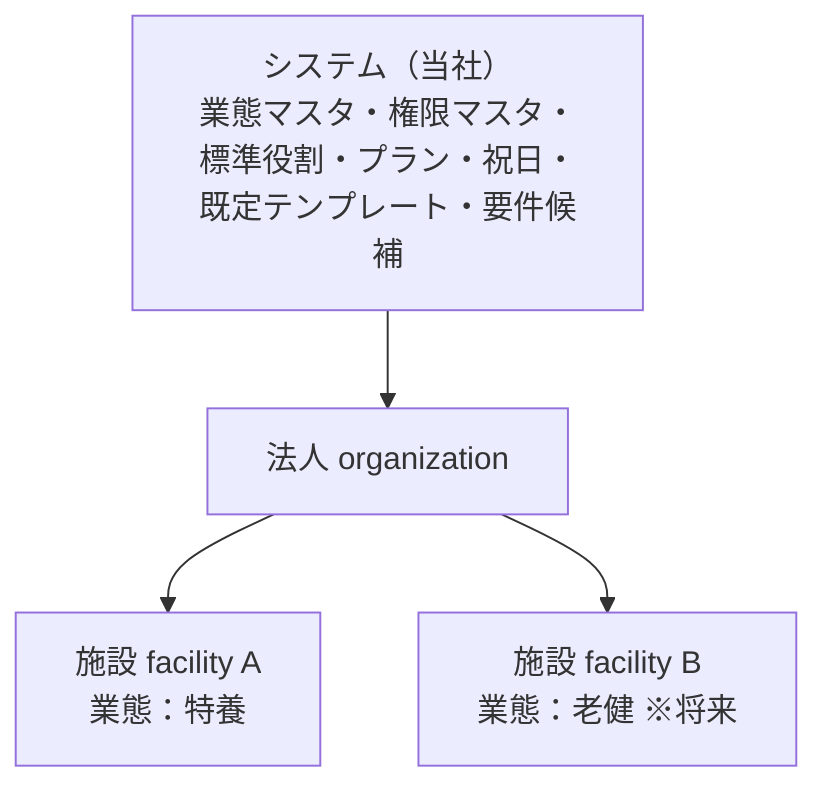
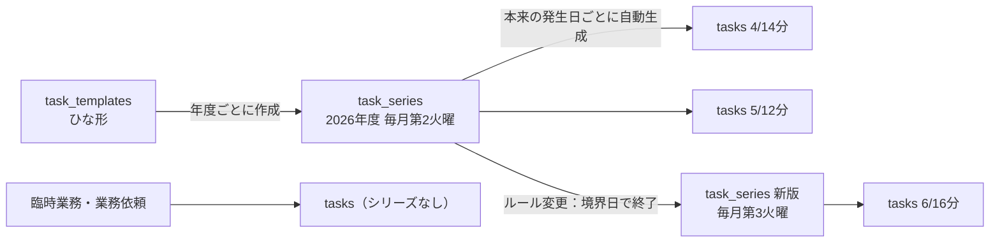

# データベース設計・マルチテナント設計

- 版：v2（2026-11-17 設計レビュー `development/design-review-2026-11-17.md` の指摘を反映）
- DB：PostgreSQL 16 以上（国内リージョン）【仮定 Q2】
- 変更管理：すべてマイグレーション（DB構造の変更手順をコードで記録したもの）で行い、手作業でDBを変更しない。ORM で表せない定義（RLS ポリシー、排他制約、部分一意索引、関数）は手書き SQL のマイグレーションで管理する
- 表記：`PK`＝主キー、`FK`＝外部キー（他テーブルへの参照）、`UQ`＝一意制約。各テーブルに**実装フェーズ**を併記する（設計は全体、実装は使う時点で）

---

## 1. 設計原則

原則の番号は「DB-n」（判断事項の「D-n」とは別）。

| No | 原則 | 内容 |
|---|---|---|
| DB-1 | テナント列 | テナント（法人）のデータは `organization_id` を必ず持つ。施設のデータは `facility_id` も持つ（空にしない）。法人共通データは `facility_id` が空 |
| DB-2 | RLS | テナントのデータはすべて行レベルセキュリティ（RLS）で保護する。テーブルの種類ごとのポリシーは第2章 |
| DB-3 | ID | UUID v7（時刻順に並ぶランダムID）。連番を外部に出さない |
| DB-4 | 共通列 | `created_at, created_by, updated_at, updated_by, version`（同時編集の上書き防止用の版番号） |
| DB-5 | 削除 | 業務データは論理削除（`deleted_at`）。物理削除は保存期限を過ぎたデータの削除処理と解約時の削除のみ |
| DB-6 | 追記のみのテーブル | 履歴テーブル（`approval_actions`、`task_status_history`、`audit_logs`、`submissions`、`document_versions`、`meeting_minutes`、`login_history`）は、アプリ用DB利用者に **INSERT と SELECT の権限だけ**を与え、UPDATE・DELETE の権限を与えない（DBの権限で更新・削除を拒否）。`ai_runs` は実行完了時に1回だけ結果を書き込み、確定後の変更はトリガーで拒否する |
| DB-7 | 固定値を持たない | 施設ID・業態・料金・カテゴリをコードに書かない。業態別の違いはマスタとテンプレートで表す |
| DB-8 | 列挙値 | ステータス等は**英字のコード値**で保存し、表示名は画面側の辞書で管理する（本書の列挙値はすべて英字） |
| DB-9 | 日時 | 日時は `timestamptz`（時差付き）。期限は「日付（`due_on`）＋任意の時刻（`due_time`）」で持ち、時刻がない場合は施設のタイムゾーンでその日の終わりまで。「今日」は施設のタイムゾーン（既定 Asia/Tokyo）で判定 |
| DB-10 | 年度 | 施設ごとに年度開始月を設定（既定4月）。年度は計画（シリーズ・研修計画・委員会計画）に保存し、後から年度開始月を変えても過去の計画の年度は変わらない |
| DB-11 | 要配慮情報 | 入居者の介護・医療情報、職員の健康情報、マイナンバーを保存するテーブル・ファイルの経路を MVP では作らない。混入を防ぐ仕組みは第4.6・4.8節と `security-design.md` 第2章 |
| DB-12 | 参照の整合 | 施設データ同士の参照は `(id, facility_id)` の複合外部キーにし、**同じ施設であることを DB で保証**する。法人単位のデータ（職員など）への参照は `(id, organization_id)` の複合外部キー＋トリガーによる所属確認。マスタ（システム共通の行を含む）への参照はトリガーで「システム共通か同じ法人か」を確認 |
| DB-13 | 論理削除と一意制約 | 名称などの一意制約は削除されていない行だけを対象にする（部分一意索引）。ただし**繰り返し業務の一意制約は取消・削除済みの行も含めて全行に掛ける**（第5章） |
| DB-14 | 期間で変わる属性 | 所属（施設・部署・役職・職種）は期間付きの別テーブルで持ち、上書きしない |
| DB-15 | 種類＋IDによる参照の禁止 | 「種類」と「ID」の2列で任意のテーブルを指す汎用参照は、外部キーが張れないため原則使わない。参照先ごとの列を持ち、「どれか1つだけ値がある」制約（CHECK）を付ける。例外は通知とAIの根拠（第4.10・4.11節に理由を記載） |
| DB-16 | 空の値を含む一意制約 | 空の値（NULL）を含む列の一意制約は `NULLS NOT DISTINCT` を指定する（空同士を同じ値として扱う） |

---

## 2. マルチテナント設計

### 2.1 階層



MVP では**1人のユーザーは1つの法人にだけ所属**する（`users.organization_id` は必須）。法人をまたぐ所属は必要になった時点で別途設計する（レビュー指摘：過剰設計・ログイン履歴の漏えい）。

### 2.2 テーブルの種類とRLSの方針

| 種類 | 内容 | 例 | RLS |
|---|---|---|---|
| S：システム専用 | 当社が管理し、全法人が参照する | permissions、business_types、holidays、plans、plan_entitlements、ai_provider_configs、ai_model_prices、requirement_candidates、job_types（システム標準分） | RLS なし。アプリ用DB利用者は **SELECT のみ**。書込みは管理用DB利用者のみ |
| C：混在マスタ | システム標準の行（`organization_id` が空）と、法人・施設が作った行が同じテーブルにある | roles、role_permissions、task_categories、task_templates、document_categories、settings | 読み取り：システム標準の行＋自法人（・自施設）の行。書込み：自法人（・自施設）の行のみ（システム標準の行は書けない） |
| T-F：施設データ | `facility_id` が必ずある | tasks、submission_requests、documents（施設分）、committees、meetings ほか大半 | 自法人かつ文脈の施設に一致する行のみ |
| T-O：法人データ | `facility_id` が空の法人共通データ | positions、departments（法人部署）、法人共通の書類・テンプレート・設定 | 参照用マスタは自法人の全員が読める。法人共通の書類は法人権限者か「全職員」レベルのみ。書込みは法人権限者のみ |
| T-P：人に関するデータ | 職員・ユーザー・所属・役割割当・ログイン履歴 | staff、staff_assignments、users、role_assignments、login_history | 第2.3節の個別ポリシー（**施設単位で分離**） |

### 2.3 RLSポリシー（設計）

文脈（リクエストごとにDBへ渡す値）：

| 設定値 | 内容 | 未設定時 |
|---|---|---|
| `app.user_id` | ログイン中のユーザー | NULL |
| `app.org_id` | ユーザーの法人 | NULL（テナントデータは0件） |
| `app.facility_ids` | 文脈の施設。**MVP では選択中の施設1つだけ**。PHASE 7 の法人横断画面では許可された施設の一覧 | NULL（施設データは0件） |
| `app.org_level` | 法人単位の役割割当（CORPORATE_ADMIN）を持つか | off |
| `app.read_only` | 当社の障害対応アクセスなど読み取り専用の文脈か | off |

ポリシーの骨格（SQL の概略）：

```sql
-- 文脈を読む関数（未設定は NULL を返し、比較は偽になる＝既定で拒否）
create function app_org_id() returns uuid language sql stable
  as $$ select nullif(current_setting('app.org_id', true), '')::uuid $$;
create function app_facility_ids() returns uuid[] language sql stable
  as $$ select nullif(current_setting('app.facility_ids', true), '')::uuid[] $$;
-- app_user_id(), app_org_level(), app_read_only() も同様

-- T-F：施設データ
create policy t_f_read on tasks for select
  using (organization_id = app_org_id() and facility_id = any(app_facility_ids()));
create policy t_f_write on tasks for all
  using (organization_id = app_org_id() and facility_id = any(app_facility_ids()) and not app_read_only())
  with check (organization_id = app_org_id() and facility_id = any(app_facility_ids()) and not app_read_only());

-- C：混在マスタ（例：task_templates）
create policy c_read on task_templates for select
  using (organization_id is null
         or (organization_id = app_org_id()
             and (facility_id is null or facility_id = any(app_facility_ids()))));
create policy c_write on task_templates for all
  using (organization_id = app_org_id() and (facility_id = any(app_facility_ids())
         or (facility_id is null and app_org_level())) and not app_read_only())
  with check (/* 同じ条件 */);

-- T-P：職員（施設に所属履歴がある職員だけ見える。法人権限者は法人全体）
create policy staff_read on staff for select
  using (organization_id = app_org_id() and (
           app_org_level()
           or user_id = app_user_id()
           or exists (select 1 from staff_assignments sa
                      where sa.staff_id = staff.id
                        and sa.facility_id = any(app_facility_ids()))));

-- T-P：ユーザー（自分自身は法人の文脈がなくても読める＝ログイン直後の所属確定用）
create policy users_self on users for select using (id = app_user_id());
create policy users_org on users for select
  using (organization_id = app_org_id()
         and exists (select 1 from staff s where s.user_id = users.id));  -- staff の RLS が効く

-- T-P：役割割当（自分の割当は文脈がなくても読める）
create policy ra_self on role_assignments for select using (user_id = app_user_id());
create policy ra_admin on role_assignments for select
  using (organization_id = app_org_id()
         and (facility_id = any(app_facility_ids()) or app_org_level()));
```

- すべてのテナントテーブルで `ENABLE ROW LEVEL SECURITY` と `FORCE ROW LEVEL SECURITY` を設定する。**RLS が有効でないテナントテーブルが1つでもあれば CI を失敗させる**検査を入れる
- RLS 内の副問い合わせ（EXISTS）が使う列には索引を張る（`staff_assignments(staff_id, facility_id)`、`staff(user_id)`）

### 2.4 文脈の設定手順（リクエストごと）

1. 認証サービスのトークンを検証し、ユーザーIDを得る。ユーザーの状態（停止・退職）と失効記録を確認（`security-design.md` 第3章）
2. 短いトランザクションで `app.user_id` だけを設定し、自分の `users` 行（法人）と `role_assignments` を読む（自分の行は文脈なしで読めるポリシー）
3. 選択中の施設に有効な役割割当があることを確認。なければ「存在しない」として扱う（404）
4. 以降の DB 処理は、`app.user_id`・`app.org_id`・`app.facility_ids`（選択中の施設）・`app.org_level` を設定した**短いトランザクション**で行う。設定は `set_config(…, true)`（トランザクション終了で自動消去）なので、共有接続でも次の利用者に残らない
5. **AI・メール・ファイル保管などの外部呼び出しはトランザクションの外で行う**（接続を握り続けて接続が枯渇するのを防ぐ）
6. アプリ用DB利用者は RLS を迂回できない（`BYPASSRLS` なし、テーブル所有者ではない）

### 2.5 全施設をまたぐ処理と当社の操作

| 処理 | 方法 |
|---|---|
| 定期処理（繰り返し生成、通知、保存期限、退職日処理、集計） | ワーカー用DB利用者（RLS 迂回なし）が、**対象施設の一覧だけを返す専用関数** `list_active_facilities()`（法人ID・施設IDのみ返す）を呼び、施設ごとに文脈（`app.org_id`、`app.facility_ids`=[その施設]、操作者＝system）を設定して処理する。通常の RLS がそのまま効く |
| 法人・施設の作成、初代施設長の招待 | 当社の管理画面から、管理用DB利用者が専用関数 `provision_organization()`・`provision_facility()`・`invite_initial_director()` を実行。管理用DB利用者はテナントテーブルを直接読めない（専用関数は法人名・施設名・状態・件数などの最小限だけ返す） |
| 要件候補の改定 | システム専用の `requirement_candidates` に新しい版を追加するだけ。施設の記録は書き換えない。施設ごとの定期処理が「採用している候補の版」と「最新の版」を比べ、違えば施設に「再確認が必要」と通知（第4.9節） |
| 当社の障害対応アクセス | 施設の承認済みアクセス（`support_access_grants`）がある場合だけ、その施設を文脈に、`app.read_only = on` で閲覧する。書込みは RLS で拒否。緊急時の手順は `development/operation-guide.md` 第4章 |
| RLS を無効化する経路 | 作らない。ホスティングの管理画面・管理キーからの直接アクセスは、アプリの外の統制で管理する（`security-design.md` 第3.2節） |

### 2.6 RLS で防げること・防げないこと

| 防げる | 防げない（別の対策が必要） |
|---|---|
| アプリの不具合による、他法人・他施設のデータの取得・更新（条件の書き忘れ、ID の書き換え） | アプリ自体が乗っ取られた場合（文脈の設定値もアプリが書くため）→ 脆弱性対策・依存部品の管理・監視 |
| 文脈の設定漏れによる全件露出（未設定は0件） | ホスティングの管理画面・管理キーを使った直接アクセス → インフラのアカウント統制 |
| 部署・本人・書類のアクセスレベルの判定 | （RLS では行わない）→ アプリの権限判定（`permission-design.md`） |

### 2.7 設定の階層

`settings` テーブルで「システム既定 → 業態 → 法人 → 施設 → 利用者」の順に値を解決する。

- 設定項目は**コード内の設定定義表（レジストリ）**に登録したものだけを保存できる。定義表には、項目名、値の型と検証ルール、既定値、上書きできる階層、**継承方式**、変更に必要な権限を書く
- 継承方式は「置き換え」のみ（下の階層に値があれば、上の階層の値をすべて置き換える）。リストの項目（通知タイミングなど）も**リスト全体を置き換える**。合算は行わない（施設で一部を外せない問題を避ける）
- 法人は項目ごとに**ロック**（施設での上書き禁止）できる。ロックは法人の設定行の `locked` 列で表す
- 利用者の階層で変えられるのは、本人の通知の受信時間帯などに限る

| 列 | 内容 |
|---|---|
| id | |
| scope_type | `system` / `business_type` / `organization` / `facility` / `user` |
| business_type_id, organization_id, facility_id, user_id | 範囲（種類に応じて該当列だけ値がある。RLS は種類C・T-Pの規則に従う） |
| key | 定義表の項目名 |
| value | jsonb（定義表の型で検証） |
| locked | 法人の行のみ有効 |

UQ(scope_type, business_type_id, organization_id, facility_id, user_id, key) NULLS NOT DISTINCT。

---

## 3. ER図（主要部分）

```mermaid
erDiagram
  organizations ||--o{ facilities : has
  business_types ||--o{ facilities : "業態"
  organizations ||--o{ users : "所属（1法人のみ）"
  organizations ||--o{ staff : employs
  staff ||--o{ staff_assignments : "所属履歴・兼務"
  users |o--o| staff : "ログインする職員"
  users ||--o{ role_assignments : has
  roles ||--o{ role_assignments : ""
  roles ||--o{ role_permissions : ""
  permissions ||--o{ role_permissions : ""

  organizations ||--o{ subscriptions : contracts
  plans ||--o{ subscriptions : ""
  plans ||--o{ plan_entitlements : ""

  task_templates ||--o{ task_series : "テンプレートから"
  task_series ||--o{ tasks : "各回を生成"
  task_series ||--o{ task_series_assignees : "既定の担当"
  tasks ||--o{ task_assignees : ""
  tasks ||--o{ task_status_history : ""
  tasks ||--o{ task_required_items : ""
  tasks ||--o| task_gov_submissions : "行政提出の情報"

  submission_requests ||--o{ submission_targets : "対象者ごと"
  submission_targets ||--o{ submissions : "提出（版）"
  submissions ||--o{ submission_files : ""

  documents ||--o{ document_versions : ""
  document_versions }o--|| files : ""
  documents ||--o{ document_links : "業務・委員会・研修への紐付け"

  committees ||--o{ committee_requirements : "要件（多対多）"
  committees ||--o{ meetings : "開催回"
  meetings ||--o{ meeting_attendees : ""
  meetings ||--o{ meeting_minutes : ""
  meetings ||--o{ decisions : "決定事項"
  decisions |o--o| tasks : "改善業務"
  training_plans ||--o{ training_sessions : ""
  training_plans ||--o{ training_targets : "対象者"
  training_targets ||--o{ training_attendance : ""
  requirement_candidates ||--o{ requirement_items : "候補から採用"

  approval_requests ||--o{ approval_actions : ""
  notifications }o--|| users : ""
  ai_runs ||--o{ ai_outputs : ""
  ai_outputs ||--o{ ai_citations : ""
```



---

## 4. テーブル定義

列は主要なもののみ。テナントテーブルには共通列（DB-4）と `organization_id`／`facility_id`（DB-1）がある。「種類」は第2.2節の分類。

### 4.1 テナント・設定・マスタ

| テーブル | 種類 | 主な列 | 説明・制約 | 実装 |
|---|---|---|---|---|
| organizations | T-O | id, name, corporate_type, status | 法人 | 2a |
| business_types | S | id, code（tokuyo / chiiki_tokuyo / roken / yuryo …）, name, active | 業態マスタ。コードで業態名による分岐はしない | 2a |
| facilities | T-F※ | id, organization_id, business_type_id, name, facility_code, capacity, fiscal_year_start_month（既定4）, timezone, status | 施設。※読めるのは、文脈の施設と、自分に役割割当がある施設（施設の切替画面用）の行 | 2a |
| departments | T-O/T-F | id, organization_id, facility_id（空＝法人部署）, name, parent_id, sort_order | 部署。部署範囲の権限は**子部署を含む** | 2a |
| positions | T-O | id, organization_id, name, rank | 役職マスタ。権限は役職ではなく役割で決める | 2a |
| job_types | C | id, organization_id（空＝システム標準）, code, name | 職種（介護職員、看護職員、生活相談員、機能訓練指導員、管理栄養士、介護支援専門員など）。研修の対象指定に使う | 2a |
| settings | C/T | 第2.7節 | 設定の階層 | 2a |
| holidays | S | date, name, source | 祝日（内閣府の公表をもとに年1回登録） | 2b |

### 4.2 ユーザー・職員

| テーブル | 種類 | 主な列 | 説明・制約 | 実装 |
|---|---|---|---|---|
| users | T-P | id, organization_id, auth_subject, login_id, email（任意）, display_name, status（`active` / `suspended` / `deleted`）, mfa_required, last_login_at | ログインする人。UQ(auth_subject) | 2a |
| staff | T-P | id, organization_id, staff_code, family_name, given_name, kana, employment_type, hired_on, left_on, status（`active` / `on_leave` / `left`）, user_id（任意） | 職員台帳（法人単位）。ログインしない職員も登録可。健康情報・家族情報・マイナンバーは持たない。UQ(organization_id, staff_code)、UQ(user_id) | 2a |
| staff_assignments | T-P | id, organization_id, staff_id, facility_id（空＝法人本部）, department_id, position_id, job_type_id, is_primary, valid_from, valid_to | 所属の期間付き履歴。兼務は複数行。**排他制約**：同じ職員の主所属の期間は重ならない（`EXCLUDE USING gist (staff_id WITH =, daterange(valid_from, valid_to) WITH &&) WHERE (is_primary)`）、同じ施設・部署の所属の期間も重ならない | 2a |
| login_history | T-P | id, organization_id, user_id, occurred_at, result（`success` / `failure` / `throttled`）, ip, user_agent, mfa_used | ログイン履歴（追記のみ）。施設の管理者は、自施設に所属履歴がある職員の分だけ見える | 2a |
| user_session_revocations | T-P | user_id, revoked_after, reason | この時刻より前に発行されたトークンを無効にする（退職・停止・端末紛失） | 2a |
| usage_events | T-F | id, organization_id, facility_id, user_id, event（`session_start` / `screen_view` / `action`）, name, occurred_at | 効果測定用の利用記録（日次の利用者数、画面別の利用、通知から対応までの時間）。内容（業務名・本文）は記録しない。保存2年【要決定】 | 2a |

### 4.3 権限

| テーブル | 種類 | 主な列 | 説明・制約 | 実装 |
|---|---|---|---|---|
| permissions | S | code（例 `task.approve`）, module, description, is_protected | 権限マスタ。`is_protected` は役割管理などの高い権限（割当の制限に使う） | 2a |
| roles | C | id, organization_id（空＝システム標準）, owner_facility_id（施設が作ったカスタムロール）, code, name, is_system, is_protected | 標準6役割はシステム標準の行（変更不可）。カスタムロールは法人または施設が所有 | 2a（カスタムは3） |
| role_permissions | C | role_id, permission_code, scope（`own` / `department` / `facility` / `organization`） | UQ(role_id, permission_code) | 2a |
| role_assignments | T-P | id, organization_id, user_id, role_id, facility_id（空＝法人単位）, department_id, valid_from, valid_to, granted_by | DEPARTMENT_MANAGER の割当は department_id 必須（CHECK）。CORPORATE_ADMIN は法人単位の行＋許可された施設ごとの行 | 2a |
| support_access_grants | T-F | id, organization_id, facility_id, support_user_ref, reason, requested_at, approved_by, approved_at, expires_at, status（`pending` / `approved` / `rejected` / `expired` / `revoked`） | 当社の障害対応アクセスの許可。承認は `support_access.approve` 権限者 | 2a |
| access_reviews | T-F | id, organization_id, facility_id, reviewed_by, reviewed_at, summary | 権限の棚卸しの実施記録（四半期） | 3 |

### 4.4 契約・プラン

| テーブル | 種類 | 主な列 | 説明・制約 | 実装 |
|---|---|---|---|---|
| plans | S | id, code, name, monthly_price, currency, is_public, valid_from, valid_to | 料金プラン（価格はデータ） | 2a |
| plan_entitlements | S | plan_id, key, value(jsonb) | プランの権利・上限。キーの一覧は下表 | 2a |
| subscriptions | T-O | id, organization_id, plan_id, status（`trial` / `active` / `suspended` / `ended`）, starts_on, ends_on, notes | 法人の契約 | 2a |
| options / option_entitlements / subscription_options | S/S/T-O | （オプションとその権利、契約したオプション） | 追加オプション | 6 |
| entitlement_overrides | T-O | subscription_id, key, value, reason, valid_to | 個別条件 | 6 |

権利のキー（命名を統一）：

| キー | 適用範囲 | 内容 |
|---|---|---|
| `module.m01` 〜 `module.m07` | 法人 | モジュールの利用可否 |
| `limit.facilities` | 法人 | 施設数の上限 |
| `limit.login_users_per_facility` | 施設 | ログインする職員数の上限（**台帳の職員数ではない**。代理登録で運用する職員は数えない）【数え方は要決定 D-5】 |
| `limit.storage_gb_per_facility` | 施設 | 保存容量 |
| `limit.ai_monthly_cost_jpy` | 法人 | AI の月間の推定費用の上限（円）。画面では回数も併記 |

判定は共通関数 `getEntitlements(organizationId, facilityId?)` で、プラン＋オプション＋個別条件を合算する。AI の利用量は `ai_runs` から月単位で集計する（専用の集計テーブルは作らない）。プラン外の機能は**画面では表示せず、API は 403（コード `PLAN_NOT_INCLUDED`）**を返す。

### 4.5 業務・期限（MODULE 02）

業務は「テンプレート（ひな形）」「シリーズ（繰り返し設定）」「各回の業務」の3層に分ける。



| テーブル | 種類 | 主な列 | 説明・制約 | 実装 |
|---|---|---|---|---|
| task_categories | C | id, organization_id, facility_id, business_type_id, name, kind（`government_submission` / `committee` / `training` / `inspection` / `hr` / `accounting` / `other`）, approval_required_default, sort_order | カテゴリ。承認の要否の既定値をカテゴリで持つ | 2b |
| task_templates | C | id, organization_id, facility_id, business_type_id, title, description, category_id, occurrence_type, recurrence_rule(jsonb), default_due_offset, completion_criteria, required_items(jsonb), requires_approval, **basis_type**, basis_note, basis_url, source_ref（出典） | ひな形。根拠種別：`law` / `notice`（行政通知）/ `corporate_rule` / `facility_rule` / `unverified`。**既定は `unverified`** | 2b |
| task_series | T-F | id, organization_id, facility_id, template_id, fiscal_year, title, category_id, department_id, service_unit_id※, occurrence_type, recurrence_rule(jsonb), generation_mode（`calendar` / `after_completion`）, weekend_holiday_rule（`keep` / `before` / `after`）, start_on, end_on, generate_ahead_days, approver_staff_id, approver_role_id, supersedes_series_id, active | 年間業務の登録単位。**ルールは変更不可**（変更＝境界日で旧シリーズを終了し、新シリーズを作る）。承認者は職員か役割のどちらか（CHECK） | 2b（完了日ベースは3） |
| task_series_assignees | T-F | series_id, staff_id, department_id, role（`primary` / `secondary`） | 既定の担当（職員または部署のどちらか、CHECK） | 2b |
| tasks | T-F | 下表 | 業務の各回・臨時業務・業務依頼 | 2b |
| task_assignees | T-F | task_id, staff_id, department_id, role（`primary` / `secondary`）, acknowledged_at | 職員または部署（例：介護部＝当日の担当者の誰か）のどちらか（CHECK）。主担当は1件まで（部分一意）。`acknowledged_at`＝依頼の既読 | 2b |
| task_required_items | T-F | id, task_id, name, accepted_file_types, is_required | 必要提出物。提出は document_links（relation=`required_item`, required_item_id） | 2b |
| task_gov_submissions | T-F | task_id, destination（提出先）, method（`e_application`＝電子申請・届出システム / `mail` / `in_person` / `email` / `other`）, receipt_number, submitted_on, due_reconfirm_required, note | 行政提出カテゴリの業務の追加情報（1対1）。完了には控えの書類（必須提出物）を求める | 2b |
| task_status_history | T-F | id, task_id, from_status, to_status, action, actor_user_id, acted_at, reason | **追記のみ** | 2b |
| comments | T-F | id, organization_id, facility_id, task_id, meeting_id, decision_id, kind（`comment` / `progress` / `completion_report`）, body, created_by | 参照先はどれか1つ（CHECK）。編集履歴は操作履歴 | 2b |

※ `service_unit_id`（併設事業所）は D-4 の決定まで作らない。決まった場合は空の列の追加で対応できる（既存データに影響なし）。

**tasks の列**

| 指示書の項目 | 列 | 型・値 |
|---|---|---|
| 業務ID・法人ID・施設ID | id, organization_id, facility_id | uuid |
| 業務名・業務説明 | title, description | text |
| 業務カテゴリ | category_id | FK |
| 業務発生区分 | occurrence_type | `daily` / `weekly` / `monthly` / `quarterly` / `semiannual` / `annual` / `ad_hoc`（臨時） |
| 担当部署 | department_id | FK（部署範囲の権限判定に使う） |
| 主担当者・副担当者 | task_assignees | — |
| 開始日・期限 | start_on, due_on, due_time | date / date / time（任意） |
| ステータス | status | `not_started` / `in_progress` / `awaiting_submission` / `awaiting_approval` / `returned` / `completed` / `on_hold` |
| 優先度 | priority | `high` / `normal` / `low` |
| 必要提出物 | task_required_items | — |
| 完了条件 | completion_criteria | text |
| 関連書類 | document_links | — |
| 承認者 | requires_approval, approver_staff_id | 承認依頼の作成時に確定（第4.7節） |
| 完了日時 | completed_at, completed_by | — |
| 作成者・更新日時 | created_by, updated_at | — |
| （追加）種別・依頼者 | kind（`task` / `request`）, requested_by_staff_id | 業務依頼 |
| （追加）シリーズ | series_id, **occurrence_date**（本来の発生日）, previous_task_id（完了日ベース）, fiscal_year | 第5章 |
| （追加）発生元 | source（`manual` / `series` / `decision` / `ai_proposal`）, decision_id, ai_output_id | どれか1つ（CHECK） |
| （追加）根拠 | basis_type, basis_note, basis_url | テンプレートから複写。未入力は `unverified` |
| （追加）取消 | cancelled_at, cancelled_by, cancel_reason | 取消は状態ではなく記録（指示書の7状態を維持） |
| （追加）保留前の状態 | status_before_hold | 保留解除時の戻り先 |

制約・索引：
- **UQ(series_id, occurrence_date)**（取消・削除済みも含む全行）：繰り返し業務の二重生成と、取り消した回の復活を防ぐ
- **UQ(series_id, previous_task_id)**：完了日ベースの次回分は1件だけ
- 索引：(facility_id, due_on, status)、(facility_id, status)、(series_id, occurrence_date)
- 期限超過は状態として保存しない（第6章の算出定義）

### 4.6 提出物回収

| テーブル | 種類 | 主な列 | 説明・制約 | 実装 |
|---|---|---|---|---|
| submission_requests | T-F | id, organization_id, facility_id, department_id, title, instructions, due_on, due_time, task_id, **data_class**（`c1` / `c2` / `c3` / `c4`）, **file_mode**（`file_required` / `file_optional` / `no_file`）, required_items(jsonb), target_rule(jsonb：全員 / 部署 / 職種 / 役職 / 個別), reviewer_staff_id, allow_late, status（`draft` / `open` / `closed`） | 提出依頼。**data_class の入力は必須**。`c4`（健康診断結果など要配慮個人情報）は `no_file`（「提出済み・確認済み」だけを記録し、ファイルを受け取らない）に強制。マイナンバーを含む書類は対象外（画面で明示） | 2b |
| submission_targets | T-F | id, request_id, staff_id, department_id（作成時点の所属）, status（`not_submitted` / `submitted` / `approved` / `returned` / `excluded`）, has_login（作成時点）, excluded_reason | UQ(request_id, staff_id)。対象者は依頼作成時に確定して保存 | 2b |
| submissions | T-F | id, target_id, version, comment, submitted_by, submitted_at, is_proxy（代理登録）, proxy_reason | **追記のみ**。UQ(target_id, version) | 2b |
| submission_files | T-F | submission_id, file_id | 提出物のファイル。**書類（documents）とは別に保存**し、書類の一覧・検索に出さない。閲覧は本人・確認者・`submission.review` の範囲内の人のみ。確認者が「書類として保管」を選んだ場合だけ、閲覧者リスト付きの「限定」書類として複製 | 2b |

### 4.7 承認（共通）

承認・差し戻しは**すべてこの2テーブルを通す**。業務・提出物・議事録の状態列は、承認処理が同じトランザクションで書き込む「結果の写し」であり、承認の正式な記録はこちら。

| テーブル | 種類 | 主な列 | 説明・制約 | 実装 |
|---|---|---|---|---|
| approval_requests | T-F | id, organization_id, facility_id, task_id, submission_id, minutes_id（どれか1つ、CHECK）, approver_staff_id, status（`pending` / `approved` / `returned` / `cancelled`）, **content_hash**, is_self_approval, requested_by, requested_at | 承認依頼。対象ごとに `pending` は1件まで（部分一意索引）。`content_hash`＝承認対象の内容（本文・完了報告・紐付いた証拠の版ID・必要提出物）を正規化したハッシュ値 | 2b |
| approval_actions | T-F | id, approval_request_id, action（`approve` / `return` / `cancel` / `reassign` / `comment`）, actor_user_id, reason, from_approver_staff_id, to_approver_staff_id, acted_at | **追記のみ**。差し戻し・取消・付け替えは理由必須（CHECK） | 2b |

- 承認者は「職員」または「役割（例：施設長）」で指定でき、**承認依頼の作成時に具体的な職員に確定**する（役職者が交代しても、誰に依頼したかが残る）
- 承認後に内容のハッシュ値が変わったら「承認後に変更あり」と表示し、再承認を依頼する（優先度などハッシュ対象外の項目の変更では表示しない）
- 多段階承認（経路の定義）は PHASE 3 で `approval_routes` を追加する

### 4.8 書類・証拠（MODULE 03）

| テーブル | 種類 | 主な列 | 説明・制約 | 実装 |
|---|---|---|---|---|
| files | T-F/T-O | id, organization_id, facility_id, storage_key, original_name, mime_type, size_bytes, sha256_received, sha256_stored, metadata_removed, status（`quarantined` / `clean` / `rejected`）, uploaded_by, uploaded_at | ファイル。保存先は `org/{法人ID}/fac/{施設ID}/{推測できないID}`。受領直後は隔離領域に置き、検査・位置情報等の除去後に保管領域へ移す。**隔離領域の原本は処理後に削除**し、受領時のハッシュ値だけ残す（`security-design.md` 第3章） | 2a |
| document_categories | C | id, organization_id, facility_id, name, default_access_level, **default_data_class**, default_retention_years | 書類カテゴリ。データ区分の既定値を持つ | 2b |
| documents | T-F/T-O | id, organization_id, facility_id（空＝法人共通）, title, category_id, access_level（`all_staff` / `managers` / `restricted`）, **data_class**, retention_until, owner_staff_id, current_version_id, status | 書類台帳。data_class は登録時に必須（カテゴリの既定値を初期表示） | 2b |
| document_versions | T-F/T-O | id, document_id, version, file_id, note, created_by, created_at, extracted_text, extraction_status（`none` / `ai_extracted` / `human_verified`） | **追記のみ**。UQ(document_id, version) | 2b |
| document_acl | T-F/T-O | document_id, staff_id, department_id, role_id（どれか1つ）, permission（`read` / `write`） | 「限定」書類の閲覧者リスト | 2b |
| document_links | T-F | id, organization_id, facility_id, document_id, task_id, required_item_id, meeting_id, decision_id, training_session_id（どれか1つ、CHECK）, relation（`evidence` / `attachment` / `required_item` / `related`） | 業務・委員会・研修と書類の紐付け。各参照は `(id, facility_id)` の複合外部キー。法人共通の書類は `(document_id, organization_id)` で参照 | 2b |
| retention_policies | C | id, organization_id, facility_id, category_id, retention_years, basis_note | 保存期限ルール（施設が設定、根拠を記録） | 3 |

### 4.9 委員会・研修（MODULE 04、PHASE 3）

| テーブル | 種類 | 主な列 | 説明・制約 |
|---|---|---|---|
| requirement_candidates | S | id, business_type_id, item_type（`committee` / `training` / `drill` / `report` / `inspection` / `other`）, name, required_frequency, basis_note, basis_url, effective_from, effective_to, version | 当社が提供する「法令等の要件」の**候補**（未確認の情報）。改定は新しい版の行を追加 |
| requirement_items | T-F | id, organization_id, facility_id, candidate_id, candidate_version, item_type, name, required_frequency, basis_type, basis_note, basis_url, verified_status（`unverified` / `verified`）, verified_by, verified_at | 施設が採用した要件。確認済みにできるのは `requirement.verify` を持つ人のみ。AI は変更不可。「再確認が必要」は採用した版と最新版の比較で**算出**（保存しない） |
| committees | T-F | id, organization_id, facility_id, department_id（任意）, name, purpose, frequency, active | 委員会の定義 |
| committee_requirements | T-F | committee_id, requirement_item_id | 委員会と要件の多対多（合同開催：例 身体拘束適正化と虐待防止を一体で開催） |
| committee_members | T-F | committee_id, staff_id, role（`chair` / `secretary` / `member`） | 委員。委員長・書記には、その委員会の範囲の権限が付く（`permission-design.md` 第6章） |
| meetings | T-F | id, organization_id, facility_id, meeting_type（`committee` / `general`）, committee_id, task_id, fiscal_year, title, scheduled_at, held_at, location, status（`scheduled` / `held` / `cancelled` / `postponed`） | 開催回。MODULE 06（会議）でも同じテーブルを使う |
| meeting_attendees | T-F | meeting_id, staff_id, external_name, external_affiliation（職員か外部のどちらか、CHECK）, attendance（`present` / `absent` / `excused`） | 出席者。外部委員（嘱託医など）は氏名・所属を記録 |
| meeting_minutes | T-F | id, meeting_id, version, body, source（`manual` / `ai_draft`）, created_by, created_at | **追記のみ**。UQ(meeting_id, version)。承認は approval_requests（minutes_id） |
| decisions | T-F | id, meeting_id, content, improvement_detail, owner_staff_id, due_on, status（`open` / `in_progress` / `implemented` / `verified` / `dropped`）, dropped_reason, verified_meeting_id | 決定事項（PDCA の5状態、TD-025） |
| training_plans | T-F | id, organization_id, facility_id, department_id（任意）, fiscal_year, title, category, target_rule(jsonb：全員 / 部署 / 職種 / 個別), planned_month, include_new_hires | 研修計画 |
| training_targets | T-F | id, plan_id, staff_id, added_reason（`initial` / `new_hire` / `manual`）, excluded_reason | 対象者（計画作成時に確定。途中入職者は追加理由付き） |
| training_sessions | T-F | id, plan_id, scheduled_at, held_at, instructor, format（`in_person` / `video` / `external`）, status | 研修の開催回（同じ研修を複数回開ける） |
| training_attendance | T-F | id, session_id, target_id, attendance（`present` / `absent` / `makeup` / `excluded`）, completion_status（`unconfirmed` / `confirmed`）, confirmed_by, confirmed_at | 出欠・受講確認。受講率は**研修計画の単位**で、対象者ごとに「いずれかの回で受講確認済み」かで集計 |

委員会の表示：
- 開催：`scheduled` → `held` → 議事録承認済み
- 改善：決定事項の状態ごとの件数
- **「実施完了」＝開催済み かつ 議事録承認済み かつ 決定事項がすべて `verified` または `dropped`**。`implemented`（実施済み・効果未確認）が残る場合は「効果確認待ち」と表示

### 4.10 通知

通知タイミングの設定は**設定の階層（settings）に一本化**する（項目 `notification.rules.{event}`、継承は置き換え）。通知テーブルは「送信待ちの表（アウトボックス）」として使う。

| テーブル | 種類 | 主な列 | 説明・制約 | 実装 |
|---|---|---|---|---|
| notifications | T-F | id, organization_id, facility_id, recipient_user_id, event, target_kind, target_id, channel（`in_app` / `email` / 将来 `web_push` 等）, title, body, **dedupe_key**, status（`pending` / `sent` / `failed` / `skipped` / `cancelled`）, scheduled_for, attempts, last_error, sent_at, read_at | UQ(dedupe_key)。`dedupe_key`＝`{event}:{target}:{recipient}:{期限日}:{timing}:{channel}`。`target_kind`/`target_id` は画面へのリンク用の参照で、表示時に閲覧権限を再確認する（整合性が必要なデータではないため、DB-15 の例外） | 2b（メールは3） |

既定の通知表（施設・法人の設定で置き換え可能）：

| イベント | タイミング | 受信者 | チャネル |
|---|---|---|---|
| 提出依頼の作成 | 作成時 | 対象者 | アプリ内（＋メール※） |
| 提出期限 | 3日前、1日前 | **未提出・差し戻し中**の対象者 | 同上 |
| 提出期限 | 当日 | 未提出・差し戻し中の対象者 | 同上 |
| 提出期限超過 | 翌日 | 未提出・差し戻し中の対象者 ／ 依頼者（**依頼ごとに1通にまとめる**「未提出 3名」） | 同上 |
| 業務期限 | 1日前、当日 | 主担当（部署担当の場合は部署の在籍者） | 同上 |
| 業務期限超過 | 翌日 | 主担当 ／ 業務の承認者（または部署管理者） | 同上 |
| 業務依頼 | 作成時 | 担当者 | 同上 |
| 承認依頼 | 作成時 | 承認者 | 同上 |
| 差し戻し | 実行時 | 担当者・提出者 | 同上 |

※ メールは PHASE 3。アプリ外への通知手段（Web Push、LINE WORKS 等）は**要決定 D-1**。チャネルは差し替え可能な部品（アダプタ）として作る。

算出・送信の規則：
- 定期処理（15分ごと）が、施設ごとに「その時点の最新データ」と通知の設定を照合し、送るべき通知を `pending` で作成（重複防止キーで二重作成を防ぐ）→ 送信処理が `pending` を取り出して送信（`FOR UPDATE SKIP LOCKED` で並行実行しても1回だけ）
- 期限変更：重複防止キーに期限日を含むため、新しい期限で改めて通知。古い期限の `pending` は `cancelled`
- 提出済み・完了・対象外になった人：照合で対象から外れ、`pending` は `cancelled`
- 受信時間帯：施設の既定（8時〜19時）と**本人の設定**（夜勤者など）の両方を満たす時間だけ送る。時間外は `scheduled_for` を次の送信可能時刻にする
- 定期処理が止まっていた場合：再開時、本来の送信時刻から**24時間以内**かつ条件がまだ成り立つものだけ送り、それ以外は `skipped`（理由を記録）
- 送信失敗：最大3回まで間隔をあけて再送し、失敗は `failed` として管理者画面に表示

### 4.11 AI

| テーブル | 種類 | 主な列 | 説明・制約 | 実装 |
|---|---|---|---|---|
| ai_provider_configs | S | id, provider, endpoint_region, model, purpose, enabled, priority | 使用する AI 事業者・モデル | 4 |
| ai_model_prices | S | provider, model, input_price, output_price, currency, valid_from | 推定費用の計算用単価 | 4 |
| ai_use_cases | S | code（例 `assistant.qa`）, allowed_data_classes, model_config_id, requires_human_review, enabled_by_default | 用途ごとの設定。施設での有効・無効は settings | 4 |
| ai_runs | T-F | id, organization_id, facility_id, user_id, use_case, provider, model, status（`queued` / `running` / `succeeded` / `failed`）, **sent_record_refs**（送信したレコードの種類とID）, data_classes_sent, redaction_summary（置換件数など）, input_tokens, output_tokens, estimated_cost_jpy, started_at, finished_at, error_code | 実行完了時に1回だけ結果を確定し、確定後の変更はトリガーで拒否 | 4 |
| ai_outputs | T-F | id, run_id, output_type（`answer` / `draft` / `extraction` / `classification` / `proposal`）, content(jsonb), verification(jsonb), review_status（`unreviewed` / `accepted` / `modified` / `rejected`）, reviewed_by, reviewed_at | AI の出力。正式データとは別保存 | 4 |
| ai_citations | T-F | output_id, source_kind, source_id, source_version, quoted_text | 根拠。作成時点の参照の記録であり、表示時に閲覧権限を再確認する（DB-15 の例外） | 4 |
| ai_conversations / ai_messages | T-F | id, user_id, facility_id, role, content, run_id | アシスタント画面の会話。保存期間は【要決定】 | 4 |

AI 事業者の条件（データ保持、学習利用、処理地域、契約）は DB ではなく `architecture/subprocessors.md`（再委託先一覧）で管理し、管理者画面に表示する。

### 4.12 操作履歴・ジョブ・入出力・イベント

| テーブル | 種類 | 主な列 | 説明・制約 | 実装 |
|---|---|---|---|---|
| audit_logs | T-F/T-O | id（bigint）, occurred_at, organization_id, facility_id, actor_type（`user` / `system` / `ai` / `support`）, actor_user_id, action（`read` / `create` / `update` / `delete` / `approve` / `export` / `login` / `role_change` …）, target_kind, target_id, changes(jsonb：変更前後), request_id, ip, user_agent | **追記のみ**（DB-6）。月単位で分割保存。閲覧の記録は機密性の高い閲覧に限定（書類のダウンロード、提出物の閲覧、職員詳細、出力、操作履歴の閲覧）。改ざん検知は第8章の日次ダイジェスト。保存期間は【要決定 TD-022】 | 2a |
| audit_digests | T-O | organization_id, date, row_count, digest, exported_at | 法人ごと・日ごとの操作履歴のハッシュ値。**別アカウントの書換え不可の保管領域にも複製** | 3 |
| jobs | T-F/S | id, organization_id, facility_id, job_type, payload, run_after, status（`queued` / `running` / `done` / `failed`）, attempts, locked_at, last_error | ジョブの待ち行列。取り出しは `FOR UPDATE SKIP LOCKED`（自前で実装し、常駐プロセスを前提にしない） | 2a |
| job_runs | S | id, job_type, started_at, finished_at, processed_count, result, error | 定期処理の実行記録（監視用） | 2a |
| domain_events | T-F | id, organization_id, facility_id, event_type, payload(jsonb), created_at, processed_at | モジュール間の連携イベント（例：決定事項の登録 → 改善業務の作成） | 2b |
| idempotency_keys | T-P | user_id, key, endpoint, response_status, response_body_hash, created_at | 二重送信防止。UQ(user_id, key)。24時間で削除 | 2a |
| import_jobs / export_jobs | T-F | id, organization_id, facility_id, type, file_id, status, summary(jsonb), requested_by | CSV 取込・出力の記録 | 2a〜3 |

---

## 5. 繰り返し業務の生成

| 項目 | 規則 |
|---|---|
| 発生日の算出 | シリーズのルール（例：毎月第2火曜、毎週月・木）から**本来の発生日**（`occurrence_date`）を算出 |
| 土日祝 | `weekend_holiday_rule` に従い**期限日（`due_on`）だけ**を前後に移す。`occurrence_date` は移さない |
| 一意性 | UQ(series_id, occurrence_date)。取消・削除済みの行も含むため、**人が取り消した回は再生成されない**。1期間に複数回ある業務（毎週月・木）は発生日が異なるため、すべて作られる |
| 実行 | 毎日深夜、施設ごとの文脈で「今日から `generate_ahead_days` 日先まで」の発生日を作成（`INSERT … ON CONFLICT DO NOTHING`）。同時に実行されても1件 |
| 欠落の検知 | 生成処理は、期間内の「本来あるべき発生日」と「実在する行」を突き合わせ、不足があれば作成し、作成できない理由（担当者不在など）があれば管理者に警告 |
| ルール変更 | シリーズのルールは変更しない。変更時は「境界日」を指定して旧シリーズを `end_on`＝境界日前日で終了し、新シリーズ（`supersedes_series_id` 付き）を作成。旧シリーズの境界日以降の**未着手**の回は取消（理由「ルール変更」）。着手済みの回は残し、利用者に確認を求める |
| 完了日ベース | 前回分が完了した時点で次回分を1件作成。UQ(series_id, previous_task_id) で、完了→再開→再完了でも二重にならない（PHASE 3） |
| 担当者 | シリーズの既定担当が停止・退職している場合は担当なしで作成し、「担当者未設定」として警告（退職者には割り当てない） |
| 年度・期間の表示 | 年度・四半期・半年は、表示と集計のために発生日と施設の年度開始月から算出する（キーには使わない）。週の開始曜日の設定も表示と集計にだけ影響する |
| 「今日」 | 施設のタイムゾーンで判定 |

## 6. 期限超過・期限の判定（ダッシュボードと一覧で共通）

| 業務 | 期限の時刻 | 期限超過の条件 |
|---|---|---|
| `due_time` なし | 期限日の終わり（施設のタイムゾーン） | 今日（施設TZ）＞ `due_on` かつ 未完了 |
| `due_time` あり | 期限日の指定時刻 | 現在時刻 ＞ `due_on` + `due_time` かつ 未完了 |

- 「未完了」＝ `completed` 以外、かつ取消されていない
- **保留（`on_hold`）の業務も期限超過に数える**（ダッシュボードでは「うち保留中 n件」を併記）

## 7. 年度更新（翌年度の業務作成）

1. 管理者が「2027年度の年間業務を作成」を実行
2. 2026年度のシリーズから新年度のシリーズ案を作成して表示（担当者は在籍者のみ引き継ぎ）
3. **行政提出カテゴリの業務は「期限の再確認が必要」として、確認しないと確定できない**（毎年変わる期限の誤った引継ぎを防ぐ）
4. 管理者が確認・修正して確定 → 新年度のシリーズを作成。今年度の記録は変更しない

## 8. バックアップ・移行・復元

| 項目 | 方針 |
|---|---|
| DB | マネージドDBの日次バックアップ＋時点復元（本番14日、実証期は7日以上。費用は予算に計上）。加えて、**日次の暗号化した論理バックアップを別アカウント・国内の書換え不可の保管領域へ**（同じアカウントの乗っ取り・ランサムウェア対策） |
| ファイル | 保管領域のファイルを、**別アカウントの版管理付き・書換え不可の保管領域へ日次で複製**（ホスティングの保管機能に版管理がない場合の対策。製品仕様は要確認） |
| 操作履歴 | 法人ごと・日ごとのダイジェスト（ハッシュ値）を別アカウントへ複製し、後から改ざん・欠落を検出できるようにする（行ごとのハッシュ連鎖は採用しない：TD-029） |
| 論理エクスポート | 法人単位のデータ出力（CSV＋ファイル一式）。解約時の返却・移行に使用 |
| 復元訓練 | 本番と同じ統制の**一時的な復元先**（本番アカウント内の新規の復元先、アクセスは運用担当のみ）に復元し、件数・参照整合性・ファイルのハッシュ値・RLS とDB利用者の権限を確認して、**確認後に破棄**する（本番データを検証環境に入れない） |
| マイグレーション | 後方互換な変更（列追加→データ移行→旧列削除の段階実施）。本番適用前に検証環境で実行 |

## 9. 将来モジュール用の拡張点

| 将来 | 追加予定 | 既存との接続 |
|---|---|---|
| 05 職員・シフト | shift_requests, shift_plans | staff、staff_assignments、提出物回収（シフト希望の回収） |
| 06 会議・音声AI | audio_recordings, transcripts | meetings、meeting_minutes、decisions、ai_runs |
| 07 法人経営管理 | 集計ビュー、法人共通テンプレートの編集 | role_assignments（法人単位）、`app.facility_ids` に許可施設の一覧 |
| 老健等 | 業態マスタの行、業態別テンプレート・要件候補 | business_types、task_templates、requirement_candidates |
| 併設事業所（D-4） | service_units と各テーブルの `service_unit_id` | 空の列の追加で対応 |
| 法人をまたぐ所属 | users と法人の多対多 | 別途設計 |
