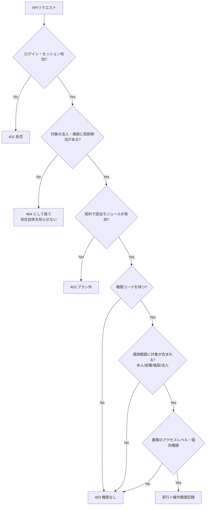

# 権限設計

## 1. 考え方

- 権限は**役職名ではなく「操作」単位**で定義する（例：`task.approve`＝業務を承認できる）
- 各権限に**適用範囲**を付ける

| 適用範囲 | 意味 |
|---|---|
| own | 自分が担当・作成・対象のものだけ |
| department | 自分の部署のもの |
| facility | 割り当てられた施設のすべて |
| organization | 法人内で**明示的に割り当てられた施設**のすべて＋法人共通データ |

- **役割（ロール）＝権限と適用範囲の束**。標準6役割を用意し、法人はコピーしてカスタムロールを作れる
- 役職（施設長・主任等）は職員台帳の属性で、権限には直接影響しない
- 1人に複数の役割を割り当て可能（例：介護主任が委員会の委員長を兼務）。権限は合算
- 判定はすべてサーバ側（API層）で行う。画面で非表示にするだけの制御はしない

## 2. 標準の役割

| コード | 名称 | 割当単位 | 概要 |
|---|---|---|---|
| SYSTEM_ADMIN | システム管理者（当社） | システム | プラン・業態マスタ・既定テンプレートの管理。**施設の業務データは通常閲覧不可**。障害対応時のみ施設の承認付きで一時アクセス |
| CORPORATE_ADMIN | 法人本部管理者 | 法人＋許可された施設 | 法人共通テンプレート・規程、許可された施設の閲覧。編集権限は最小限から付与 |
| FACILITY_DIRECTOR | 施設長 | 施設 | 施設の全業務の閲覧・承認、職員・権限・設定の管理 |
| ADMIN_MANAGER | 事務長 | 施設 | 施設長に準じる。最終承認は施設設定により可否を選択 |
| DEPARTMENT_MANAGER | 部署管理者・介護主任 | 施設＋部署 | 自部署の業務・依頼・提出物の管理、一次承認 |
| STAFF | 一般職員 | 施設 | 自分の業務・依頼・提出物の確認と更新 |

## 3. 権限一覧（MVP）

| モジュール | 権限コード | 内容 |
|---|---|---|
| 共通 | `dashboard.view` | ダッシュボード閲覧 |
| 業務 | `task.read` / `task.create` / `task.update` / `task.delete` | 業務の閲覧・作成・編集・取消 |
| | `task.assign` | 担当者の設定・業務依頼 |
| | `task.approve` | 業務の完了承認・差し戻し |
| | `task_series.manage` | 年間業務・繰り返し設定・年度更新 |
| | `task_template.manage` | テンプレート管理 |
| 提出物 | `submission_request.manage` | 提出依頼の作成・締切 |
| | `submission.submit` | 自分の提出 |
| | `submission.review` | 提出物の確認・承認・差し戻し |
| 書類 | `document.read` / `document.create` / `document.update` / `document.delete` | 書類（アクセスレベルの範囲内） |
| | `document.read_managers` | アクセスレベル「管理職」の書類の閲覧（「限定」の書類は書類ごとの閲覧者リストで制御） |
| | `document.manage_acl` | 書類の閲覧者リストの設定 |
| 委員会・研修 | `committee.manage` / `meeting.manage` / `minutes.approve` / `training.manage` / `training.confirm` | 委員会・開催・議事録承認・研修管理・受講確認 |
| | `requirement.verify` | 法令等の要件一覧の「確認済み」設定 |
| 職員 | `staff.read` / `staff.manage` | 職員台帳の閲覧・管理 |
| | `staff.read_private` | 職員の機密項目（将来）の閲覧 |
| 権限 | `role.manage` / `role.assign` | カスタムロール作成・役割割当 |
| 施設 | `facility.manage` / `settings.manage` | 施設情報・設定・通知タイミング |
| 出力 | `data.export` | CSV等の出力 |
| 監査 | `audit.read` | 操作履歴・ログイン履歴の閲覧 |
| AI | `ai.use` | AIアシスタントの利用 |
| | `ai.usage.view` | AI利用量・推定費用の閲覧 |
| | `ai.output.accept` | AI出力（下書き・抽出・提案）の採用 |
| 契約 | `subscription.view` | 契約・プランの閲覧 |
| システム | `system.*` | 当社のみ（プラン、業態、既定テンプレート） |

## 4. 標準役割の初期権限（○＝付与、範囲を併記）

| 権限 | CORPORATE_ADMIN | FACILITY_DIRECTOR | ADMIN_MANAGER | DEPARTMENT_MANAGER | STAFF |
|---|---|---|---|---|---|
| dashboard.view | organization | facility | facility | department | own |
| task.read | organization | facility | facility | department | own |
| task.create | — | facility | facility | department | —（使われない機能を作らない方針。必要性はヒアリングで確認） |
| task.update | — | facility | facility | department | own（状態・進捗・報告のみ） |
| task.delete | — | facility | facility | own（自分が作成） | — |
| task.assign | — | facility | facility | department | — |
| task.approve | — | facility | facility | department | — |
| task_series.manage | — | facility | facility | — | — |
| task_template.manage | organization | facility | facility | — | — |
| submission_request.manage | — | facility | facility | department | — |
| submission.submit | own | own | own | own | own |
| submission.review | — | facility | facility | department | — |
| document.read | organization | facility | facility | facility | facility（all_staff のみ） |
| document.read_managers | organization | facility | facility | facility | — |
| document.manage_acl | — | facility | facility | — | — |
| document.create | organization | facility | facility | facility | own（指定カテゴリ） |
| committee / meeting / training.manage | — | facility | facility | department | — |
| minutes.approve | — | facility | facility | — | — |
| training.confirm | — | facility | facility | department | — |
| requirement.verify | organization | facility | facility | — | — |
| staff.read | organization | facility | facility | department | — |
| staff.manage | — | facility | facility | — | — |
| role.manage / role.assign | organization | facility | facility | — | — |
| settings.manage | organization | facility | facility | — | — |
| data.export | organization | facility | facility | — | — |
| audit.read | organization | facility | facility | — | — |
| ai.use | organization | facility | facility | department | own |
| ai.usage.view | organization | facility | facility | — | — |
| ai.output.accept | — | facility | facility | department | — |

CORPORATE_ADMIN の初期権限は**閲覧中心**とし、編集が必要な場合は法人がカスタムロールで個別に付与する（必要最小限の原則）。

## 5. 判定の手順

DB側の RLS は「法人・施設」までを強制し、「部署・本人・アクセスレベル」はアプリ側で判定する（RLS を複雑にしすぎない）。

## 6. 機密情報の扱い

- 職員台帳の一般職員による閲覧は不可（`staff.read` なし）。業務画面には担当者の氏名・部署のみ表示
- 将来の機密項目（連絡先、資格証の画像等）は `staff_private_fields` / アクセスレベル「限定」の書類で分離し、`staff.read_private` を持つ人・書類の閲覧者リストに入っている人のみ
- 「限定」の書類は施設長でも閲覧者リストにない限り開けない。閲覧者リストの変更（`document.manage_acl`）は記録され、変更した事実は消せない
- 提出物は「本人」と「確認者（submission.review の範囲内）」のみ閲覧可。他の職員の提出物は見えない

## 7. カスタムロール

- 法人管理者または施設長が標準役割をコピーして作成し、権限と範囲を変更
- 付与できるのは**自分が持つ権限・範囲まで**（権限の自己拡大を防止）
- 役割の変更・割当は操作履歴に記録し、ダッシュボードで管理者に通知

## 8. AI の権限

- AI は「質問した人の権限」でのみデータを検索する（AI専用の広い権限は持たない）
- AI が行えるのは「回答」「下書き」「抽出」「提案」の作成まで。登録・変更・通知・承認は、権限を持つ人が画面で確認して実行
- 将来 AI が業務登録等を補助する場合も、用途ごとの許可リスト（`ai_use_cases`）と人の確認を必須とする
