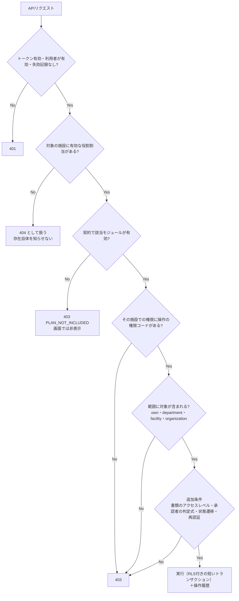

# 権限設計

- 版：v2（2026-11-17 設計レビューの指摘を反映：割当の上限、承認者の判定式、適用範囲の定義、状態操作と権限の対応、法人管理者の最小権限）

## 1. 考え方

- 権限は**役職名ではなく「操作」単位**で定義する（例：`task.approve`＝業務を承認できる）
- 各権限に**適用範囲**を付ける

| 適用範囲 | 意味 | 包含関係 |
|---|---|---|
| own | 自分が関係するもの（資源ごとの定義は第5章） | 最も狭い |
| department | 割当の部署（**子部署を含む**）に属するもの | own を含む |
| facility | 割当の施設のすべて | department を含む |
| organization | 法人内で**明示的に許可された施設**のすべて＋法人共通データ | facility を含む |

- **役割＝権限と適用範囲の束**。標準6役割を用意し、カスタムロールは PHASE 3
- 役職（施設長・主任等）は職員台帳の属性で、権限には影響しない
- 判定はすべてサーバ側（API層）で行う。画面で非表示にするだけの制御はしない
- **権限は施設ごとに判定し、施設をまたいで合算しない**（施設Aで主任・施設Bで一般職員の人は、施設Bでは一般職員の権限だけ）

## 2. 標準の役割

| コード | 名称 | 割当単位 | 概要 |
|---|---|---|---|
| SYSTEM_ADMIN | システム管理者（当社） | 当社の管理画面（テナントの役割割当ではない） | 法人・施設の作成、プラン・業態・既定テンプレート・要件候補の管理。**施設の業務データは閲覧できない**（DB の権限で分離） |
| CORPORATE_ADMIN | 法人本部管理者 | 法人単位の行＋許可された施設ごとの行 | MVP では**閲覧のみ**。編集の権限は PHASE 7 で設計 |
| FACILITY_DIRECTOR | 施設長 | 施設 | 施設の全業務の閲覧・承認、職員・権限・設定の管理 |
| ADMIN_MANAGER | 事務長 | 施設 | 施設長と同じ権限。違いは「割り当てられる役割」（第4章）と承認者の既定値（施設設定） |
| DEPARTMENT_MANAGER | 部署管理者・介護主任 | 施設＋部署（必須） | 自部署の業務・依頼・提出物・委員会・研修の管理と承認 |
| STAFF | 一般職員 | 施設 | 自分の業務・依頼・提出物の確認と報告 |
| SUPPORT_READONLY | 当社の障害対応（固定） | 承認された支援アクセスの期間のみ（テナントの役割割当ではない） | 当社管理画面の閲覧画面から、許可された施設のデータを閲覧のみ。DB 利用者 app_support は SELECT 権限だけを持ち、すべての RLS ポリシーが許可の有効性を確認する。法人共通の行は読めない。ファイルの中身は許可の `include_files` が真の場合のみ（`database-design.md` 第2.5節） |

## 3. 権限一覧

| モジュール | 権限コード | 内容 | 保護※ |
|---|---|---|---|
| 共通 | `dashboard.view` | ダッシュボード閲覧 | |
| 業務 | `task.read` | 業務の閲覧 | |
| | `task.create` / `task.update` | 業務の作成・内容の編集 | |
| | `task.delete` | 業務の取消 | |
| | `task.assign` | 担当者の設定・業務依頼 | |
| | `task.progress` | 着手・進捗報告・提出待ち・完了報告（担当者の操作） | |
| | `task.approve` | 業務の承認・差し戻し（第6章の判定式を満たす場合のみ） | |
| | `task.hold` | 保留・保留の解除 | |
| | `task.reopen` | 完了した業務の再開 | |
| | `task.force_complete` | 例外完了（必要提出物・承認を経ずに完了。理由必須、記録・表示される） | ○ |
| | `task_series.manage` | 年間業務・繰り返し設定・年度更新 | |
| | `task_template.manage` | テンプレート管理 | |
| 提出物 | `submission_request.manage` | 提出依頼の作成・締切 | |
| | `submission.submit` | 自分の提出 | |
| | `submission.review` | 提出物の確認・承認・差し戻し | |
| | `submission.proxy` | 代理登録（紙で受け取った分など） | |
| | `submission.exclude` | 対象外の設定 | |
| 承認 | `approval.reassign` | 承認者の付け替え（不在・退職時） | |
| 書類 | `document.read` | 書類の閲覧（アクセスレベル「全職員」） | |
| | `document.read_managers` | アクセスレベル「管理職」の書類の閲覧 | |
| | `document.create` / `document.update` / `document.delete` | 書類の登録・新しい版の追加・削除 | |
| | `document.manage_acl` | 「限定」書類の閲覧者リストの設定 | ○ |
| 委員会・研修 | `committee.read` | 委員会・開催・議事録・決定事項の閲覧 | |
| | `committee.manage` | 委員会の定義・委員の設定 | |
| | `meeting.manage` | 開催の登録・出席者 | |
| | `minutes.edit` | 議事録の作成・編集 | |
| | `minutes.approve` | 議事録の承認 | |
| | `decision.manage` | 決定事項の登録・状態変更 | |
| | `training.manage` / `training.confirm` | 研修の管理・受講確認 | |
| | `training.read` | 研修計画・開催・出欠の閲覧 | |
| | `requirement.read` | 法令等の要件一覧の閲覧 | |
| | `requirement.manage` | 要件の採用・編集 | |
| | `requirement.verify` | 要件の「確認済み」設定（根拠の確認） | ○ |
| 職員 | `staff.read` | 職員台帳の閲覧 | |
| | `staff.manage` | 職員の登録・所属・招待・停止・引継ぎ | ○ |
| | `org_structure.manage` | 部署・役職・職種マスタ | |
| 権限 | `role.assign` | 役割の割当・解除（第4章の制限あり） | ○ |
| | `role.manage` | カスタムロールの作成・編集（PHASE 3） | ○ |
| 施設 | `facility.manage` | 施設情報 | ○ |
| | `settings.manage` | 施設設定・通知タイミング・承認ルール | ○ |
| 出力 | `data.export` | CSV 等の出力 | ○ |
| 削除 | `data.purge_request` | 完全削除・墨消しの依頼（要配慮情報の混入、保存期限の到来）。依頼と同時に表示停止 | ○ |
| | `data.purge_approve` | 完全削除・墨消しの承認（実行は当社の保守処理） | ○ |
| 通知 | `notification.manage` | 送信に失敗した通知の確認・再送 | |
| 監査 | `audit.read` | 操作履歴・ログイン履歴の閲覧 | ○ |
| 利用状況 | `usage.view` | 施設の利用状況（利用者数・画面別の利用・代理登録率）の閲覧 | |
| | `access_review.run` | 権限の棚卸しの実施（PHASE 3） | ○ |
| AI | `ai.use` | AI アシスタントの利用（PHASE 4） | |
| | `ai.usage.view` | AI 利用量・推定費用・AI事業者の条件の閲覧 | |
| | `ai.output.accept` | AI 出力（下書き・抽出・提案）の採用 | |
| 契約 | `subscription.view` | 契約・プランの閲覧 | |
| 支援 | `support_access.approve` | 当社の障害対応アクセスの承認 | ○ |

※ 保護：権限の昇格や大量の情報取得につながる権限。カスタムロールには含められない。実行時は**直近10分以内の多要素認証による再認証**を求める（`role.assign`、`document.manage_acl`、`data.export`、`support_access.approve`、`settings.manage` のうちセキュリティ関連項目）。

## 4. 役割の割当の規則（権限昇格の防止）

| 規則 | 内容 |
|---|---|
| R1 自分には割り当てない | 自分自身の役割の割当・変更・解除はできない |
| R2 自分の権限の範囲内 | 割り当てる役割のすべての（権限, 範囲）が、割当者がその施設で持つ（権限, 範囲）に含まれること |
| R3 割り当てられる人の表 | 下表に従う |
| R4 最後の施設長 | 施設の最後の FACILITY_DIRECTOR は解除できない（施設が管理不能になるのを防ぐ） |
| R7 DB での強制 | 保護された役割（CORPORATE_ADMIN・FACILITY_DIRECTOR）は Web アプリからは割り当てられない（DB のトリガーで拒否）。R1・R4 も DB のトリガーで強制 |
| R5 通知と記録 | 役割の割当・変更・解除は、その施設の FACILITY_DIRECTOR と ADMIN_MANAGER 全員に通知し、操作履歴に記録 |
| R6 再認証 | 割当の操作には再認証が必要 |

| 割り当てる役割 | 割り当てられる人 |
|---|---|
| CORPORATE_ADMIN（法人単位・各施設） | **当社の手続きのみ**（契約者からの書面の依頼に基づき、専用関数 `assign_protected_role()`。MVP） |
| FACILITY_DIRECTOR | 当社の手続き（施設長交代の依頼に基づき、同上）。PHASE 7 で CORPORATE_ADMIN による割当を設計 |
| ADMIN_MANAGER | FACILITY_DIRECTOR |
| DEPARTMENT_MANAGER、STAFF | FACILITY_DIRECTOR、ADMIN_MANAGER |
| カスタムロール（PHASE 3） | 作成元（法人／施設）の範囲内で、R2 を満たす人 |

カスタムロール（PHASE 3）：
- 所有者は法人または施設。施設が作ったロールはその施設でだけ割り当てられる
- 作成・編集できる権限は、作成者が持つ権限・範囲まで。保護された権限は含められない
- 他の人に割当済みのロールを編集する場合も、編集後の権限が編集者の権限に含まれること

## 5. 「own（本人）」と「department（部署）」の定義

### 5.1 own：資源ごとの「自分が関係する」の定義

| 資源 | 自分が関係するもの |
|---|---|
| 業務 | 主担当・副担当（職員として）／担当部署に自分が所属している部署担当の業務／依頼者／作成者／指定された承認者（閲覧のみ） |
| 提出依頼・提出物 | 自分が対象者の提出物／自分が作成者・確認者の提出依頼 |
| 書類 | 自分が登録者・管理者の書類／閲覧者リストに含まれる「限定」書類 |
| 委員会・会議 | 委員・出席者として参加した開催の議事録・決定事項（閲覧）／自分が担当の決定事項 |
| 研修 | 自分が対象者の研修 |
| 承認依頼 | 自分が承認者（操作）・依頼者（閲覧） |
| ダッシュボード | 自分に関係する業務・提出物・承認依頼だけを集計 |

### 5.2 department：部署の判定

- 部署は**役割割当の `department_id`**（DEPARTMENT_MANAGER では必須）を正とし、その部署と子部署を範囲とする
- 資源の部署：

| 資源 | 部署の列 |
|---|---|
| 業務 | tasks.department_id（空の業務は部署範囲に入らない） |
| 提出依頼・提出物の確認 | submission_requests.department_id（依頼を出した部署） |
| 委員会・開催・決定事項 | committees.department_id（空の委員会は施設全体の委員会） |
| 研修 | training_plans.department_id |
| 職員 | staff_assignments の部署（その時点で有効な所属） |

### 5.3 法人単位（organization）の判定と法人共通データ

- 法人単位の役割割当（`facility_id` が空）は、**同じ人に施設ごとの割当がある施設**についてだけ効く（許可されていない施設は対象外）
- 法人共通データの**閲覧**：参照用の法人共通データ（法人の基本情報、契約・プラン、システム標準・法人共通の役職・職種・部署、法人共通の書類）は、施設の範囲の権限でも閲覧できる（例：施設長の `subscription.view`〔facility〕で法人の契約を閲覧できる）。法人共通の書類のアクセスレベルはアプリで判定する
- 法人共通データの**書込み**：法人単位の権限（`app.org_level`）が必要。MVP の CORPORATE_ADMIN は閲覧のみなので、法人共通データは当社の手続き（専用関数）で登録する（PHASE 7 で法人の編集権限を設計）
- 施設が必要とする役職・職種・部署は、施設の `org_structure.manage` で**施設の行**として登録する（法人共通の行を変更しない）

## 6. 承認できる人の判定式

承認依頼 AR を利用者 U が承認・差し戻しできる条件（**すべて満たす**）：

1. AR の状態が `pending`
2. U の職員が AR の**指定された承認者**（`approver_staff_id`）である
3. U が、対象の種類に応じた権限を、対象を含む範囲で持つ
   - 業務 → `task.approve`、提出物 → `submission.review`、議事録 → `minutes.approve`
4. 自己承認でない（U が完了報告・提出・議事録作成をした本人ではない）。ただし下記の例外を除く

承認者の指定・確定：
- 承認者は、業務 → シリーズ → カテゴリの順に指定を探し、どれにもなければ施設設定 `approval.default_approver_staff_id`（**既定の承認者。導入時に事務長本人を設定**）を使う
- 指定が「役割」の場合：施設内でその役割を持つ職員が1人ならその人。複数なら施設設定 `approval.role_designee.{役割}` で指定した人。いなければ施設設定 `approval.fallback_approver_staff_id`（**予備の承認者。導入時に施設長本人を設定**）
- 決まった職員が条件3を満たさない場合は、予備の承認者に回す
- 自己承認になる場合（承認者＝完了報告した本人）は予備の承認者に回す。予備の承認者本人の業務で他に承認者がいない場合のみ自己承認を認め、`is_self_approval` として記録・表示する
- 承認者が権限を失った・退職した場合、承認依頼に「承認者に権限なし」と表示し、`approval.reassign` を持つ人が付け替える（理由必須）
- 事務長の「最終承認」は権限ではなく、施設設定の「既定の承認者」で表す

## 7. 業務の状態操作と必要な権限

| 操作 | 遷移 | 必要な権限・条件 |
|---|---|---|
| 着手（API `start`） | 未着手・差し戻し・提出待ち → 進行中 | `task.progress`（own）または `task.update`（範囲内） |
| 提出待ちにする（API `wait-submission`） | 進行中 → 提出待ち | `task.progress`（own）または `task.update` |
| 完了報告（API `report-completion`） | 未着手・進行中・提出待ち・差し戻し → 承認待ち（承認必要）／完了（承認不要） | `task.progress`（own）。**必須の必要提出物がそろっていること**。承認が必要な業務は「完了」に直接移せない（サーバで拒否） |
| 承認・差し戻し | 承認待ち → 完了／差し戻し | 第6章の判定式。差し戻しは理由必須 |
| 保留・解除（API `hold`・`resume`） | 完了以外 → 保留 → 保留前の状態（**承認待ちだった場合は進行中**） | `task.hold`（範囲内）。理由必須。承認待ちを保留にすると承認依頼は取消 |
| 再開（API `reopen`） | 完了 → 進行中 | `task.reopen`（範囲内）。理由必須 |
| 例外完了（API `force-complete`） | 完了以外 → 完了 | `task.force_complete`（施設長・事務長）。理由必須。業務詳細とダッシュボードに「例外完了」と表示 |
| 取消（API `cancel`） | 完了以外 → （取消の記録） | `task.delete`（範囲内）。理由必須。保留中の承認依頼は取消 |
| 内容の編集 | — | `task.update`（範囲内）。担当者は進捗とコメントのみ |

状態遷移図は `product/module-specifications.md` を参照。

## 8. 標準役割の初期権限（範囲を記載、— は付与なし）

| 権限 | CORPORATE_ADMIN | FACILITY_DIRECTOR | ADMIN_MANAGER | DEPARTMENT_MANAGER | STAFF |
|---|---|---|---|---|---|
| dashboard.view | organization | facility | facility | department | own |
| task.read | organization | facility | facility | department | own |
| task.create / task.update / task.assign | — | facility | facility | department | — |
| task.delete | — | facility | facility | own（自分が作成） | — |
| task.progress | — | own | own | own | own |
| task.approve / task.hold | — | facility | facility | department | — |
| task.reopen | — | facility | facility | department | — |
| task.force_complete | — | facility | facility | — | — |
| task_series.manage / task_template.manage | — | facility | facility | — | — |
| submission_request.manage | — | facility | facility | department | — |
| submission.submit | own | own | own | own | own |
| submission.review / proxy / exclude | — | facility | facility | department | — |
| approval.reassign | — | facility | facility | — | — |
| document.read | organization | facility | facility | facility | facility |
| document.read_managers | organization | facility | facility | facility | — |
| document.create | — | facility | facility | facility | own（指定カテゴリ） |
| document.update / document.delete | — | facility | facility | own | own（自分が登録・未確定のもの） |
| document.manage_acl | — | facility | facility | — | — |
| committee.read / training.read | organization | facility | facility | department | own（委員・出席者・対象者として関係するもの） |
| committee.manage / meeting.manage / decision.manage | — | facility | facility | department | — |
| minutes.edit | — | facility | facility | department | — |
| minutes.approve | — | facility | facility | — | — |
| training.manage / training.confirm | — | facility | facility | department | — |
| requirement.read | organization | facility | facility | facility | — |
| requirement.manage / requirement.verify | — | facility | facility | — | — |
| staff.read | organization | facility | facility | department | — |
| staff.manage / org_structure.manage | — | facility | facility | — | — |
| role.assign | — | facility | facility | — | — |
| role.manage（PHASE 3） | — | facility | facility | — | — |
| facility.manage / settings.manage | — | facility | facility | — | — |
| data.export / audit.read | — | facility | facility | — | — |
| data.purge_request | — | facility | facility | — | — |
| data.purge_approve | — | facility | — | — | — |
| access_review.run（PHASE 3） | — | facility | facility | — | — |
| notification.manage / usage.view | — | facility | facility | — | — |
| ai.use（PHASE 4） | organization | facility | facility | department | own |
| ai.usage.view / subscription.view | organization | facility | facility | — | — |
| ai.output.accept | — | facility | facility | department | — |
| support_access.approve | — | facility | facility | — | — |

- 委員会の委員長・書記には、役割とは別に、**その委員会に限った権限**を資源単位で付与する（委員長：`meeting.manage`・`minutes.edit`・`decision.manage`、書記：`minutes.edit`）。一般職員が委員長・書記を務める場合に対応するため
- 一般職員による業務の作成（自分用メモ）は作らない（TD-028）

## 9. 判定の手順

DB の RLS は「法人・施設」までを強制し、部署・本人・書類のアクセスレベル・承認者の判定はアプリ側で行う（`database-design.md` 第2.6節）。

## 10. 機密情報の扱い

- 一般職員は職員台帳を閲覧できない。業務画面には担当者の氏名・部署のみ表示
- 提出物は書類とは別に保存し（`submission_files`）、本人・指定された確認者・`submission.review` の範囲内の人だけが閲覧できる。書類の一覧・検索には出ない
- 「限定」書類は、施設長でも閲覧者リストにない限り開けない。閲覧者リストの変更（自分の追加を含む）は記録され、書類の管理者に通知される
- 書類・提出物のデータ区分が C3 以上のものは、AI に送らない（`security-design.md` 第2章）

## 11. AI の権限

- AI は「質問した人の権限」でのみデータを検索する（AI 専用の広い権限は持たない）
- AI が行えるのは「回答」「下書き」「抽出」「提案」の作成まで。登録・変更・通知・承認は、権限を持つ人が画面で確認して実行
- 将来 AI が業務登録等を補助する場合も、用途ごとの許可リスト（`ai_use_cases`）と人の確認を必須とする
