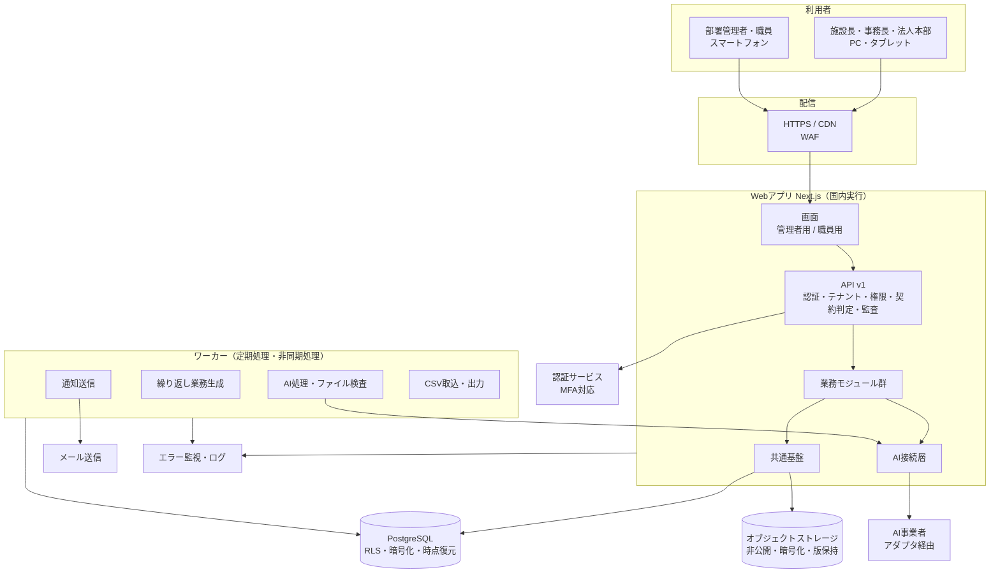

# システム全体構成・モジュール構成・API設計

## 1. 全体構成

方式：**モジュラーモノリス**（1つのアプリの中を機能ごとの区画に分ける）。少人数で保守でき、必要になれば区画単位で切り出せる。



【仮定 Q2】実証期：アプリ＝Vercel（東京実行）、DB・認証・ストレージ＝Supabase（東京）。いずれも標準技術（PostgreSQL、S3互換、OIDC）で接続し、AWS 等へ移行可能な構成にする。

この構成で注意する点（設計で対処済み）：
- **ワーカー**：サーバレス実行（必要な時だけ動く方式）は1回の実行時間に上限があり、常駐プロセスを置けない。実証期は外部のスケジューラから定期的にジョブ処理の窓口を呼び出し、制限時間内に処理できる分だけ処理する方式とする。処理はすべて冪等（何度実行しても結果が同じ）・分割可能にし、将来は常駐ワーカーへ移しても同じ動きにする（TD-018）
- **DB接続**：サーバレスでは接続数が増えやすいため、接続を共有する仕組み（コネクションプール）を使う。RLS の設定値はトランザクション単位で設定するため、共有接続でも混ざらない（`database-design.md` 2.2）
- **データの所在**：アプリの実行・DB・ファイルは東京リージョンに置けるが、ホスティング事業者のログ・管理機能が国外で処理される可能性がある。**ログに個人情報を出さない**ことを前提とし、本番前に各社の条件を確認する（Q2）
- **認証**：メールアドレスを持たない職員のログイン方式に対応できるかを確認してから認証サービスを確定する（TD-016）

## 2. 技術構成

| 層 | 採用案 | 理由 |
|---|---|---|
| 言語 | TypeScript（strict） | 画面とサーバで共通。型で不具合を減らす |
| フレームワーク | Next.js（App Router） | 画面とAPIを1プロジェクトで管理 |
| UI | Tailwind CSS＋アクセシブルな部品集（Radix系） | スマホ対応・読みやすさ・一貫性 |
| 入力検証 | Zod | APIの入力を全件検証。画面と同じ定義を共用 |
| DB操作 | Drizzle ORM＋マイグレーション | SQLに近く、RLS・制約を明示的に扱える |
| ジョブ | PostgreSQL ベースのジョブキュー（pg-boss 等） | 追加のサーバ不要 |
| 認証 | マネージド認証（OIDC 準拠） | パスワード保管を自前で持たない。MFA |
| テスト | Vitest／実DB結合テスト（Docker）／Playwright | 必須テスト12項目 |
| CI | GitHub Actions | 変更ごとに型検査・テスト・脆弱性検査 |

## 3. ソースコード構成（予定）

```
ai-facility-partner/
├── apps/web/                 Next.js（画面・API）
│   ├── app/(admin)/          管理者用画面
│   ├── app/(staff)/          職員用画面
│   └── app/api/v1/           API
├── packages/
│   ├── core/                 共通基盤
│   │   ├── tenancy/          法人・施設・業態・設定の階層
│   │   ├── identity/         ユーザー・職員・役割・権限判定
│   │   ├── entitlements/     契約・プラン・機能利用判定
│   │   ├── audit/            操作履歴・ログイン履歴
│   │   ├── files/            ファイル保管・検査・期限付きURL
│   │   ├── notifications/    通知ポリシー・送信
│   │   ├── approvals/        承認（共通）
│   │   ├── links/            書類との紐付け（共通）
│   │   └── jobs/             定期処理
│   ├── modules/
│   │   ├── m01-assistant/    施設運営AI
│   │   ├── m02-tasks/        業務・期限・依頼・提出物・カレンダー
│   │   ├── m03-documents/    書類・証拠
│   │   ├── m04-committees/   委員会・研修
│   │   ├── m05-staffing/     （将来）
│   │   ├── m06-meetings-ai/  （将来）
│   │   └── m07-corporate/    （将来）
│   ├── ai/                   AI接続層・事業者アダプタ
│   ├── db/                   スキーマ・マイグレーション・RLSポリシー
│   └── integrations/         CSV・外部連携アダプタ
├── tests/                    結合テスト・E2E・AI評価
└── docs/                     本設計文書
```

## 4. モジュール間のルール

| ルール | 内容 |
|---|---|
| 公開窓口 | 各モジュールは `index.ts` で公開した関数だけを他モジュールに提供。内部のテーブルを他モジュールが直接読まない |
| 依存方向 | modules → core の一方向。core は modules に依存しない。modules 間の呼び出しは公開窓口経由 |
| イベント | 「委員会の決定事項が登録された」等の出来事はイベントとして記録し、業務モジュールが受け取って改善業務を作成（疎結合） |
| 契約判定 | 各モジュールは起動時に `requireModule('m04')` を宣言。プラン外なら API・画面とも非表示 |
| 業態 | モジュールのコードで業態コードによる分岐をしない。違いはテンプレート・設定で表現 |
| 自動チェック | 依存ルール違反を静的解析（lint）で検出し CI で失敗させる |

## 5. API設計

### 5.1 方針

- REST 形式の JSON API（`/api/v1/...`）。画面もこの API を使う（将来の外部連携・アプリ化に流用）
- 仕様は OpenAPI（API仕様の標準記述形式）で自動生成し、文書と実装を一致させる
- 施設のデータは URL に施設IDを含める：`/api/v1/facilities/{facilityId}/tasks`
  - URL の施設IDは「指定」にすぎず、アクセス可否は必ずサーバが役割割当で確認
- 認証：HttpOnly・Secure・SameSite の Cookie によるセッション。外部連携用は将来 API キー（施設単位・権限限定）

### 5.2 共通仕様

| 項目 | 仕様 |
|---|---|
| ページング | `?cursor=...&limit=50`（最大200） |
| 絞り込み・並び替え | `?status=in_progress&due_from=2026-04-01&sort=due_on` |
| 同時編集 | 更新時に `version` を送信。不一致なら 409（他の人が先に更新） |
| 二重送信防止 | 作成系は `Idempotency-Key` ヘッダーに対応 |
| エラー形式 | `{ "error": { "code": "PERMISSION_DENIED", "message": "…", "details": … } }` |
| 他テナントの対象 | 403 ではなく 404（存在を知らせない） |
| 日時 | ISO 8601、時差付き |
| 監査 | すべての更新系と、機密データの閲覧系を操作履歴に記録 |

### 5.3 エンドポイント一覧（MVP）

| 区分 | メソッド・パス | 内容 |
|---|---|---|
| 認証 | `POST /auth/login`、`POST /auth/logout`、`POST /auth/mfa/verify` | （認証サービスと連携） |
| 自分 | `GET /me`、`GET /me/tasks`、`GET /me/submissions`、`GET /me/notifications` | 職員用画面の中心 |
| 法人・施設 | `GET/PATCH /organizations/{id}`、`GET/POST /organizations/{id}/facilities`、`GET/PATCH /facilities/{id}` | |
| 設定 | `GET /facilities/{id}/settings`（解決済み）、`PATCH /facilities/{id}/settings/{key}` | |
| 職員 | `GET/POST /facilities/{id}/staff`、`GET/PATCH /facilities/{id}/staff/{staffId}`、`POST …/staff/{staffId}/invite`、`POST …/staff/{staffId}/suspend` | |
| 役割 | `GET/POST /organizations/{id}/roles`、`PATCH /roles/{roleId}`、`GET/POST /facilities/{id}/role-assignments`、`DELETE /role-assignments/{id}` | |
| ダッシュボード | `GET /facilities/{id}/dashboard?date=` | 実データの集計のみ |
| 業務 | `GET/POST /facilities/{id}/tasks`、`GET/PATCH /tasks/{taskId}`、`POST /tasks/{taskId}/status`、`POST /tasks/{taskId}/comments`、`POST /tasks/{taskId}/request-approval`、`POST /tasks/{taskId}/cancel` | |
| 年間業務 | `GET/POST /facilities/{id}/task-series`、`PATCH /task-series/{seriesId}`、`POST /facilities/{id}/fiscal-years/{fy}/rollover`（翌年度案の作成）、`POST …/rollover/commit` | |
| テンプレート | `GET/POST /task-templates`（範囲指定） | |
| カレンダー | `GET /facilities/{id}/calendar?view=month&from=&to=` | |
| 提出依頼 | `GET/POST /facilities/{id}/submission-requests`、`GET /submission-requests/{reqId}/targets`、`POST /submission-requests/{reqId}/remind`（確認後の手動督促）、`POST /submission-targets/{targetId}/submissions`、`POST /submission-targets/{targetId}/review` | |
| 承認 | `GET /facilities/{id}/approvals?status=pending`、`POST /approvals/{id}/approve`、`POST /approvals/{id}/return` | |
| 書類 | `POST /facilities/{id}/files`（アップロードURL発行）、`GET/POST /facilities/{id}/documents`、`GET /documents/{docId}`、`POST /documents/{docId}/versions`、`GET /document-versions/{verId}/download`（期限付きURL）、`POST/DELETE /links` | |
| 委員会 | `GET/POST /facilities/{id}/committees`、`GET/POST /committees/{cid}/meetings`、`PATCH /meetings/{mid}`、`POST /meetings/{mid}/minutes`、`POST /meetings/{mid}/decisions`、`PATCH /decisions/{did}` | PHASE 3 |
| 研修 | `GET/POST /facilities/{id}/training-plans`、`POST /training-plans/{pid}/sessions`、`PUT /training-sessions/{sid}/attendance` | PHASE 3 |
| 要件一覧 | `GET/POST /facilities/{id}/requirement-items`、`POST /requirement-items/{rid}/verify` | PHASE 3 |
| 通知 | `GET/PATCH /facilities/{id}/notification-policies`、`POST /notifications/{nid}/read` | |
| AI | `POST /facilities/{id}/assistant/messages`、`GET /facilities/{id}/ai/usage`、`POST /ai-outputs/{oid}/review` | PHASE 4 |
| 監査 | `GET /facilities/{id}/audit-logs`、`GET /facilities/{id}/login-history` | |
| CSV | `POST /facilities/{id}/imports`、`POST /facilities/{id}/exports`、`GET /exports/{eid}` | |
| 契約 | `GET /organizations/{id}/subscription`、`GET /organizations/{id}/entitlements` | 閲覧のみ（管理は当社） |
| システム | `/system/...`（プラン・業態・既定テンプレート） | SYSTEM_ADMIN のみ |

## 6. ダッシュボードの算出定義

すべて実データの集計。データがない場合は「0件」と「未登録（シリーズ・データ自体がない）」を区別して表示。ダミーデータは本番環境に存在させない（シード投入は開発・検証環境のみで、環境変数で禁止）。

| 表示 | 算出条件（施設・閲覧範囲内、取消除く） |
|---|---|
| 本日の業務 | `due_on = 今日` かつ 未完了 |
| 今週の業務 | `due_on` が今週（月〜日、施設設定で変更可） かつ 未完了 |
| 今月の業務 | `due_on` が今月 かつ 未完了 |
| 期限超過 | `due_on < 今日` かつ 未完了 |
| 期限が近い業務 | `今日 < due_on ≤ 今日＋N日`（N は設定、既定3日） |
| 未提出の書類 | 締切前後の提出依頼で `submission_targets.status = not_submitted / returned` の件数（依頼別） |
| 承認待ち | `approval_requests.status = pending` かつ 承認者が自分（管理者は施設全体も切替表示） |
| 担当者未設定 | 主担当者がいない未完了業務 |
| 委員会・研修予定 | 今後30日の `meetings` / `training_sessions`（予定） |
| 完了した業務 | 期間内に `completed_at` がある業務 |
| AIからの確認事項 | PHASE 2〜3：**ルールによる自動チェック**（根拠「未確認」の行政提出業務、担当者が退職・停止中の未完了業務、決定事項の期限超過、業務が未登録の要件など）として表示し、**「AI」とは表示しない**。PHASE 4 以降：AI による指摘を根拠付きで追加し「AIによる指摘」と明示 |

## 7. UI設計の方針（詳細は `product/screen-design.md`）

- 管理者用と職員用で画面の入口を分ける（役割により自動で振り分け、管理者は職員用表示にも切替可能）
- スマホは下部タブ（ホーム／業務／提出／通知）。片手操作できるボタンサイズ（44px 以上）
- 文字は 16px 以上、色だけに頼らない状態表示（色＋文字＋アイコン）
- 期限は「あと3日」「2日超過」のような相対表示を併記
