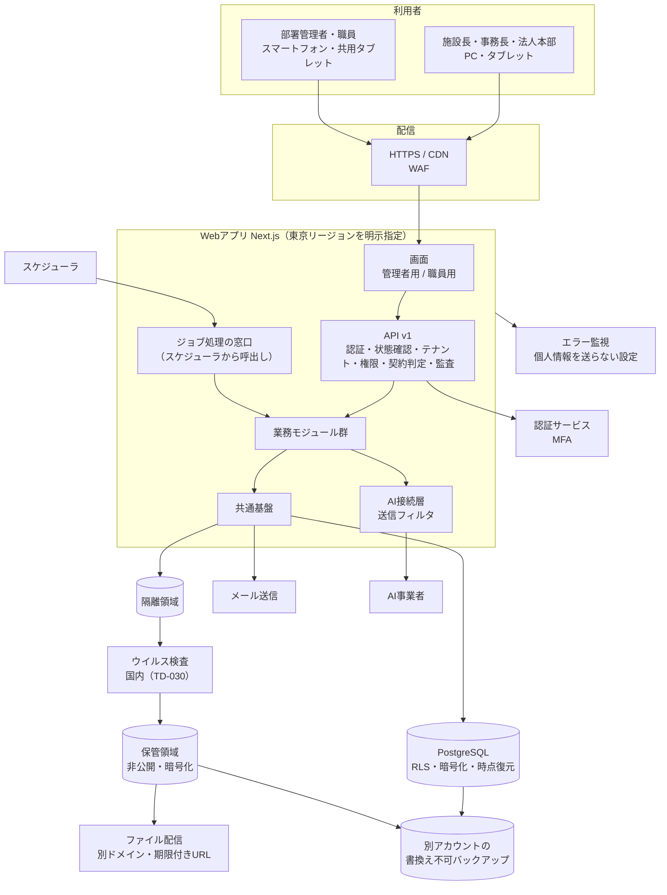

# システム全体構成・モジュール構成・API設計

- 版：v2（2026-11-17 設計レビューの指摘を反映：ジョブ方式、トランザクションの単位、プラン外の扱い、ファイル配信、API の追加）

## 1. 全体構成

方式：**モジュラーモノリス**（1つのアプリの中を機能ごとの区画に分ける）。少人数で保守でき、必要になれば区画単位で切り出せる。



【仮定 Q2】実証期：アプリ＝Vercel（東京リージョンを明示指定）、DB・認証・ストレージ＝Supabase（東京）。いずれも標準技術（PostgreSQL、S3互換、OIDC）で接続し、AWS 等へ移行可能な構成にする。

この構成での対処（設計に反映済み）：

| 論点 | 対処 |
|---|---|
| 常駐プロセスがない | ジョブは DB の待ち行列（`jobs`）に積み、スケジューラから定期的に呼ばれる窓口が制限時間内に処理できる分だけ取り出して実行する（`FOR UPDATE SKIP LOCKED`）。外部ライブラリの常駐ワーカーは前提にしない（TD-018） |
| DB 接続数 | 接続を共有する仕組み（コネクションプール）を使う。RLS の設定値は**短いトランザクション単位**で設定し、AI・メール・ストレージなどの外部呼び出しはトランザクションの外で行う（接続を握り続けない） |
| 実行場所 | 関数の実行リージョンを東京に明示指定する。リクエストの前処理（ミドルウェア）で個人情報を扱わない（世界中で実行されうるため。製品仕様は要確認） |
| データの所在と事業者の所在 | 保存場所が国内でも事業者は外国にある。`subprocessors.md` で整理し、専門家が判断する |
| DB の直接公開窓口 | ホスティングが提供する DB の直接公開 API（Supabase の Data API 等）は無効化し、RLS を迂回する管理キーをアプリで使わない |
| ウイルス検査 | サーバレス関数内では動かさず、国内の検査用コンテナまたは検査サービスで行う（TD-030） |
| ファイルのバックアップ | DB のバックアップにファイル本体は含まれないため、別アカウントへ日次複製する |
| 認証 | メールのない職員のログイン・共用端末への対応（D-2）を満たすかで認証サービスを確定（TD-016） |
| プレビュー環境 | 変更ごとのプレビュー環境はアクセス保護を有効にし、架空データのみ使用 |

## 2. 技術構成

| 層 | 採用案 | 理由 |
|---|---|---|
| 言語 | TypeScript（strict） | 画面とサーバで共通。型で不具合を減らす |
| フレームワーク | Next.js（App Router） | 画面と API を1プロジェクトで管理 |
| UI | Tailwind CSS＋アクセシブルな部品集（Radix 系） | スマホ対応・読みやすさ・一貫性 |
| 入力検証 | Zod | API の入力を全件検証。画面と同じ定義を共用 |
| DB 操作 | Drizzle ORM＋手書き SQL のマイグレーション | 表は ORM、RLS・排他制約・部分一意索引・関数は手書き SQL |
| ジョブ | 自前の DB 待ち行列（`jobs`） | 追加サーバ不要。常駐・非常駐どちらでも同じ処理 |
| 認証 | マネージド認証（OIDC 準拠、TD-016 で確定） | パスワードを自前で保管しない。MFA |
| テスト | Vitest／実DB結合テスト（Docker）／Playwright | 必須テスト12項目 |
| CI | GitHub Actions（介護SaaS専用リポジトリ） | 変更ごとに型検査・テスト・脆弱性検査・RLS 有効検査 |

## 3. ソースコード構成（予定）

```
ai-facility-partner/
├── apps/web/                 Next.js（画面・API・ジョブ処理の窓口）
│   ├── app/(admin)/          管理者用画面
│   ├── app/(staff)/          職員用画面
│   └── app/api/v1/           API
├── apps/console/             当社の管理画面（別の入口・別の認証・IP 制限）
├── packages/
│   ├── core/
│   │   ├── tenancy/          法人・施設・業態・設定の階層（設定定義表）
│   │   ├── identity/         ユーザー・職員・所属・役割・権限判定
│   │   ├── entitlements/     契約・プラン・機能利用判定
│   │   ├── audit/            操作履歴・ログイン履歴・利用記録
│   │   ├── files/            二段階の保管・検査・期限付きURL
│   │   ├── notifications/    通知の算出・送信待ち・チャネルのアダプタ
│   │   ├── approvals/        承認（共通）
│   │   ├── events/           モジュール間イベント
│   │   └── jobs/             DB 待ち行列・定期処理
│   ├── modules/
│   │   ├── m01-assistant/    施設運営AI
│   │   ├── m02-tasks/        業務・期限・依頼・提出物・カレンダー
│   │   ├── m03-documents/    書類・証拠
│   │   ├── m04-committees/   委員会・研修
│   │   └── m05〜m07/         （将来）
│   ├── ai/                   AI接続層・送信フィルタ・事業者アダプタ
│   ├── db/                   スキーマ・マイグレーション・RLSポリシー
│   └── integrations/         CSV・外部連携アダプタ
├── tests/                    結合テスト・E2E・AI評価
└── docs/                     本設計文書
```

## 4. モジュール間のルール

| ルール | 内容 |
|---|---|
| 公開窓口 | 各モジュールは `index.ts` で公開した関数だけを他モジュールに提供。内部のテーブルを他モジュールが直接読まない |
| 依存方向 | modules → core の一方向。modules 間の呼び出しは公開窓口経由 |
| イベント | 「委員会の決定事項が登録された」等は `domain_events` に記録し、業務モジュールが受け取って改善業務を作成（疎結合） |
| 契約判定 | 各モジュールは `requireModule('m04')` を宣言。プラン外なら**画面では非表示、API は 403（`PLAN_NOT_INCLUDED`）** |
| 業態 | モジュールのコードで業態コードによる分岐をしない。違いはテンプレート・設定で表現 |
| DB アクセス | すべて `withTenantTx(ctx, fn)`（文脈を設定した短いトランザクション）経由。直接の接続を書かない |
| 自動チェック | 依存ルール違反・`withTenantTx` を使わない DB アクセスを静的解析（lint）で検出し CI で失敗させる |

## 5. API設計

### 5.1 方針

- REST 形式の JSON API（`/api/v1/...`）。画面もこの API を使う（将来の外部連携・アプリ化に流用）
- 仕様は OpenAPI（API 仕様の標準記述形式）で自動生成し、文書と実装を一致させる
- 施設のデータは URL に施設IDを含める：`/api/v1/facilities/{facilityId}/tasks`。URL の施設IDは「指定」にすぎず、アクセス可否は必ずサーバが役割割当で確認
- 認証：HttpOnly・Secure・SameSite の Cookie によるセッション。外部連携用は将来 API キー（施設単位・権限限定）

### 5.2 共通仕様

| 項目 | 仕様 |
|---|---|
| ページング | `?cursor=...&limit=50`（最大200） |
| 絞り込み・並び替え | `?status=in_progress&due_from=2026-04-01&sort=due_on` |
| 同時編集 | 更新時に `version` を送信。不一致なら 409 |
| 二重送信防止 | 作成系は `Idempotency-Key` ヘッダーに対応（`idempotency_keys` に24時間保存） |
| エラー形式 | `{ "error": { "code": "PERMISSION_DENIED", "message": "…", "details": … } }` |
| 他テナントの対象 | 404（存在を知らせない） |
| プラン外 | 403 `PLAN_NOT_INCLUDED` |
| 再認証が必要 | 403 `REAUTH_REQUIRED`（画面で多要素認証を求めて再実行） |
| 日時 | ISO 8601、時差付き |
| 監査 | すべての更新系と、機密データの閲覧系を操作履歴に記録 |

### 5.3 エンドポイント一覧

| 区分 | メソッド・パス | フェーズ |
|---|---|---|
| 認証 | `POST /auth/login`、`POST /auth/logout`、`POST /auth/mfa/verify`、`POST /auth/reauth` | 2a |
| 自分 | `GET /me`、`GET /me/facilities`、`GET /me/tasks`、`GET /me/submissions`、`GET /me/requests`（自分が出した依頼）、`GET /me/notifications`、`PATCH /me/settings`（受信時間帯など） | 2a〜2b |
| 法人・施設 | `GET /organizations/{id}`、`GET/PATCH /facilities/{id}` | 2a |
| 設定 | `GET /facilities/{id}/settings`（解決済み）、`PATCH /facilities/{id}/settings/{key}`、法人設定 `PATCH /organizations/{id}/settings/{key}`（PHASE 7） | 2a |
| 職員 | `GET/POST /facilities/{id}/staff`、`GET/PATCH /staff/{staffId}`、`POST /staff/{staffId}/assignments`、`POST /staff/{staffId}/invite`、`POST /staff/{staffId}/suspend`（即時停止）、`GET /staff/{staffId}/handover`（引継ぎ対象の一覧）、`POST /staff/{staffId}/handover` | 2a |
| マスタ | `GET/POST /facilities/{id}/departments`、`/organizations/{id}/positions`、`/organizations/{id}/job-types` | 2a |
| 役割 | `GET /facilities/{id}/role-assignments`、`POST /facilities/{id}/role-assignments`、`DELETE /role-assignments/{id}`、カスタムロール `GET/POST /roles`（PHASE 3） | 2a |
| 支援アクセス | `GET /facilities/{id}/support-access`、`POST /support-access/{id}/approve`、`POST /support-access/{id}/reject`、`POST /support-access/{id}/revoke` | 2a |
| ダッシュボード | `GET /facilities/{id}/dashboard?date=` | 2b |
| 業務 | `GET/POST /facilities/{id}/tasks`、`GET/PATCH /tasks/{taskId}`、`POST /tasks/{taskId}/actions/{start|wait-submission|report-completion|hold|resume|reopen|force-complete|cancel}`、`POST /tasks/{taskId}/acknowledge`、`POST /tasks/{taskId}/comments` | 2b |
| 年間業務 | `GET/POST /facilities/{id}/task-series`、`POST /task-series/{seriesId}/revise`（境界日を指定して新シリーズ）、`POST /facilities/{id}/fiscal-years/{fy}/rollover`、`POST …/rollover/commit` | 2b |
| テンプレート | `GET/POST /facilities/{id}/task-templates` | 2b |
| カレンダー | `GET /facilities/{id}/calendar?view=month|week|year&from=&to=` | 2b |
| 提出依頼 | `GET/POST /facilities/{id}/submission-requests`、`GET /submission-requests/{reqId}/targets`、`POST /submission-requests/{reqId}/remind`（送信内容の確認後）、`POST /submission-targets/{targetId}/submissions`（本人）、`POST /submission-targets/{targetId}/proxy-submissions`、`POST /submission-targets/{targetId}/exclude`、`GET /submission-files/{fileId}/download` | 2b |
| 承認 | `GET /facilities/{id}/approvals?status=pending`、`POST /approvals/{id}/approve`、`POST /approvals/{id}/return`、`POST /approvals/{id}/reassign` | 2b |
| 書類 | `POST /facilities/{id}/uploads`（隔離領域へのアップロードURL発行）、`GET/POST /facilities/{id}/documents`、`GET/PATCH /documents/{docId}`、`POST /documents/{docId}/versions`、`PUT /documents/{docId}/acl`、`GET /document-versions/{verId}/download`、`POST/DELETE /document-links` | 2b |
| 通知 | `GET /me/notifications`、`POST /notifications/{nid}/read`、管理者向け `GET /facilities/{id}/notifications?status=failed`・`POST /notifications/{nid}/retry`（`notification.manage`） | 2b-1 |
| 利用状況 | `GET /facilities/{id}/usage?from=&to=`（`usage.view`） | 2b-2 |
| CSV | `POST /facilities/{id}/imports`（プレビュー）、`POST /imports/{id}/commit`、`POST /facilities/{id}/exports`、`GET /exports/{eid}` | 2b（取込）〜3（出力） |
| 委員会 | `GET/POST /facilities/{id}/committees`、`GET/POST /committees/{cid}/meetings`、`PATCH /meetings/{mid}`、`POST /meetings/{mid}/minutes`、`POST /meetings/{mid}/decisions`、`POST /decisions/{did}/actions/{start|implement|verify|drop}` | 3 |
| 研修 | `GET/POST /facilities/{id}/training-plans`、`POST /training-plans/{pid}/targets`、`POST /training-plans/{pid}/sessions`、`PUT /training-sessions/{sid}/attendance`、`POST /training-attendance/{aid}/confirm` | 3 |
| 要件一覧 | `GET /facilities/{id}/requirement-candidates`、`GET/POST /facilities/{id}/requirement-items`、`POST /requirement-items/{rid}/verify` | 3 |
| 監査・棚卸し | `GET /facilities/{id}/audit-logs`、`GET /facilities/{id}/login-history`（自施設に所属履歴がある職員の分）、`GET /facilities/{id}/access-review`、`POST /facilities/{id}/access-reviews` | 3 |
| 契約 | `GET /organizations/{id}/subscription`、`GET /organizations/{id}/entitlements` | 3 |
| AI | `POST /facilities/{id}/assistant/messages`、`GET /facilities/{id}/ai/usage`、`GET /ai/vendor-terms`、`POST /ai-outputs/{oid}/review` | 4 |
| ジョブ | `POST /internal/jobs/tick`（スケジューラ専用。秘密のトークンと送信元の確認） | 2a |
| 当社管理 | 別アプリ `apps/console`（法人・施設の作成、プラン、業態、既定テンプレート、要件候補、支援アクセスの申請） | 2a（作成・招待）〜3（要件候補）〜6（プラン管理画面） |

## 6. ダッシュボードの算出定義

すべて実データの集計。データがない場合は「0件」と「未登録（シリーズ・データ自体がない）」を区別して表示。架空データは本番環境に存在させない（投入処理は本番で無効）。期限・期限超過の判定は `database-design.md` 第6章に従う。

| 表示 | 算出条件（施設・閲覧範囲内、取消除く） |
|---|---|
| 本日の業務 | 期限日＝今日 かつ 未完了 |
| 今週の業務 | 期限日が今週（週の開始曜日は施設設定） かつ 未完了 |
| 今月の業務 | 期限日が今月 かつ 未完了 |
| 期限超過 | 期限超過の条件を満たす（**保留中を含み、「うち保留中 n件」を併記**） |
| 期限が近い業務 | 今日 < 期限日 ≤ 今日＋N日（N は設定、既定3日） |
| 未提出の書類 | 公開中の提出依頼の、`not_submitted`／`returned` の対象者数（依頼別） |
| 承認待ち | `pending` の承認依頼のうち、承認者が自分のもの（管理者は施設全体も切替表示） |
| 担当者未設定 | 主担当（職員または部署）がいない未完了業務 |
| 委員会・研修予定 | 今後30日の開催予定（PHASE 2 はカテゴリ「委員会」「研修」の業務、PHASE 3 から委員会・研修の開催） |
| 完了した業務 | 期間内に完了した業務（例外完了は別掲） |
| 確認事項 | PHASE 2〜3：**ルールによる自動チェック**（根拠「未確認」の行政提出業務、担当者が停止・退職済みの未完了業務、承認者に権限がない承認依頼、送信に失敗した通知、決定事項の期限超過、業務が未登録の要件）。「AI」とは表示しない。PHASE 4 以降：AI による指摘を根拠付きで追加し「AIによる指摘」と明示 |

## 7. UI設計の方針（詳細は `product/screen-design.md`）

- 管理者用と職員用で画面の入口を分ける（役割により自動で振り分け、管理者は職員用表示にも切替可能）
- スマホは下部タブ（ホーム／業務／提出／通知）。ボタンは44px 以上
- 文字は16px 以上、色だけに頼らない状態表示（色＋文字＋アイコン）
- 期限は「あと3日」「2日超過」のような相対表示を併記
- AI の回答では外部の画像・リンクを表示しない
