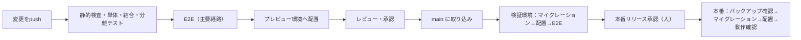

# 環境構築・デプロイ手順（草案）

> **草案**：ホスティング先（Q2）の決定後に確定する。ここでは実証期の仮定構成（Supabase 東京＋ Vercel 東京実行）を前提に、他の構成に移しても変わらない手順を中心に記載する。

## 1. 環境

| 環境 | 用途 | データ | 利用者 |
|---|---|---|---|
| ローカル | 開発者の作業 | 架空データ（Docker の PostgreSQL） | 開発者 |
| プレビュー | 変更ごとの確認 | 架空データ（共有の検証DBは使わない） | 開発者・事業責任者 |
| 検証（staging） | 受入テスト、復元訓練、施設への画面確認 | 架空データ | 施設長・事務長（確認用アカウント） |
| 本番（production） | 実証・運用 | 実データ（実データ前の準備完了後） | 施設 |

- 環境ごとに DB・ストレージ・認証・AI の APIキー・メール送信設定を**完全に分ける**
- 本番データを他の環境へ複製しない。不具合調査は本番の操作履歴とエラー監視で行う

## 2. 必要な設定値（名前のみ。値は秘密情報管理に保存）

| 名前 | 内容 | 秘密 |
|---|---|---|
| `APP_ENV` | local / preview / staging / production | — |
| `APP_BASE_URL` | 公開URL | — |
| `DATABASE_URL` | アプリ用DB接続（RLSを迂回できないDB利用者） | ○ |
| `DATABASE_MIGRATION_URL` | マイグレーション用DB接続（CIのみで使用） | ○ |
| `AUTH_*` | 認証サービスの設定 | ○ |
| `STORAGE_*` | オブジェクトストレージの設定 | ○ |
| `MAIL_*` | メール送信の設定 | ○ |
| `AI_PROVIDER_*_API_KEY` | AI 事業者の APIキー（事業者ごと） | ○ |
| `JOB_RUNNER_TOKEN` | 定期処理の呼出し用トークン | ○ |
| `ALLOW_SEED_DATA` | 架空データ投入の許可（本番では必ず false） | — |
| `SENTRY_DSN` 等 | エラー監視 | ○ |

秘密情報はリポジトリ・ログ・画面に出さない。CI で秘密情報の混入を検査する。

## 3. ローカル開発の手順（予定）

1. Node.js 22、pnpm、Docker を用意
2. `pnpm install`
3. `docker compose up -d db`（PostgreSQL 起動）
4. `pnpm db:migrate`（マイグレーション適用）
5. `pnpm db:seed:fictional`（架空データ投入）
6. `pnpm dev`（開発サーバ起動）
7. `pnpm test`（単体・結合）、`pnpm test:e2e`（画面）

## 4. CI/CD の流れ

- 本番へのリリースは人の承認を必須とする
- マイグレーションは**後方互換**（古い版のアプリでも動く変更）を原則とし、列の削除などは段階的に行う

## 5. リリース手順（本番）

1. 検証環境で E2E・受入確認が完了していることを確認
2. 本番 DB の時点復元が有効であることを確認（必要に応じて手動バックアップ）
3. マイグレーション適用
4. アプリ配置
5. 動作確認（ログイン、ダッシュボード、業務作成、提出）
6. エラー監視を30分確認
7. リリース記録（版、変更内容、実施者）を `development-progress.md` に追記

## 6. 切り戻し

- アプリ：直前の版に戻す（ホスティングの機能）
- DB：後方互換マイグレーションのため原則アプリのみ戻す。データ破損時は時点復元（`operation-guide.md` の復旧手順）

## 7. 定期処理

| 処理 | 頻度 | 備考 |
|---|---|---|
| 繰り返し業務の生成 | 毎日深夜 | 何度実行しても結果は同じ（冪等） |
| 通知の算出・送信 | 15分ごと | 送信時刻帯は施設設定（既定：8時〜19時） |
| ファイルのウイルス検査 | アップロードごと | |
| 保存期限の到来チェック | 毎日 | 通知のみ。削除は人が実行 |
| AI 利用量の集計 | 毎時 | |

実証期は「外部のスケジューラから定期的にジョブ処理用の窓口を呼び出し、時間内に処理できる分だけ処理する」方式とし、常駐のワーカーサーバを持たない。処理はすべて冪等・分割可能にして、将来常駐ワーカーに移しても同じ動きにする（TD-018）。

## 8. ドメイン・メール

- 独自ドメインを取得（製品名確定後）
- メール送信用に SPF・DKIM・DMARC を設定（なりすまし防止、迷惑メール判定の回避）
