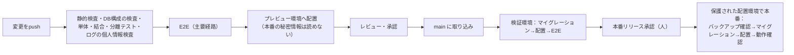

# 環境構築・デプロイ手順（草案）

- 版：v2（2026-11-17 設計レビューの指摘を反映）
- **草案**：ホスティング先（Q2）の決定後に確定する。ここでは実証期の仮定構成（Supabase 東京＋ Vercel 東京実行）を前提に、他の構成に移しても変わらない手順を中心に記載する

## 1. 環境

| 環境 | 用途 | データ | 利用者 | 保護 |
|---|---|---|---|---|
| ローカル | 開発者の作業 | 架空データ（Docker の PostgreSQL） | 開発者 | — |
| プレビュー | 変更ごとの確認 | 架空データ（変更ごとに使い捨て） | 開発者・事業責任者 | アクセス保護を有効化 |
| 検証（staging） | 受入テスト、施設への画面確認 | 架空データ | 施設長・事務長等（確認用アカウント） | 多要素認証 |
| 本番（production） | 実証・運用 | 実データ（実データ前の準備の完了後） | 施設 | 第4章 |

- 環境ごとに DB・ストレージ・認証・AI のキー・メール送信設定を**完全に分ける**
- 本番データを他の環境へ複製しない。復元訓練は本番と同じ統制の一時的な復元先で行い、確認後に破棄する

## 2. 必要な設定値（名前のみ。値は秘密情報管理に保存）

| 名前 | 内容 | 秘密 |
|---|---|---|
| `APP_ENV` | local / preview / staging / production | — |
| `APP_BASE_URL` / `FILES_BASE_URL` | アプリの URL ／ ファイル配信用の別ドメイン | — |
| `DATABASE_URL` | アプリ用DB接続（RLS を迂回できない DB 利用者） | ○ |
| `DATABASE_WORKER_URL` | ワーカー用DB接続（RLS を迂回できない） | ○ |
| `DATABASE_MIGRATION_URL` | マイグレーション用（保護された配置環境の CI のみ） | ○ |
| `CONSOLE_DATABASE_URL` | 当社管理画面用（システム専用テーブルと専用関数のみ） | ○ |
| `SUPPORT_DATABASE_URL` | 支援アクセスの閲覧用（RLS 迂回なし、読み取り専用の文脈） | ○ |
| `MAINTENANCE_DATABASE_URL` | 保守用（RLS 迂回あり）。**国内の保守専用の実行環境の秘密情報管理にだけ置く**。Web アプリ・ワーカー・CI には置かない | ○ |
| 緊急用の DB 認証情報 | 環境変数には置かない。封印保管し、2名の承認で取り出す（`operation-guide.md` 第4.2節） | ○ |
| `AUTH_*` | 認証サービスの設定 | ○ |
| `STORAGE_*` | 隔離領域・保管領域の設定 | ○ |
| `SCAN_*` | ウイルス検査の設定（TD-030） | ○ |
| `BACKUP_*` | 別アカウントのバックアップ保管先 | ○ |
| `MAIL_*` | メール送信の設定 | ○ |
| `AI_PROVIDER_*_API_KEY` | AI 事業者のキー（事業者ごと） | ○ |
| `JOB_TICK_TOKEN` | ジョブ処理の窓口の呼出し用トークン | ○ |
| `ALLOW_FICTIONAL_SEED` | 架空データ投入の許可（本番では必ず false。true だと起動しない） | — |
| `SENTRY_DSN` 等 | エラー監視（個人情報を送らない設定と一緒に） | ○ |

秘密情報はリポジトリ・ログ・画面に出さない。CI で秘密情報の混入を検査する。

## 3. ローカル開発の手順（予定）

1. Node.js 22、pnpm、Docker を用意
2. `pnpm install`
3. `docker compose up -d db`（PostgreSQL 起動）
4. `pnpm db:migrate`（マイグレーション適用。RLS ポリシー・関数を含む）
5. `pnpm db:check`（RLS 有効・権限の検査）
6. `pnpm db:seed:fictional`（架空データ投入）
7. `pnpm dev`（開発サーバ起動）
8. `pnpm test`（単体・結合）、`pnpm test:e2e`（画面）

## 4. CI/CD の流れ

- 本番の秘密情報は**保護された配置環境**（承認者付き、main ブランチからの配置のみ）でしか読めない。プルリクエストやプレビューのワークフローからは読めない
- 保守用・緊急用の DB 認証情報は CI に置かない。CI は保守専用の実行環境のプログラムを配置するだけ
- CI は介護SaaS専用のリポジトリでのみ動かす（Q1）
- マイグレーションは後方互換を原則とし、列の削除などは段階的に行う

## 5. リリース手順（本番）

1. 検証環境で E2E・受入確認が完了していることを確認
2. 時点復元が有効で、直近の別アカウントのバックアップが成功していることを確認
3. マイグレーション適用、`db:check` で RLS・権限を確認
4. アプリ配置（関数の実行リージョンが東京であることを確認）
5. 動作確認（ログイン、ダッシュボード、業務作成、提出）
6. エラー監視を30分確認
7. リリース記録（版、変更内容、実施者、承認者）を `development-progress.md` に追記

## 6. 切り戻し

- アプリ：直前の版に戻す（ホスティングの機能）
- DB：後方互換マイグレーションのため原則アプリのみ戻す。データ破損時は時点復元（`operation-guide.md` 第5章）

## 7. 定期処理

すべて DB の待ち行列（`jobs`）を使い、スケジューラから呼ばれる窓口が施設ごとに処理する。冪等（何度実行しても結果が同じ）・分割可能。

| 処理 | 頻度 | 備考 |
|---|---|---|
| ジョブ処理の窓口の呼出し | 1分ごと | 待ち行列から制限時間内に処理できる分だけ取り出す |
| 繰り返し業務の生成・欠落の検知 | 毎日深夜 | 施設ごと |
| 通知の算出 | 15分ごと | 送信は待ち行列経由。受信時間帯を考慮 |
| 退職日の処理 | 毎日0時過ぎ（施設のタイムゾーン） | ログイン停止・セッション失効・引継ぎの警告。リクエスト時の確認と二重 |
| 長期未使用の管理権限の停止 | 毎日 | 90日。施設の最後の施設長は停止せず警告 |
| ファイルのウイルス検査・移動 | アップロードごと（ジョブ） | |
| 保存期限の到来チェック | 毎日 | 通知のみ。削除は人が実行 |
| 別アカウントへのバックアップ・ファイル複製 | 毎日 | **国内の保守専用の実行環境**（app_maintenance）。成功・失敗を記録し、失敗は運用担当に通知 |
| 承認済みの削除依頼の実行 | 毎日 | 同上。`purge_records` に記録し、施設に結果を表示 |
| 操作履歴のダイジェスト | 毎日 | 法人ごと。別アカウントへ複製（PHASE 3） |
| 期限切れの二重送信防止キーの削除 | 毎日 | 24時間経過分 |

## 8. ホスティングの設定で確認すること（Q2 確定時）

- 関数の実行リージョンを東京に明示指定できるか。ミドルウェア等が国外で実行される場合の扱い
- DB の直接公開 API（Supabase の Data API 等）を無効化できるか
- セッション時間の制御、時点復元の保持期間とその費用
- ストレージの版管理の有無（ない場合は別アカウントへの複製で代替）
- ログの保存期間と、国内の長期保存先への転送方法
- 管理画面のアクセス制御（多要素認証の強制、メンバー管理、操作記録）

## 9. ドメイン・メール

- 独自ドメインを取得（製品名確定後）。ファイル配信用に別のドメイン（またはサブドメイン）を用意
- メール送信用に SPF・DKIM・DMARC を設定
