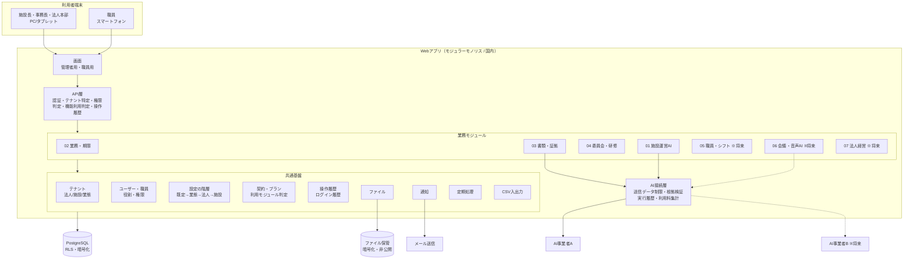
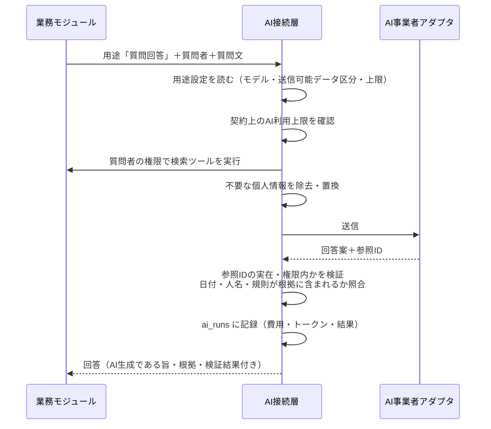

# PHASE 0 報告：既存環境の調査と推奨構成

- 作成日：2026-11-17
- 対象：AI施設運営パートナー（開発指示書 2026-11 版）
- 状態：**報告（承認待ち）**。本報告の確認後に PHASE 1（基盤設計）へ進む。コードはまだ書いていない。
- 前版：`../archive/mvp-design-v0.1.md`（2026-11-09。今回の指示書で要件が増えたため置き換え）

> 専門用語は初出時に（　）で説明する。

---

## 1. 現在のプロジェクト構成

| 項目 | 状況 |
|---|---|
| リポジトリ | `mao726/company`（GitHub） |
| 作業ブランチ | `claude/jolly-cerf-c0w9hs` |
| 既定ブランチ | `claude/major-sns-list-iktsak`（SNS運用資料のブランチ。`main` は存在しない） |
| 本プロダクトのファイル | `ai-facility-partner/docs/` に設計文書のみ（本報告、旧設計書 v0.1） |
| 同居している別事業の資料 | `docs/` 直下にSNS運用資料11本。他ブランチに「business-os」（別事業の運営メモ）、「HISTORIA AI」設計書、ポートフォリオ用サンプル |

```
company/
├── docs/                       ← SNS運用資料（本プロダクトと無関係、変更しない）
└── ai-facility-partner/
    └── docs/
        ├── archive/mvp-design-v0.1.md
        └── development/
            ├── phase0-report.md          ← 本書
            ├── development-progress.md
            └── technical-decisions.md
```

## 2. 既存機能

**なし。** アプリケーションのコード、画面、API、設定ファイル、依存関係定義（package.json 等）はどのブランチにも存在しない。
したがって「既存機能を壊さない」制約は現時点では発生せず、**作り直しによる損失もない**。今回作る基盤が最初の「既存機能」になる。

## 3. 現在の技術スタック

本プロダクト用の技術はまだ採用していない。開発環境（クラウド上の作業用コンピュータ）で使える道具は以下。

| 道具 | バージョン | 用途 |
|---|---|---|
| Node.js / pnpm | 22 / 10 | TypeScriptアプリの実行・部品管理 |
| PostgreSQL（クライアント） | 16 | データベース操作 |
| Docker | 29 | 開発用DBの起動 |
| Chromium + Playwright | 導入済み | 画面の自動テスト（スマホ表示を含む） |
| Java / Python | 21 / 3.13 | 必要時のみ |

推奨構成（第8章）の開発・テストに必要なものは揃っている。

## 4. 既存データベース構成

**なし。** DB、マイグレーション（DB構造の変更履歴）、初期データはいずれも存在しない。

## 5. 現状の問題点

| No | 問題 | 影響 | 改善案 |
|---|---|---|---|
| P-1 | 別事業（SNS、business-os 等）と同じリポジトリ | 権限管理・外注先への共有・監査で、介護SaaSと無関係な情報まで見える。SaaSとしてのコード管理に不向き | **専用リポジトリを新設**（推奨）→ 質問 Q1 |
| P-2 | 既定ブランチがSNS資料のブランチで、`main` がない | 本番に出すコードの基準が曖昧 | 専用リポジトリで `main` を基準ブランチにし、保護設定（レビュー必須）を行う |
| P-3 | 自動テスト（CI）・コード規約・`.gitignore` がない | 秘密情報の誤登録、品質低下の恐れ | PHASE 1 の最初に整備 |
| P-4 | 旧設計書 v0.1 は今回の指示書の要件を満たさない | そのまま実装すると作り直しが発生 | 第7章の問題を修正した設計で PHASE 1 を行う |
| P-5 | 開発環境の起動時スクリプトにホスト名が誤記されていた | 起動時エラー | 2026-11-09 に修正済み（次回新規セッションで最終確認） |

## 6. 今回の構想に対して不足している機能

すべて未実装。指示書の MODULE 01〜07 と、MVP（施設運営コントロールセンター）に必要な共通基盤の対応は次のとおり。

| 区分 | 必要なもの | 対象フェーズ |
|---|---|---|
| 共通基盤 | 法人・施設（テナント）、ユーザー・職員分離、役割・権限（カスタムロール）、設定の階層、契約プラン・利用モジュール判定、操作履歴、ログイン履歴、ファイル保管、通知基盤、定期処理、CSV入出力、AI接続層 | PHASE 1 設計 → PHASE 2〜3 実装 |
| MODULE 02 業務・期限 | 業務、業務テンプレート、繰り返し生成、業務依頼、提出物回収、年間カレンダー、完了承認 | PHASE 2 |
| MODULE 03 書類・証拠 | アップロード、版管理、紐付け、保存期限、アクセス権、検索 | PHASE 2（AI読み取りは PHASE 4） |
| MODULE 04 委員会・研修 | 年間計画、開催、出席、議事録、決定事項→改善タスク、研修出欠・受講確認、実施証拠 | PHASE 3 |
| MODULE 01 施設運営AI | 根拠付き質問回答、確認事項の提示、改善提案 | PHASE 4 |
| MODULE 05〜07 | 職員・シフト、会議音声AI、法人経営管理 | PHASE 7（構造のみ先に用意） |

## 7. 将来の拡張を妨げる設計上の問題（旧設計 v0.1 の点検結果）

既存コードはないため、点検対象は旧設計書 v0.1。以下は**そのまま実装すると後で作り直しになる**箇所と、その修正方針。

| No | v0.1 の設計 | 問題 | PHASE 1 での修正方針 |
|---|---|---|---|
| A-1 | 役割を4種類の固定値で持つ | カスタムロール・操作単位の権限が作れない | 「役割」「権限（操作）」「役割と権限の対応」を別テーブルに分離。権限には適用範囲（本人／部署／施設／法人）を持たせる |
| A-2 | ユーザーと所属（membership）のみ | 「ログインする人」と「職員としての情報」が混在。ログインしない職員（委員会の出席者だけ等）を扱えない | `users`（ログイン）と `staff`（職員台帳）を分離し、任意で紐付け |
| A-3 | AI は Claude 前提 | AI事業者を切り替えられない | AI接続層を独立させ、事業者ごとの「アダプタ（差し替え部品）」で接続。業務側コードは事業者名を知らない |
| A-4 | 契約・プランの概念なし | 料金や利用可能機能がコードに埋まる | `plans` / `plan_features` / `subscriptions` / `subscription_options` で管理し、機能の利用可否は共通の判定関数で確認 |
| A-5 | 設定は施設の JSON 1か所 | 法人共通ルールと施設独自ルールを両立できない | 設定を「システム既定 → 業態テンプレート → 法人 → 施設」の順に上書きする階層構造に |
| A-6 | 繰り返しルールからタスクを直接生成 | 二重生成の防止、年度ごとの履歴、テンプレートからの翌年度作成が弱い | 「業務テンプレート」「繰り返し設定（シリーズ）」「各回の業務」に分け、各回に**期間キー**（例：2026年4月分）を持たせて一意制約で二重生成を防ぐ。年度（会計年度）も保持 |
| A-7 | 施設種別（特養/老健）を列で持ち、コードで分岐する想定 | 業態追加のたびにコード修正 | 業態は「業態マスタ＋業態別テンプレート（業務・委員会・研修・カテゴリ）」で表現し、コードで業態名による分岐をしない |
| A-8 | 委員会・研修・会議の設計なし | MVP 要件を満たさない | 委員会（定義）→ 開催回 → 出席・議事録 → 決定事項 → 改善業務（業務テーブルへ連携）の流れで設計 |
| A-9 | AI実行履歴が会話単位のみ | 文書読み取り・抽出など会話以外の AI 処理の記録、利用料の確認ができない | `ai_runs`（すべての AI 実行：目的、事業者、モデル、送信データ区分、トークン数、費用、結果、承認状態）に統一 |
| A-10 | 法人横断の閲覧設計が「将来」扱い | 後から追加すると権限判定を全面修正 | 最初から権限の適用範囲に「法人」を含め、法人管理者には**明示的に許可された施設のみ**を見せる |

## 8. 推奨するシステム構成

### 8.1 基本方針

- **モジュール型の単一アプリ（モジュラーモノリス）**：1つのアプリの中を機能ごとの区画（モジュール）に分ける。サーバを機能ごとに分ける方式（マイクロサービス）より保守が簡単で、将来必要になれば区画単位で切り出せる
- **標準技術のみ**：特定クラウド専用の機能に依存しない。移行・バックアップ・復元が容易
- **二重のデータ分離**：アプリでの権限確認に加え、DB自体でも他法人・他施設の行を返さない（RLS：行レベルセキュリティ）

### 8.2 推奨技術（PHASE 1 で確定）

| 層 | 推奨 | 理由 |
|---|---|---|
| 言語 | TypeScript | 画面とサーバを1つの言語で書け、少人数で保守できる |
| Webフレームワーク | Next.js | 画面と API（サーバの窓口）を1つのプロジェクトで管理。PC・スマホ対応が容易 |
| DB | PostgreSQL（国内リージョンのマネージドサービス） | 実績がありRLSを持つ。標準SQLのため移行しやすい |
| DB操作・マイグレーション | Drizzle ORM | DB構造の変更をコードで履歴管理 |
| 認証 | マネージド認証サービス（多要素認証に対応したもの） | パスワード管理を自前で作らない |
| ファイル | S3互換ストレージ（非公開・暗号化） | 原本保管。閲覧は期限付きURLのみ |
| 定期処理 | ジョブ実行基盤（DB上のジョブキュー） | 繰り返し業務生成・期限通知 |
| AI | 自社のAI接続層 ＋ 事業者アダプタ（初期は1社） | 事業者・モデルを設定で切り替え |
| テスト | Vitest／実DB結合テスト／Playwright | 必須テスト12項目を自動化 |

### 8.3 構成図



### 8.4 拡張性のための主要な仕組み（PHASE 1 で詳細設計）

| 仕組み | 内容 | 守る方針 |
|---|---|---|
| テナント階層 | 法人 → 施設。全データに法人ID・施設ID（法人共通データは施設IDなし） | 方針4、7、データ分離 |
| 業態マスタ＋テンプレート | 特養・老健・有料等の違いをデータで表現 | 方針2、3 |
| 設定の階層 | 既定値を法人・施設で上書き。管理画面から変更 | 方針4、8 |
| 権限（操作×範囲） | 例：「業務.承認」を「部署範囲」で付与。カスタムロール可 | 第7章 |
| 機能利用判定 | 契約プランで有効なモジュール・上限を判定する共通関数 | 方針6 |
| AI接続層 | 用途ごとに「使うモデル・送信してよいデータ区分・出力形式」を設定で定義 | 方針5、12、第5章 |
| 履歴を消さない | 業務の各回は独立行、更新は操作履歴に差分記録、削除は論理削除、承認履歴は追記のみ | 方針9、監査 |
| モジュール間の連携 | 「委員会の決定事項 → 業務を作成」のように、他モジュールは公開された関数経由でのみ利用 | 方針1、10 |

### 8.5 AI接続層の考え方



- AI の出力は「提案」「下書き」「候補」として保存し、人が確認・承認するまで正式データにしない
- AI が実行できる操作は用途ごとの許可リストで制限。MVP では**登録・変更・通知・承認を AI が実行することはない**（提案のみ）

## 9. 推奨する開発順序

指示書のフェーズ順を守り、各フェーズでテストと確認を終えてから次に進む。

| 順 | フェーズ | 内容 | 完了の判断 |
|---|---|---|---|
| 0 | PHASE 0（本報告） | 調査・問題点・推奨構成 | 承認と質問への回答 |
| 1 | PHASE 1 基盤設計 | 指示書第14章の文書一式（設計書18本）を作成。DB設計、権限、AI接続、API、画面 | 設計承認 |
| 2a | PHASE 2 前半 | プロジェクト雛形、CI、テナント・認証・権限・操作履歴、**分離テスト**、法人・施設登録、ユーザー・職員管理 | 必須テスト 1〜3 合格 |
| 2b | PHASE 2 後半 | 業務・繰り返し・業務依頼・提出物回収・書類・年間カレンダー・ダッシュボード | 必須テスト 4、5、8、11、12 合格 |
| 3 | PHASE 3 | 委員会・研修、承認、通知、CSV出力 | 必須テスト 6、7、10 合格 |
| 4 | PHASE 4 | AI 施設長アシスタントほか | 必須テスト 9 合格、AI評価基準達成 |
| 5 | PHASE 5 | 実証施設で運用・効果測定 | 削減時間の測定結果 |
| 6〜7 | PHASE 6〜7 | SaaS化・拡張 | 別途計画 |

補足：
- 契約プラン基盤は PHASE 2a で**データ構造と判定関数のみ**用意し（実証施設は「全機能有効」の1プラン）、管理画面は PHASE 6 で作る
- 実在の職員情報の投入は、セキュリティチェックリストと契約（個人情報の取扱い）が整った後（PHASE 5 の前提条件）

## 10. 実装に必要な外部サービス・APIと概算費用

月額、税別、1ドル150円換算。**実証期（1法人・1施設・職員30〜80名）**の目安。料金は改定されるため、契約前に最新の公式料金で再確認する。

| 用途 | 候補 | 実証期の月額目安 | 備考 |
|---|---|---|---|
| アプリ実行 | Vercel（東京）／AWS（東京） | 3,000〜15,000円 | ホスティング先で変動（Q2） |
| DB・認証・ファイル | Supabase（東京）／AWS RDS＋Cognito＋S3 | 4,000〜20,000円 | バックアップ・時点復元を含める |
| AI（質問回答・要約） | Claude API（Sonnet 5.5：入力 $2・出力 $10／100万トークン） | 5,000〜12,000円 | 1か月1,500回・1回あたり入力8千／出力800トークン程度を想定 |
| AI（分類・抽出の軽作業） | Claude API（Haiku 5.5：入力 $0.10・出力 $0.50／100万トークン） | 数百円 | |
| AI（高精度が必要な場合） | Claude API（Opus 5.5：入力 $4・出力 $20） | 上記の約2倍 | 用途ごとに設定で切替可能にする |
| 文書読み取り（OCR） | AIの画像・PDF読み取り機能、または専用OCR | 0〜5,000円 | PHASE 4 |
| メール送信 | Amazon SES／Resend 等 | 0〜3,000円 | |
| エラー監視 | Sentry 等 | 0〜4,000円 | |
| ドメイン | — | 約200円（年2,000〜3,000円） | |
| **合計** | | **約1.5万〜6万円** | |

別途費用（月額に含まない）：
- 外部セキュリティ診断（脆弱性診断）：1回 数十万円〜（本番運用前に推奨）
- 法務確認（利用規約、個人情報の委託契約、AI事業者の規約確認）
- 将来：音声文字起こし（MODULE 06）、外部チャット通知、電子署名などは利用量に応じて追加

AI事業者について確認が必要な事項（「確認できる仕組み」として管理画面にも表示する）：データ保持期間、学習利用の有無、処理地域（国内処理の可否）、ゼロデータ保持（送信データを保存しない契約）の可否、契約条件。

## 11. 開発・運用上のセキュリティリスク

| No | リスク | 起こり得ること | 対策（PHASE 1 で設計に反映） |
|---|---|---|---|
| R-1 | テナント分離の不備 | 他法人・他施設のデータが見える | API層での自動付与＋DBのRLS＋**CI毎の分離テスト**（失敗時はリリース不可） |
| R-2 | 権限判定の漏れ | 職員が承認・削除・他職員の機密情報を閲覧 | 全APIで共通の権限判定を必須化。役割×操作の全組合せをテスト |
| R-3 | AI経由の情報漏えい | AIが質問者の権限外の情報を回答 | AIの検索は質問者の権限で実行。回答の参照IDを権限検証 |
| R-4 | AIへの過剰なデータ送信 | 不要な個人情報が外部事業者に渡る | 用途ごとに送信可能なデータ区分を定義。送信内容を記録 |
| R-5 | AIの誤回答・推測の登録 | 期限・担当者・法的義務を誤って登録 | AI出力は「提案」扱い。根拠照合。人の承認なしに確定しない |
| R-6 | プロンプトインジェクション | アップロード文書内の指示文でAIが誤動作 | 文書内容はデータとして扱い、AIに操作権限を持たせない |
| R-7 | ファイル経由の攻撃・漏えい | ウイルス、公開URLからの流出 | 種類・サイズ制限、ウイルス検査、非公開保管、期限付きURL |
| R-8 | アカウント乗っ取り | 共用PC、使い回しパスワード | 多要素認証（管理職以上は必須を推奨）、自動ログアウト、ログイン履歴、失敗回数制限 |
| R-9 | 退職者のアクセス | 退職後もログインできる | 在籍状態の停止で即時無効化。定期的な権限棚卸し |
| R-10 | 秘密情報の漏えい | APIキーがコードやログに残る | 秘密情報管理サービスに保管、コード検査、ログのマスキング |
| R-11 | 本番データの開発流用 | 実データがテスト環境に残る | 開発・テストは架空データのみ。環境ごとに完全分離 |
| R-12 | バックアップ・復元の失敗 | 障害時にデータを戻せない | 日次バックアップ＋時点復元、定期的な復元訓練（必須テスト10） |
| R-13 | 運営者（当社）による閲覧 | 施設の同意なく閲覧 | SYSTEM_ADMIN も通常は施設データ閲覧不可。障害対応時のみ施設承認＋記録付き |
| R-14 | 依存部品の脆弱性 | 外部ライブラリの欠陥 | 自動更新チェック、脆弱性スキャンをCIに組込み |
| R-15 | ガイドライン・法令の未対応 | 医療・介護分野の安全管理要件を満たさない | 厚労省「医療情報システムの安全管理に関するガイドライン」、経産省・総務省「提供事業者ガイドライン」、個人情報保護委員会・厚労省「医療・介護関係事業者ガイダンス」から設計チェックリストを作成し、**専門家の確認を受ける** |

## 12. 実証施設で確認すべき事項

業務ヒアリングで確認し、推測で設計に組み込まない。

**業務**
1. 現在の期限管理の方法（紙、Excel、ホワイトボード、介護ソフト）と、そこで管理している業務の一覧（実例を匿名化して提供いただく）
2. 行政提出物の種類・提出先・時期・担当者
3. 施設で開催している委員会・研修の一覧、頻度、議事録の様式（法令上の要否は施設・専門家が確認し、AIや開発側が判断しない）
4. 職員への業務依頼の現在の方法（口頭、紙、LINE、メール）
5. 職員から回収している提出物の種類（資格証、研修レポート、シフト希望、健康診断結果等）と回収の手間
6. 承認の流れ（誰が・何段階で承認するか、差し戻しの頻度）
7. 書類の保管場所・保存年限・閲覧制限のルール
8. 施設長・事務長が毎朝・毎週確認していること、現在困っていること上位3つ
9. 年度の区切り（4月始まりか）、業務の年間スケジュール

**利用環境**
10. 職員数、部署構成、役職（介護主任、各部署長など）
11. 職員の端末（施設支給のスマホ／私物スマホ利用可否／共用PC）
12. 職員のメールアドレス保有状況（ない場合のログイン方法）
13. 施設のネットワーク・セキュリティルール（外部サービス利用の規程、情報システム担当者の有無）
14. 普段の連絡手段（メール、LINE WORKS、Chatwork 等）
15. 使用中の介護ソフト・勤怠・会計ソフトの名称（将来連携の確認用）

**効果測定（PHASE 5 のために導入前に計測）**
16. 期限管理・提出物回収・書類探し・会議録作成に毎月かかっている時間（施設長、事務長、事務員）
17. 期限超過・提出漏れの発生件数（把握している範囲）

---

## 開発着手に必要な質問（優先度の高いもののみ）

細かな仕様は PHASE 1 と施設ヒアリングで確認する。以下は PHASE 1 を始めるために先に決めていただきたい事項。

| No | 質問 | 選択肢・私の推奨 |
|---|---|---|
| **Q1** | 開発用のリポジトリをどうするか | **推奨：介護SaaS専用のリポジトリを新設**（例：`ai-facility-partner`）。現在のリポジトリはSNS等の別事業と同居しているため。新設していただければ、本報告の文書を移します |
| **Q2** | データの置き場所と、実証期の月額インフラ予算の上限 | 推奨：データは国内に限定。実証は構築の早いマネージドサービス（Supabase＋Vercel の東京リージョン等）、本番前に AWS 東京等への移行要否を判断。予算上限（例：月3万円）を教えてください |
| **Q3** | 実証施設は決まっているか。ヒアリングはいつ頃可能か | 第12章の確認事項を使ってヒアリングしたい |
| **Q4** | 最初に使うAI事業者と、AIに送ってよい情報の範囲 | 推奨：初期は Claude API の1社、構造は切替可能に。**職員氏名をAIに送るか**（送らない場合は内部IDに置き換えて回答後に復元）を決めたい |
| **Q5** | 開発・運用の体制 | 開発は私（Claude Code）が担当する前提でよいか。コードレビュー・本番運用・障害時の連絡を担当する人はいるか（外部委託を含む） |
| **Q6** | 法人本部（理事長・CORPORATE_ADMIN）を MVP の利用者に含めるか | 推奨：データ構造は最初から対応、法人本部向け画面は PHASE 7。実証が1法人1施設のため |

---

## 次のフェーズ（PHASE 1）で作成するもの

承認と上記回答の後、指示書第14章の文書一式を作成する。

```
docs/
  business/     business-model.md, target-market.md, pricing-strategy.md
  architecture/ system-architecture.md, database-design.md, permission-design.md,
                security-design.md, ai-architecture.md, integration-design.md
  product/      product-roadmap.md, module-specifications.md, user-flows.md, screen-design.md
  development/  development-progress.md, technical-decisions.md, test-strategy.md,
                deployment-guide.md, operation-guide.md
```

`development-progress.md` と `technical-decisions.md` は今回先行して作成した。
