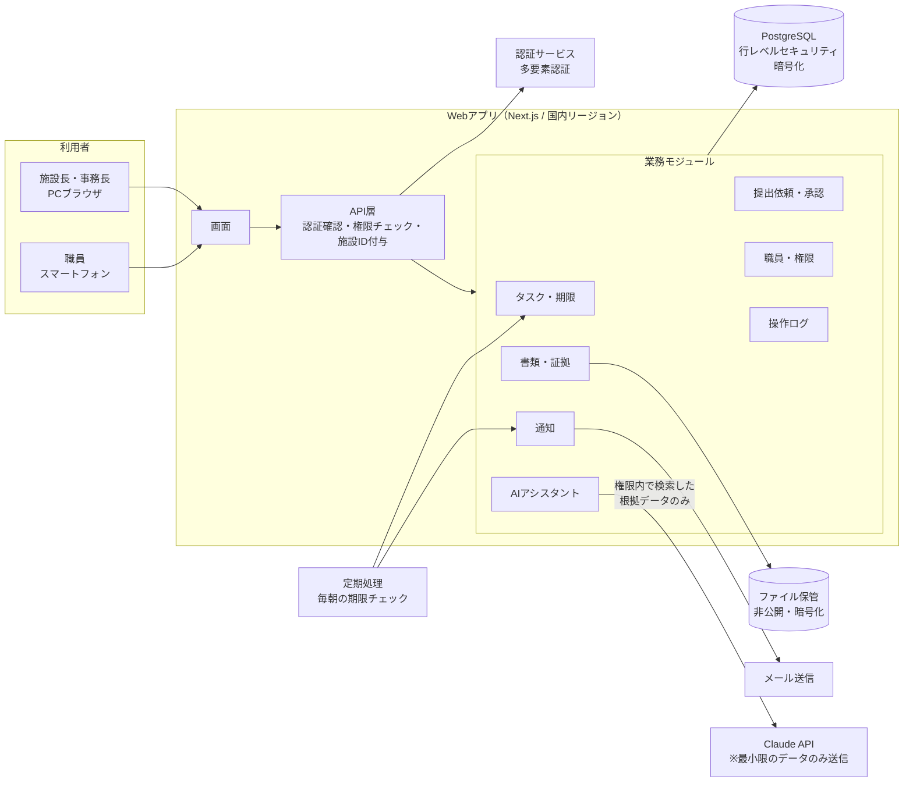
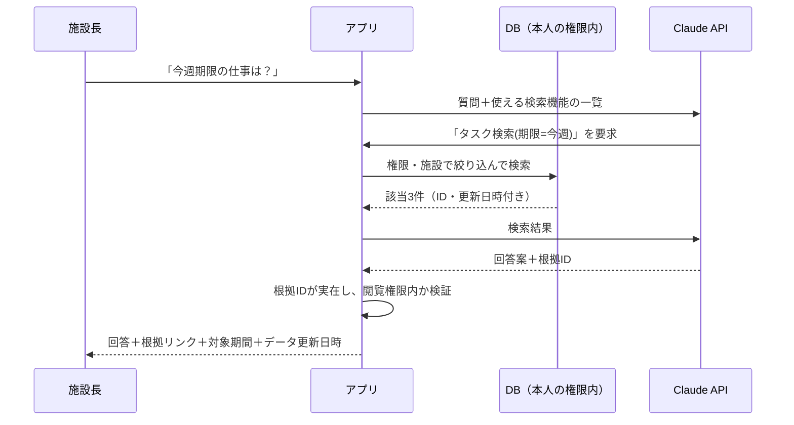
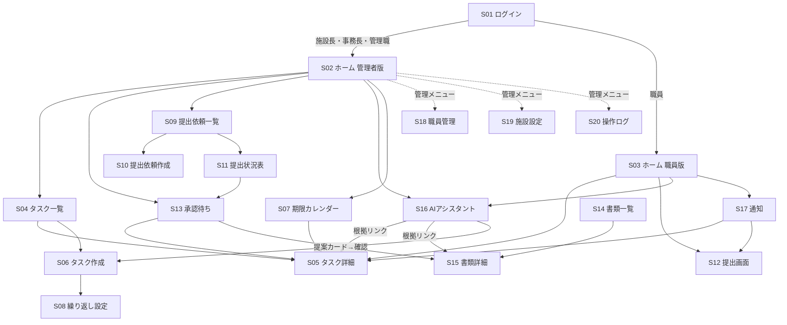

# AI施設運営パートナー MVP 設計書・開発計画（v0.1 承認待ち）

- 作成日：2026-11-09
- 状態：**設計案（未承認）**。本書の承認前に本格実装は行わない。
- 対象MVP：施設長AIアシスタント（特別養護老人ホーム1施設での実証）
- 本書で「推奨」と書いたものは提案であり、決定ではない。決定が必要な事項は「11. 未決定事項・確認事項」に一覧化している。

> 用語の補足は、初出時に（　）で簡単に説明する。末尾に用語集もある。

---

## 1. 開発環境・構成の調査結果

### 1.1 リポジトリ（`mao726/company`）の現状

| 項目 | 結果 |
|---|---|
| 既存のアプリケーションコード | **なし**（プログラム、DB定義、画面は存在しない） |
| 既存ファイル | `docs/` 配下にSNS運用関連の文書11本（約1,850行）。介護SaaSとは無関係 |
| 他ブランチ | `business-os`（別事業の運営メモ）、ポートフォリオ用サンプル等。介護・特養に関係するコードや設計は**なし** |
| 結論 | **ゼロから新規開発**。既存資産との互換性で技術を縛られる要素はない。既存のSNS文書は削除・変更しない |

本プロダクトは同リポジトリ内の新しいフォルダ `ai-facility-partner/` に置く案とした（本書もここに置いている）。
将来、関係者が増える・権限を分けたい場合は**専用リポジトリへの分離を推奨**（→未決定事項 D-14）。

### 1.2 開発用の実行環境（クラウド開発環境）

| ツール | バージョン | 用途 |
|---|---|---|
| Node.js | 22.x | Webアプリの実行・ビルド |
| npm / pnpm | 10.x | 部品（ライブラリ）の管理 |
| PostgreSQL クライアント | 16 | データベース操作 |
| Docker | 29.x | 開発用DBをローカルで起動 |
| Python | 3.13 | 補助スクリプト（必須ではない） |
| Playwright + Chromium | 導入済み | 画面の自動テスト（スマホ表示含む） |

推奨技術構成（下記）を開発・テストするのに必要な道具は揃っている。

### 1.3 環境設定で見つかった不具合（対応済み）

開発環境の「起動時スクリプト」に、通信許可リスト用と思われるホスト名（youtube.com 等）がそのまま書かれており、コマンドとして実行されてエラーになっていた。各行をコメント化して無害化する変更を適用した（この環境は通信制限なしのため許可リストへの登録は不要）。次回の新規セッション起動時に解消を確認する。

---

## 2. 推奨技術構成と理由

### 2.1 選定の考え方

1. **1人〜少人数で保守できること**（言語・部品の種類を最小に）
2. **データ分離と権限制御を、アプリとDBの二重で守れること**
3. **日本国内にデータを置けること**（医療・介護分野のガイドライン対応）
4. **特定サービスに強く依存しないこと**（後で移行できる標準技術）
5. **PC・スマホ両対応のWebアプリ**（アプリストア申請不要）

### 2.2 推奨構成（案）

| 層 | 推奨 | 説明・理由 |
|---|---|---|
| 言語 | **TypeScript**（画面・サーバ共通） | 1つの言語で画面とサーバを書けるので保守が楽。型（データの形）チェックで不具合を減らせる |
| Webフレームワーク | **Next.js** | 画面とAPI（サーバの窓口）を1つのプロジェクトで作れる。利用者が多く、人材・情報が豊富 |
| 画面部品 | Tailwind CSS + shadcn/ui | スマホ対応の画面を早く・一貫して作れる。部品はコードとして自社に取り込むため依存が軽い |
| データベース | **PostgreSQL**（国内リージョンのマネージド版） | 実績ある標準DB。**RLS**（行レベルセキュリティ＝DB自体が「他施設の行は見せない」と強制する機能）で施設分離を二重化できる |
| DB操作 | Drizzle ORM（＋マイグレーション） | DB構造の変更履歴をコードで管理でき、作り直しを防ぐ |
| 認証（ログイン） | マネージド認証（Supabase Auth 等）＋多要素認証 | パスワード管理・再設定・セッション管理を自前実装しない方が安全 |
| ファイル保管 | S3互換オブジェクトストレージ（国内・暗号化・非公開） | 提出物・証拠資料の原本を保管。閲覧は期限付きURLのみ |
| AI | **Claude API**（Anthropic） | 日本語性能と「根拠に基づく回答」の制御に適する。API経由のデータは原則学習に使われない（契約条件は要確認：D-3） |
| 検索 | PostgreSQL の全文検索（日本語対応拡張 pgroonga / pg_bigm） | 別の検索サーバを持たずに済む。ベクトル検索（意味検索）は必要になってから追加 |
| メール通知 | 送信専用メールサービス（Amazon SES / Resend 等） | リマインド・承認依頼の送信 |
| 定期処理 | DBのジョブ or クラウドのスケジューラ | 毎朝の期限チェック・リマインド生成 |
| 監視 | Sentry 等のエラー監視 | 障害の早期発見 |
| テスト | Vitest（部品）／ 実DBを使う結合テスト ／ Playwright（画面） | 「他施設のデータが見えない」ことを自動テストで毎回確認 |
| CI | GitHub Actions | コードを変更するたびにテストを自動実行 |

### 2.3 ホスティング（置き場所）の選択肢 → **決定が必要（D-1）**

| 案 | 内容 | 長所 | 短所 | 月額目安（実証期） |
|---|---|---|---|---|
| **A（実証向け推奨）** | Supabase（東京リージョン：DB・認証・ファイル）＋ Vercel（東京リージョンで実行） | 構築が最速。運用作業が少ない | 米国企業のサービス。本番での利用可否は契約・ガイドライン確認が必要 | 約1〜2万円 |
| B（本番向け候補） | AWS 東京リージョン（コンテナ実行＋RDS＋S3＋Cognito等） | 医療・介護分野での採用実績、資料が豊富。細かい統制が可能 | 構築・運用の手間とコストが増える | 約3〜6万円 |
| C | 国産クラウド（さくら等） | 国内事業者・国内法準拠を説明しやすい | マネージド機能が少なく、自前運用が増える | 要見積 |

**推奨方針**：コードは標準技術（Next.js＋PostgreSQL＋S3互換）だけで書き、特定クラウド専用機能に依存しない。実証は案Aで素早く始め、**実データ（実在の職員・入居者情報）を入れる前に**本番基盤（A継続 or B）を確定する。

### 2.4 採用しないもの（過剰な複雑化を避ける）

- マイクロサービス（機能ごとに別サーバ）：MVP規模では保守負担が大きい。代わりに**1つのアプリの中で機能ごとにフォルダ（モジュール）を分ける**
- ネイティブアプリ（iOS/Android）：当面はスマホ対応Webで十分。ホーム画面追加（PWA）で代替
- 専用の検索サーバ・ベクトルDB：データ量が少ない間は不要
- 複数AIエージェントの自律連携：MVPでは「1つのアシスタント＋決められた検索機能」のみ。将来拡張できる構造だけ用意

---

## 3. MVPシステム構成図



### 3.1 AIアシスタントの仕組み（推測させない構造）



ポイント：
- AIはDBを直接読めない。アプリが用意した**検索機能（ツール）**を通してのみ情報を得る。検索は必ずその利用者の権限と施設に絞られる
- 回答には**根拠（参照したデータへのリンク）を必須**とし、根拠のない記述は表示しない／「登録情報からは確認できません」と表示
- AIが「タスク作成」「通知送信」などを提案しても**実行はしない**。「提案カード」として表示し、利用者が確認ボタンを押して初めて実行（→ 8.4）

### 3.2 アプリ内のモジュール分割（後から機能を足しやすくする）

```
src/
  modules/
    tenancy/      法人・施設・施設種別（特養/老健）設定
    staff/        職員・部署・役職・権限
    tasks/        タスク・業務依頼・期限・繰り返し
    submissions/  提出依頼・提出物・差戻し
    approvals/    承認（タスク・提出物・書類に共通）
    documents/    書類・証拠資料・ファイル
    notifications/通知・リマインド
    assistant/    AIアシスタント（検索ツール・根拠検証）
    audit/        操作ログ
  shared/         権限チェック・施設ID付与・共通部品
```

将来の「入居判定」「事故管理」「LIFE」等は `modules/` にフォルダを追加する形で拡張し、既存部分を作り直さない。

---

## 4. データベース設計案

### 4.1 全テーブル共通ルール

| ルール | 内容 | 理由 |
|---|---|---|
| `facility_id` を必ず持つ | 施設に属する全データに施設IDを付ける | 施設ごとのデータ分離の土台 |
| RLS有効 | DBが「ログイン中の施設以外の行」を返さない | アプリに不具合があっても他施設データが漏れない二重の守り |
| ID | 推測困難なランダムID（UUID） | URLから他データを推測されにくい |
| 論理削除 | 削除は `deleted_at` に日時を入れるだけ（物理削除は保存期間経過後の別処理） | 誤削除の復旧・監査対応 |
| 作成者・更新者・日時 | `created_by / created_at / updated_by / updated_at` | 誰がいつ変えたかを追える |
| 楽観ロック | `version` 番号 | 2人が同時に編集した時の上書き事故を防ぐ |

### 4.2 ER図（主要テーブル）

```mermaid
erDiagram
  organizations ||--o{ facilities : "法人は複数施設"
  facilities ||--o{ memberships : ""
  users ||--o{ memberships : "1人が複数施設に所属可"
  facilities ||--o{ departments : ""
  memberships }o--o| departments : ""
  facilities ||--o{ tasks : ""
  tasks ||--o{ task_assignees : ""
  tasks }o--o| recurrence_rules : "繰り返し元"
  tasks ||--o{ comments : ""
  facilities ||--o{ submission_requests : ""
  submission_requests ||--o{ submission_targets : "対象職員ごと"
  submission_targets ||--o{ submissions : "提出（版）"
  submissions ||--o{ file_objects : ""
  facilities ||--o{ documents : ""
  documents ||--o{ document_versions : ""
  document_versions ||--|| file_objects : ""
  approvals }o--|| facilities : "対象：タスク/提出物/書類"
  facilities ||--o{ notifications : ""
  facilities ||--o{ ai_conversations : ""
  ai_conversations ||--o{ ai_messages : ""
  ai_messages ||--o{ ai_citations : "根拠"
  ai_messages ||--o{ ai_action_proposals : "AIの提案"
  facilities ||--o{ audit_logs : ""
```



### 4.3 テーブル定義（主要列のみ）

**組織・職員**

| テーブル | 主な列 | 説明 |
|---|---|---|
| organizations | id, name | 法人。MVPは1法人だが最初から用意（後で複数施設管理に対応） |
| facilities | id, organization_id, name, **facility_type**（tokuyo/roken）, capacity, settings(JSON) | 施設。施設種別で項目・帳票を切り替える土台 |
| users | id, auth_id, display_name, email(任意), status(有効/停止) | ログインする人。認証サービスのIDと紐付け |
| memberships | id, user_id, facility_id, **role**, position_title, department_id, employment_status, started_on, ended_on | 「どの施設で・どの役割か」。退職時は status 停止で即ログイン不可 |
| departments | id, facility_id, name | 部署（介護、看護、事務、栄養、相談員 等） |

**タスク・期限**

| テーブル | 主な列 | 説明 |
|---|---|---|
| tasks | id, facility_id, kind（task/request）, title, description, category, due_at, priority, status, requires_approval, source（manual/recurring/ai_proposal）, **basis_type**（法令/施設ルール/未確認）, basis_note, basis_document_id, basis_checked_at | タスク・業務依頼・期限。根拠種別は**推測で埋めず、未入力なら「未確認」** |
| task_assignees | task_id, membership_id, role（担当/確認者） | 担当者（複数可） |
| recurrence_rules | id, facility_id, title, rule（毎月○日・毎年○月等）, lead_days, template(JSON), active | 繰り返し業務（委員会、点検、研修）からタスクを自動生成 |
| reminders | id, task_id, remind_at, channel, sent_at | 期限○日前などの通知予定 |
| comments | id, target_type, target_id, body, created_by | タスク等へのコメント |

タスク状態：`未着手 → 対応中 → (確認待ち) → 完了` ／ `差戻し` ／ `取消`。期限超過は状態ではなく「期限＜今日 かつ 未完了」で自動判定（二重管理を避ける）。

**提出依頼・承認**

| テーブル | 主な列 | 説明 |
|---|---|---|
| submission_requests | id, facility_id, title, instructions, due_at, required_file_types, target_rule, status | 「全職員に資格証の写しを提出」等の依頼 |
| submission_targets | id, request_id, membership_id, status（未提出/提出済/差戻し/承認済/対象外）, last_reminded_at | 職員ごとの提出状況（一覧表の1マス） |
| submissions | id, target_id, version, comment, submitted_at, submitted_by | 提出1回分。再提出は版を増やし上書きしない |
| approvals | id, facility_id, target_type, target_id, step, approver_membership_id, status（依頼中/承認/差戻し/取消）, comment, decided_at | 承認記録。タスク・提出物・書類で共通利用 |

**書類・証拠**

| テーブル | 主な列 | 説明 |
|---|---|---|
| file_objects | id, facility_id, storage_key, file_name, mime_type, size, **sha256**, uploaded_by, scanned_status | 原本ファイル。ハッシュ値（ファイルの指紋）で改ざん検知 |
| documents | id, facility_id, title, category, tags, confidentiality（一般/管理職のみ/限定）, effective_on, expires_on, retention_until, owner_membership_id | 書類・証拠資料の台帳 |
| document_versions | id, document_id, version, file_id, extracted_text, note | 版管理。検索用の抽出テキスト |
| links | id, facility_id, from_type, from_id, to_type, to_id | 「このタスクの証拠はこの書類」等の紐付け（汎用） |

**通知・AI・ログ**

| テーブル | 主な列 | 説明 |
|---|---|---|
| notifications | id, facility_id, membership_id, type, title, target_type, target_id, read_at, emailed_at | アプリ内通知・メール送信記録 |
| ai_conversations / ai_messages | id, membership_id, role, content, model, tokens, created_at | AIとの会話履歴 |
| ai_citations | message_id, source_type, source_id, source_updated_at | 回答の根拠（どのデータの、いつ時点の情報か） |
| ai_action_proposals | id, message_id, action_type, payload(JSON), status（提案/実行済/却下）, decided_by, decided_at | AIの提案。人が確認して初めて実行 |
| audit_logs | id, facility_id, actor_membership_id, action, target_type, target_id, before/after(JSON), ip, user_agent, created_at | 操作ログ。**追記のみ（更新・削除不可）** |

### 4.4 老健など将来展開への備え

- `facilities.facility_type` と `settings` で、施設種別ごとに表示項目・カテゴリ・繰り返し業務テンプレートを切り替える
- 業務カテゴリやテンプレートはコードに直書きせず**マスタデータ**として持つ（特養用テンプレート、老健用テンプレート）
- 入居者（利用者）情報のテーブルはMVPでは**作らない**（→D-6）。将来追加時も `facility_id`＋RLSの同じ仕組みに乗せる

---

## 5. 利用者の役割と権限設計

### 5.1 役割（MVP案）

| 役割 | 想定 | 概要 |
|---|---|---|
| 施設長 | 施設長 | 施設内の全情報を閲覧、最終承認、職員・権限管理 |
| 事務長 | 事務長・事務責任者 | 施設長に準じる。設定・職員管理・提出依頼の作成 |
| 管理職 | 主任・各部署リーダー・相談員長 等 | 自部署のタスク・提出状況を管理、一次承認 |
| 職員 | 介護・看護・事務・栄養・リハ等の一般職員 | 自分の担当タスク・提出依頼のみ |
| 法人管理者（将来） | 法人本部 | 複数施設の横断閲覧（**明示的に許可された施設のみ**） |
| 運営者（当社） | 保守担当 | **通常は施設データを閲覧不可**。障害対応時のみ、施設の許可と記録付きで一時アクセス |

職種（介護・看護等）は「部署」で表し、権限は「役割」で決める（職種×役職の組合せ爆発を避ける）。

### 5.2 権限表（○＝可、△＝自分の担当・自部署のみ、×＝不可）

| 操作 | 施設長 | 事務長 | 管理職 | 職員 |
|---|---|---|---|---|
| ホーム（施設全体） | ○ | ○ | △（自部署） | ×（自分用ホーム） |
| タスク閲覧 | ○ | ○ | △ | △（担当分＋公開分） |
| タスク作成・業務依頼 | ○ | ○ | △（自部署宛） | △（自分用のみ） |
| タスクの削除・取消 | ○ | ○ | △（自分が作成） | × |
| 提出依頼の作成 | ○ | ○ | △（自部署宛） | × |
| 提出 | ○ | ○ | ○ | ○ |
| 提出物の承認・差戻し | ○ | ○ | △（一次承認） | × |
| 書類の登録 | ○ | ○ | ○ | △（指定カテゴリのみ） |
| 書類の閲覧 | ○ | ○ | 機密度による | 一般のみ |
| 職員・権限の管理 | ○ | ○ | × | × |
| 通知設定（施設） | ○ | ○ | × | × |
| AIアシスタント | ○ | ○ | ○（権限内データのみ） | ○（権限内データのみ） |
| 操作ログ閲覧 | ○ | ○ | × | × |

- AIは**質問した本人の権限で見えるデータだけ**を根拠にする（AI経由の情報漏れを防ぐ）
- 権限表は最初はコード内の表で管理し、施設ごとのカスタマイズが本当に必要になってから設定画面化する（→D-8）

---

## 6. 画面一覧と画面遷移図

### 6.1 画面一覧

| No | 画面 | 主な利用者 | 主な端末 | 概要 |
|---|---|---|---|---|
| S01 | ログイン／多要素認証 | 全員 | 両方 | ID・パスワード＋認証コード |
| S02 | ホーム（管理者版） | 施設長・事務長 | PC | 今日・今週・期限超過・承認待ち・提出状況サマリ・AI入力欄 |
| S03 | ホーム（職員版） | 職員 | スマホ | 自分の今日のタスク・提出依頼・通知。大きなボタン |
| S04 | タスク一覧 | 全員 | 両方 | 絞り込み（期限・担当・カテゴリ・状態） |
| S05 | タスク詳細・編集 | 全員 | 両方 | 内容・根拠・コメント・添付・承認・履歴 |
| S06 | タスク作成／業務依頼 | 管理職以上 | 両方 | 担当・期限・根拠種別・繰り返し |
| S07 | 期限カレンダー | 管理職以上 | PC | 月・週表示 |
| S08 | 繰り返し業務の設定 | 施設長・事務長 | PC | 委員会・点検・研修などの定期業務 |
| S09 | 提出依頼一覧 | 管理職以上 | PC | 依頼ごとの回収率 |
| S10 | 提出依頼の作成 | 管理職以上 | PC | 対象者（全員/部署/個人）、期限、必要ファイル |
| S11 | 提出状況表 | 管理職以上 | PC | 職員×状態の一覧、未提出者へ一括リマインド（確認後送信） |
| S12 | 提出画面 | 職員 | スマホ | 撮影・ファイル選択して提出 |
| S13 | 承認待ち一覧 | 承認者 | 両方 | 承認・差戻し（コメント必須） |
| S14 | 書類一覧・検索 | 全員 | 両方 | キーワード・カテゴリ・期限 |
| S15 | 書類登録・詳細 | 全員 | 両方 | 原本表示・版履歴・紐付けタスク |
| S16 | AIアシスタント | 全員 | 両方 | 質問・回答・根拠リンク・提案カード |
| S17 | 通知一覧 | 全員 | 両方 | 既読管理 |
| S18 | 職員一覧・登録 | 施設長・事務長 | PC | 役割・部署・在籍状態、招待 |
| S19 | 施設設定 | 施設長・事務長 | PC | 通知タイミング、カテゴリ |
| S20 | 操作ログ | 施設長・事務長 | PC | 誰が・いつ・何をしたか |
| S21 | マイページ | 全員 | 両方 | パスワード・通知設定 |

### 6.2 画面遷移図



### 6.3 UIの基本方針

- スマホは**下部タブ4つ**（ホーム／タスク／提出／AI）に絞る。片手操作できるボタンサイズ
- ホームは「今日やること」を最上部に。数字だけでなく**件数をタップすると該当一覧へ**
- 未入力・データなしは「0件」と「未登録」を区別して表示（推測で埋めない）
- 文字サイズ大きめ、専門用語は施設で使う言葉に合わせる（実証施設でヒアリング）

---

## 7. 機能ごとの開発優先順位

評価：難易度（低・中・高）、価値＝施設長・事務長の負担軽減効果

| 優先 | 機能 | 難易度 | 価値 | 30日内 | 備考 |
|---|---|---|---|---|---|
| **P0** | ログイン・施設分離・役割権限 | 中 | 前提 | ○ | 全機能の土台。分離テスト必須 |
| **P0** | 職員・部署・役割管理 | 低 | 前提 | ○ | CSV一括登録は P1 |
| **P0** | 操作ログ | 低 | 前提 | ○ | 後付けすると漏れが出るため最初から |
| **P0** | タスク・業務依頼・期限 | 中 | 高 | ○ | 中核機能 |
| **P0** | ホーム（今日・今週・超過・承認待ち） | 低〜中 | 高 | ○ | タスク・承認データの集計表示 |
| **P0** | 提出依頼・提出状況表・提出（スマホ） | 中 | 高 | ○ | 回収作業の削減効果が大きい |
| **P0** | 承認・差戻し | 中 | 高 | ○ | 提出物・タスクで共通化 |
| **P1** | 書類・証拠の登録と検索（キーワード） | 中 | 高 | ○ | OCRは含まない |
| **P1** | リマインド（アプリ内＋メール） | 中 | 高 | ○ | 送信は設定ルールに基づく自動、一括送信は確認後 |
| **P1** | AIアシスタント（閲覧のみ・根拠付き回答） | 中〜高 | 高 | ○（試行版） | 評価テストに合格したら実証施設へ公開 |
| P1 | 繰り返し業務（委員会・点検・研修） | 中 | 高 | △ | テンプレートは施設ヒアリング後 |
| P2 | AIの提案（文章からタスク・期限案を作成→確認して登録） | 中 | 高 | × | P1のAI評価後 |
| P2 | PDF・画像の文字読み取り（OCR） | 中〜高 | 中 | × | 書類検索の強化 |
| P2 | 職員CSV取込、帳票出力 | 低 | 中 | × | |
| P2 | 毎朝の自動レポート（メール） | 中 | 高 | × | ホームの内容をAIが要約 |
| P3 | LINE WORKS／Chatwork等の外部チャット通知 | 中 | 中 | × | 施設の利用ツール次第（D-9） |
| P3 | 老健テンプレート、複数施設・法人本部画面 | 中 | — | × | 構造のみ先に用意 |
| P3 | 前回会話で挙がった介護業務支援（入居判定、ケアプラン、LIFE、請求確認等） | 高 | — | × | 入居者の要配慮個人情報を扱うため、セキュリティ体制確立後 |

---

## 8. セキュリティ設計

### 8.1 準拠を確認するガイドライン（実装前に最新版を確認）

- 厚生労働省「医療情報システムの安全管理に関するガイドライン」（第6.0版）
- 経済産業省・総務省「医療情報を取り扱う情報システム・サービスの提供事業者における安全管理ガイドライン」（当社はこの「提供事業者」に該当する可能性が高い）
- 個人情報保護委員会・厚生労働省「医療・介護関係事業者における個人情報の適切な取扱いのためのガイダンス」
- 個人情報保護法（要配慮個人情報、委託先の監督、越境移転）

→ これらから**設計チェックリスト**を作成し、実データ投入前に全項目を確認する（Week 1〜4で作成）。

### 8.2 主要対策

| 分類 | 対策 |
|---|---|
| 通信 | HTTPS（TLS1.2以上）のみ。HSTS |
| 保存データ | DB・ファイル保管・バックアップを暗号化。ファイルは非公開、閲覧は数分で失効するURL |
| データ所在 | DB・ファイル・バックアップは国内リージョン（D-1, D-2） |
| 施設分離 | ①API層で施設IDを自動付与 ②DBのRLSで強制 ③**他施設データにアクセスできないことを自動テストでCI毎に検証** |
| 認証 | 多要素認証（管理職以上は必須、職員は施設判断：D-5）。パスワード要件、ログイン失敗回数制限 |
| セッション | 一定時間無操作で自動ログアウト。共用PCを想定した短めの設定 |
| 権限 | 役割ベース。全APIで権限チェック（画面で隠すだけにしない） |
| 退職・異動 | 在籍状態を停止すると即時ログイン不可・セッション破棄 |
| 操作ログ | 閲覧・作成・変更・削除・承認・AI生成・ログインを記録。追記専用、改変不可 |
| ファイル | 種類・サイズ制限、ウイルススキャン（P1で導入）、ハッシュ値保存 |
| 秘密情報 | APIキー等はコードに書かず、クラウドの秘密情報管理機能に保管 |
| バックアップ | 日次自動＋時点復元（7日以上）。四半期ごとに復元訓練 |
| 開発データ | **実在の職員・入居者情報を開発・テストに使わない**。架空データのみ |
| 運営者アクセス | 当社担当者は通常アクセス不可。障害時は施設承認＋記録付きの一時アクセス |

### 8.3 AIに関する安全設計

| 要件 | 実装方法 |
|---|---|
| 登録情報を根拠に回答 | AIはアプリの検索ツール経由でしか情報を得られない |
| 情報がなければ明示 | 検索結果0件時は「登録情報からは確認できません」と定型表示。AIの自由作文で埋めさせない |
| 推測で期限・担当者・規則を作らない | 回答中の日付・人名・規則が根拠データに含まれるかをアプリ側で照合。不一致は表示しない／警告 |
| 根拠の表示 | 参照データへのリンク、対象期間、データ更新日時を回答の下に必ず表示 |
| 権限の継承 | 検索は質問者本人の権限で実行 |
| AIへの送信範囲 | 回答に必要な検索結果のみ送信。マイナンバー等は送らない。送信内容はログに記録 |
| 学習利用 | API利用規約上の学習利用なし・保存期間を契約で確認し、施設へ書面で説明（D-3） |
| 操作の確認 | 変更・削除・通知・承認はAIが直接実行しない。提案カード→利用者が確認→実行→ログ |
| 失敗時 | AIが止まっても全業務は通常画面で継続可能 |
| 品質確認 | 架空データの「質問と正解」集（50問程度）で、根拠付き回答率・推測ゼロを毎回自動評価 |

### 8.4 「確認が必要な操作」の扱い

| 操作 | 確認方法 |
|---|---|
| 削除・取消 | 確認ダイアログ＋理由入力（論理削除） |
| 一括通知・リマインド送信 | 送信先と文面のプレビュー→送信ボタン |
| 承認・差戻し | 承認者本人の操作のみ。AIによる代行承認は不可 |
| AIの提案（タスク作成等） | 提案内容を編集可能な形で表示→「登録する」で実行 |
| 権限変更 | 施設長・事務長のみ。変更前後をログ記録 |

---

## 9. 開発工程とテスト計画

### 9.1 開発の進め方

1. **業務ヒアリング**（実証施設）：現在の期限管理・提出物回収・承認の流れ、使用中の紙・Excel・ソフト、職員のスマホ利用状況
2. **小さく作って見せる**：1週間単位で動く画面を見ていただき、修正
3. **架空データで実証準備**：架空の施設・職員・タスクで全機能を確認
4. **セキュリティチェックリスト確認**→実データ投入可否を判断
5. **実証運用**：施設長・事務長から開始し、職員に段階展開

### 9.2 環境

| 環境 | 用途 | データ |
|---|---|---|
| 開発 | 開発者の作業用 | 架空データ |
| 検証（ステージング） | 施設への画面確認・受入テスト | 架空データ |
| 本番 | 実証運用 | 実データ（チェックリスト合格後） |

### 9.3 テスト計画

| テスト種類 | 内容 | 実行タイミング |
|---|---|---|
| 単体テスト | 権限判定、期限計算（繰り返し・祝日）、状態遷移 | コード変更毎（CI） |
| 結合テスト（実DB） | **施設分離テスト**：施設Aのユーザーで施設Bの全種類データの取得・更新・削除を試み、すべて拒否されることを確認 | コード変更毎（CI、失敗時はリリース不可） |
| 権限テスト | 役割×操作の全組合せが権限表どおりか | コード変更毎 |
| 画面テスト（E2E） | スマホ・PC表示で主要業務（依頼→提出→承認）を通しで操作 | 毎日／リリース前 |
| AI評価テスト | 質問と正解集：根拠付き回答、データなし時の「確認できません」、推測なし、権限外データ非表示 | AI関連変更毎 |
| セキュリティテスト | 依存部品の脆弱性チェック、主要な攻撃パターン（なりすまし、ID書換え）の確認 | 週次／リリース前 |
| 受入テスト | 施設長・事務長による業務シナリオ確認 | 各週末デモ・実証前 |
| 復元訓練 | バックアップからの復元 | 本番開始前・四半期 |

完成の定義：テスト合格＋画面で実際に動作＋施設の確認。**画面だけ・ダミーデータ表示だけの機能は完成扱いにしない**。各機能の実装状況は機能一覧に「未着手／実装中／検証中／完成」で正直に記載する。

---

## 10. 今後30日間の開発ロードマップ（承認後に開始）

| 期間 | 開発 | 事業側・施設側で必要なこと | 成果物（確認できるもの） |
|---|---|---|---|
| **Week 1**（Day 1–7） | 決定事項の反映、プロジェクト雛形、CI、ログイン、施設・役割・RLS、**施設分離テスト**、操作ログ基盤 | 未決定事項（11章）の回答、実証施設のヒアリング日程 | ログインして施設ごとに分かれた空のホームが動く。分離テストが自動実行される |
| **Week 2**（Day 8–14） | 職員・部署・役割管理、タスク・業務依頼・期限、ホーム（今日／今週／超過／承認待ち）、スマホ表示 | 業務ヒアリング（期限業務・提出物の実例を匿名化して共有） | タスクを作り、担当者のスマホに表示、ホームに集計される |
| **Week 3**（Day 15–21） | 提出依頼・提出状況表・スマホ提出、承認・差戻し、書類登録・検索、アプリ内通知・メールリマインド | 提出物・承認フローの確認、検証環境での操作確認 | 「依頼→スマホで提出→承認」が通しで動く |
| **Week 4**（Day 22–30） | AIアシスタント（閲覧のみ・根拠付き）、AI評価テスト、セキュリティチェックリスト初版、検証環境で総合テスト、操作マニュアル初版 | 架空データでのデモ確認、実データ投入可否の判断材料の確認 | 施設長がAIに質問し、根拠付きで回答される。実証開始判断資料 |

30日時点の到達目標：**架空データで、MVPの主要業務（タスク・期限・提出・承認・書類・AI質問）が一通り動く検証版**。実データでの運用開始は、セキュリティチェックリストと契約関係（D-11）が整ってから。

リスク：ヒアリング日程・決定事項の回答が遅れると Week 2 以降がずれる。AIの品質基準未達の場合、AIはWeek 4では施設に公開せず改善を続ける。

### 10.1 費用概算（月額、実証期・1施設、税別・為替1ドル150円換算、要最新確認）

| 項目 | 目安 |
|---|---|
| アプリ実行（Vercel Pro 等） | 約3,000円 |
| DB・認証・ファイル（Supabase Pro 等） | 約4,000〜8,000円 |
| AI利用料（Claude API、職員30名・質問数百回/月想定） | 約3,000〜15,000円 |
| メール送信 | 0〜3,000円 |
| エラー監視・ドメイン等 | 0〜2,000円 |
| **合計** | **約1万〜3万円**（案A）／案Bは約3万〜6万円 |

開発者の人件費、セキュリティ診断（外部、数十万円〜）、法務確認費用は含まない。

---

## 11. 未決定事項・確認事項（ご判断ください）

| No | 項目 | 選択肢・推奨 | 決める人 | 期限目安 |
|---|---|---|---|---|
| D-1 | ホスティング先 | 推奨：実証は案A、実データ前に本番基盤を確定 | 事業責任者 | Week 1 |
| D-2 | データを国内に限定するか | 推奨：DB・ファイル・バックアップは国内必須 | 事業責任者 | Week 1 |
| D-3 | AI事業者と送信データ範囲 | 推奨：Claude API。学習利用なし・保存期間の条件を確認し施設へ説明。送る情報の範囲（職員氏名を含めるか等） | 事業責任者＋施設 | Week 3 |
| D-4 | 実証施設の確定と窓口 | 施設名、施設長・事務長の協力範囲、職員数 | 事業責任者 | Week 1 |
| D-5 | 職員のログイン方法 | 個人メールなし職員への対応（ID＋パスワード／施設発行アカウント）、私物スマホ利用可否、多要素認証の範囲 | 施設 | Week 1 |
| D-6 | MVPで入居者（利用者）情報を扱うか | **推奨：扱わない**（職員・業務情報のみ）。書類に入居者情報が含まれる場合の運用ルールが必要 | 事業責任者＋施設 | Week 1 |
| D-7 | 役割の種類・名称 | 施設長／事務長／管理職／職員の4種でよいか、施設の実際の職制 | 施設 | Week 2 |
| D-8 | 権限を施設ごとに変更できる必要があるか | 推奨：MVPは固定権限表 | 事業責任者 | Week 2 |
| D-9 | 通知手段 | メールのみ／LINE WORKS等のチャット。職員が普段使う連絡手段 | 施設 | Week 2 |
| D-10 | 承認の段数 | 1段（施設長）／2段（管理職→施設長）。対象ごとに違うか | 施設 | Week 2 |
| D-11 | 契約・個人情報の取扱い | 利用規約、個人情報取扱い（委託）契約、秘密保持、障害時の責任範囲 | 事業責任者（法務） | 実データ前 |
| D-12 | データ保存期間と退職者データ | 書類・ログ・提出物の保存年数 | 施設＋事業責任者 | Week 4 |
| D-13 | 開発体制・予算 | 開発担当（内製／外注）、月額費用の上限、外部セキュリティ診断の実施時期 | 事業責任者 | Week 1 |
| D-14 | リポジトリ | 現在の `mao726/company` 内で開発するか、専用リポジトリに分けるか（推奨：専用） | 事業責任者 | Week 1 |
| D-15 | 製品名・ドメイン | 「AI施設運営パートナー」の正式名称、URL | 事業責任者 | Week 4 |
| D-16 | 既存ソフトの把握 | 実証施設で使用中の介護ソフト・勤怠・会計（将来連携のため名称だけ確認） | 施設 | Week 2 |
| D-17 | 施設で管理している期限業務の実例 | 委員会、研修、点検、行政提出等の一覧（法令根拠は施設・専門家と確認し、推測で登録しない） | 施設 | Week 2 |

---

## 用語集

| 用語 | 説明 |
|---|---|
| MVP | 最小限の実用版。まず使ってもらい、改善するための最初の製品 |
| SaaS | インターネット経由で使うソフト。施設側でのインストール不要 |
| API | プログラム同士がデータをやり取りする窓口 |
| マルチテナント | 1つのシステムを複数施設で共有しつつ、データは施設ごとに分ける方式 |
| RLS（行レベルセキュリティ） | データベース自体が「見てよい行」だけを返す仕組み |
| ORM・マイグレーション | プログラムからDBを扱う道具と、DB構造の変更手順を記録する仕組み |
| 多要素認証 | パスワード＋スマホの確認コードなど、2つ以上の方法で本人確認 |
| CI | コード変更のたびに自動でテストを実行する仕組み |
| E2Eテスト | 実際の画面操作を自動で再現して確認するテスト |
| ハッシュ値 | ファイルの「指紋」。1文字でも変わると値が変わるため改ざん検知に使う |
| 論理削除 | データを消さずに「削除済み」の印を付けること |
| リージョン | クラウドのデータセンターの所在地域 |
| PWA | Webアプリをスマホのホーム画面に追加し、アプリのように使える仕組み |
