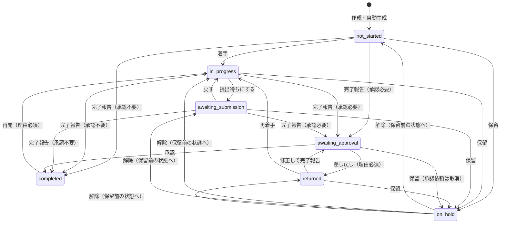
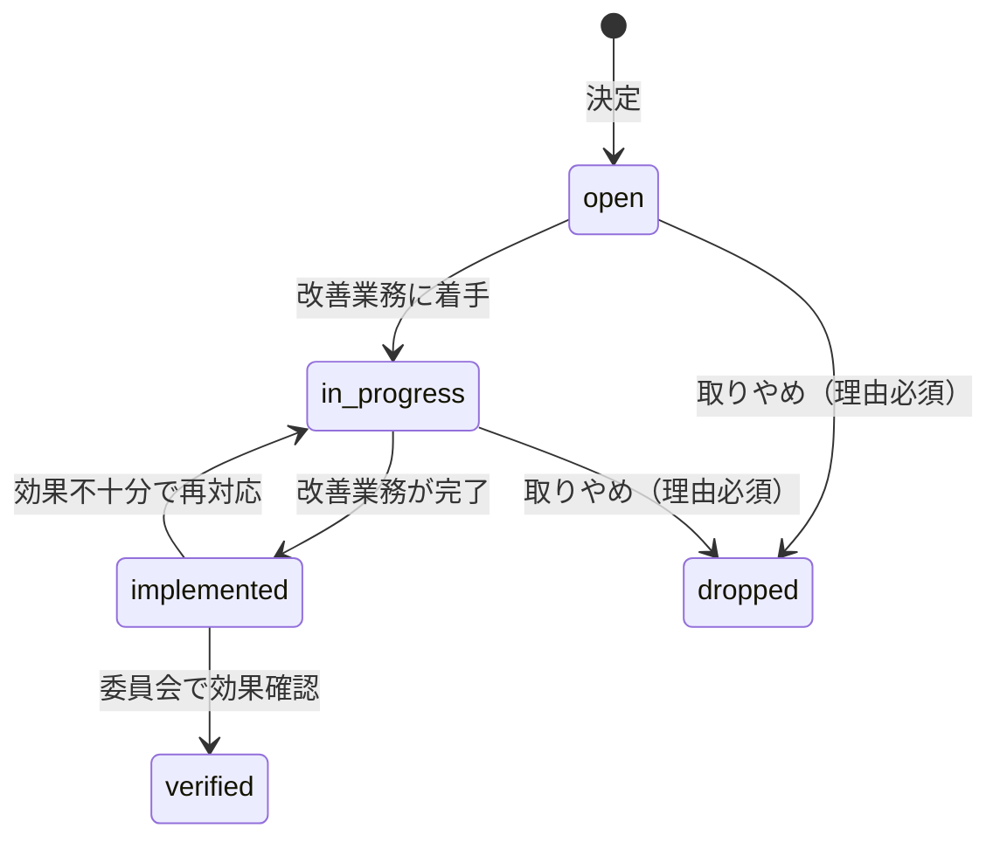

# モジュール仕様

- 版：v2（2026-11-17 設計レビューの指摘を反映）
- 各モジュールの「作る範囲」「作らない範囲」「状態遷移」「業務ルール」を定義する
- **【要確認】** は実証施設のヒアリングで確定する項目、**【D-n】** は事業責任者の判断待ち（`development/open-decisions.md`）
- 権限の詳細は `architecture/permission-design.md`、テーブルは `architecture/database-design.md`

---

## 共通基盤

| 機能 | フェーズ | 内容 |
|---|---|---|
| 法人・施設登録 | 2a | 当社が管理画面で法人・施設を作成し、施設長を招待。セルフ登録は PHASE 6 |
| 職員台帳 | 2a | 氏名、職員番号、所属（施設・部署・役職・職種・期間）、雇用形態、在籍状態。CSV 取込（初回＋**月1回の差分取込**） |
| ユーザー（ログイン） | 2a | 職員を招待してログイン可能にする。ログインしない職員も台帳登録可。ログイン方式は【D-2】 |
| 役割・権限 | 2a | 標準6役割と割当（割当の規則つき）。カスタムロール作成は PHASE 3 |
| 設定 | 2a | 施設設定（年度開始月、週の開始曜日、承認の既定、受信時間帯）。設定定義表に登録した項目のみ |
| 契約判定 | 2a | プラン・権利・契約と判定関数。実証は「全機能有効」の実証プラン1件。オプション・個別条件は PHASE 6 |
| 操作履歴 | 2a | 記録は最初から。閲覧画面は PHASE 3 |
| 利用記録 | 2a | 効果測定用（日次の利用者数、画面別の利用、通知から対応までの時間、代理登録率） |
| 通知 | 2b | アプリ内通知。メールは PHASE 3。アプリ外への通知手段は【D-1】 |
| CSV | 2b〜3 | 職員・年間業務の取込（2b）、各種出力（3） |
| 支援アクセス | 2a | 当社の障害対応アクセスの申請・承認・期限・記録 |

### 退職・異動時の処理

1. 管理者が職員の退職日（または異動）を登録
2. **退職日の翌日0時**（施設のタイムゾーン）以降はログイン不可（リクエストごとの確認と定期処理の二重）。懲戒・紛失時は「即時停止」で直ちに失効
3. 引継ぎ対象の一覧を表示し、**引継ぎ先の指定を管理者に求める**（自動で付け替えない）。対象：
   - 未完了業務の主担当・副担当
   - 年間業務（シリーズ）の既定の担当者・承認者
   - 承認者になっている承認依頼
   - 提出依頼の確認者
   - 書類の管理者
   - 委員会の委員長・書記・委員
   - 決定事項の担当者
   - 役割の割当
4. 引継ぎが終わるまで、ダッシュボードの自動チェックに「退職・停止した職員の担当が残っています」と表示。繰り返し生成は退職者を担当にせず「担当者未設定」で作る
5. 過去の業務・提出物・承認履歴は退職者名のまま保存

---

## MODULE 02：業務・期限管理

### 範囲

| 機能 | フェーズ | 備考 |
|---|---|---|
| 業務の登録・編集・取消 | 2b-1 | |
| 業務発生区分（毎日〜年次・臨時） | 2b-1 | |
| 繰り返し業務の自動生成（暦ベース） | 2b-1 | 完了日ベース（前回完了から○日後）は PHASE 3 |
| 年間業務の登録（シリーズ）・ルール変更（境界日指定） | 2b-1 | |
| 業務テンプレート・翌年度作成 | 2b-1 | 法人共通テンプレートの編集は PHASE 7。特養の標準テンプレートの作成は【D-9】 |
| 業務依頼 | 2b-1 | |
| 完了承認（1段階） | 2b-1 | 多段階承認は PHASE 3 |
| 行政提出物の管理 | 2b-1 | 提出先・提出方法・受付番号・控え（第「行政提出」節） |
| ダッシュボード | 2b-1 | |
| 提出物回収 | 2b-2 | 代理登録・対象外・データ区分を含む |
| 年間カレンダー（月・週・年） | 2b-2 | 外部カレンダー同期は将来 |
| リマインド | 2b-1（アプリ内） | メールは PHASE 3、アプリ外通知は【D-1】 |
| 運営指導への備えの一覧・出力 | 【D-7】 | MVP に含めるか判断待ち |

### 業務のステータス遷移

- 「完了報告」は**必須の必要提出物がそろっている場合だけ**可能。承認が必要な業務は「完了」に直接移せない（サーバで拒否）
- 承認待ちの業務を保留にした場合、保留を解除すると「進行中」に戻り、改めて完了報告する
- 「例外完了」（施設長・事務長のみ、理由必須）は、どの未完了状態からでも「完了」にする。業務詳細とダッシュボードに「例外完了」と表示
- 「取消」は、完了以外のどの状態からでも可能（理由必須）。状態ではなく取消の記録として残す
- 各操作に必要な権限は `permission-design.md` 第7章

| 状態 | 表示名 | 意味 |
|---|---|---|
| not_started | 未着手 | |
| in_progress | 進行中 | |
| awaiting_submission | 提出待ち | 担当者が手動で設定。必要提出物や他の職員からの提出を待っている状態。【要確認】施設での使い方 |
| awaiting_approval | 承認待ち | 完了報告済み、承認者の判断待ち |
| returned | 差し戻し | 承認者が差し戻した |
| completed | 完了 | |
| on_hold | 保留 | 一時停止。期限超過には数え、「うち保留中」として併記 |

### 業務ルール

| ルール | 内容 |
|---|---|
| 職員の操作 | 職員画面の基本操作は「完了報告」の1つ（未着手からも可能）。着手・提出待ちは任意 |
| 毎日の業務 | 職員画面では「今日のチェックリスト」としてまとめ、1タップで完了報告。担当は部署（例：介護部の当日の担当者）にもでき、部署の誰かが完了すると、完了した人を記録【要確認：施設の運用】 |
| 承認の要否 | 既定は**カテゴリで決める**（行政提出：必要、その他：不要。施設設定で変更）。業務ごとに変更可 |
| 承認者 | 業務 → シリーズ → カテゴリ → 施設設定の順に決定し、承認依頼の作成時に職員に確定。既定は「事務長、事務長本人の業務は施設長」【要確認】 |
| 自己承認 | 既定は不可（次の承認者に回す）。施設長本人の業務で他に承認者がいない場合のみ、自己承認として記録・表示 |
| 承認後の変更 | 承認後に内容（本文・完了報告・証拠の版・必要提出物）が変わったら「承認後に変更あり」と表示し、再承認を依頼 |
| 担当者未設定 | 主担当（職員または部署）がいない業務はダッシュボードで警告 |
| 根拠 | 行政提出・委員会・研修カテゴリの業務は根拠種別の入力を促し、未入力は「未確認」と表示 |
| 履歴 | 各回の業務は独立した記録。シリーズの変更は新シリーズとして作り、過去の回は変更しない |

### 繰り返し生成

`database-design.md` 第5章のとおり。要点：
- 「本来の発生日」ごとに1件（取消済みも含めて一意）。人が取り消した回は復活しない。「毎週月・木」のような1期間に複数回の業務もすべて作られる
- 土日祝は期限日だけを前後に移す（シリーズごとに「そのまま／前営業日／翌営業日」）
- ルール変更は境界日を指定して新シリーズを作る。旧シリーズの境界日以降の未着手の回は取消
- 生成処理は欠落も検知し、作れない理由があれば管理者に警告
- 生成の先行日数：毎日型7日、毎週型14日、毎月型以上60日（シリーズごとに変更可）

### 業務依頼

- 作成：依頼タイトル、依頼内容、担当者（主・副、職員または部署）、期限、添付、完了条件、承認要否
- 依頼された職員：自分の画面で確認（**既読を記録**）→ 完了報告（添付可）。進捗コメントは任意
- 依頼者：「自分が出した依頼」画面で進捗確認、催促（送信内容を確認して送信）、承認・差し戻し

### 行政提出

行政提出カテゴリの業務には、次の項目を持たせる（`task_gov_submissions`）。

| 項目 | 内容 |
|---|---|
| 提出先 | 指定権者（都道府県・市町村）、国保連など |
| 提出方法 | 電子申請・届出システム／郵送／持参／メール／その他。電子申請の場合は GビズID 等の準備を事前の業務として登録することを推奨 |
| 受付番号・提出日 | 提出後に記録 |
| 控え | **提出した書類の控え（または受付の記録）を必須の必要提出物にする**（運営指導で「提出した証拠」を示せるようにする） |
| 期限の再確認 | 翌年度作成時に「期限の再確認が必要」となり、確認しないと確定できない（期限は通知等で毎年変わることがあるため） |

### 提出物回収

| 項目 | 仕様 |
|---|---|
| データ区分 | 依頼作成時に**必須**。C4（健康診断結果など）は「ファイルを受け取らず、提出済み・確認済みだけを記録」に強制。マイナンバーを含む書類は依頼できない。C3 の扱いは【D-8】 |
| 対象者 | 全員／部署／職種／役職／個別指定。**依頼作成時に対象者を確定して保存**。後からの追加は手動（記録付き） |
| 提出 | 本人がスマホで撮影・ファイル選択して提出。再提出は版を追加。通信失敗時は端末に下書きを保持して再送 |
| 代理登録 | 紙で受け取った場合などに、管理者が本人に代わって提出を記録（「代理登録」と表示、登録者・理由を記録） |
| 期限後の提出 | 既定で受付（「遅延」と表示）。施設設定で締切後の受付停止も可 |
| 確認 | 確認者が承認・差し戻し（理由必須）。承認の記録は共通の承認テーブル |
| 対象外 | 休職者などを理由付きで対象外に設定 |
| 閲覧 | 提出物は本人・確認者・確認権限の範囲内の人のみ。書類の一覧・検索には出ない。確認者が「書類として保管」を選んだ場合のみ「限定」書類として複製 |
| 通知 | `database-design.md` 第4.10節の既定の通知表 |
| ログインしない職員 | 提出状況表で「アカウントなし」を表示。紙での回収と代理登録を案内。**未提出者一覧の印刷**（掲示・朝礼用）を用意 |

### 年間カレンダー

- 月表示・週表示：業務・委員会・研修の予定と期限。状態を色＋文字で表示
- 年表示：12か月×カテゴリの件数一覧（未完了・完了・超過）。**印刷用の年間行事表**を出力
- 絞り込み：部署、カテゴリ、担当者

### 年度更新

`database-design.md` 第7章のとおり。行政提出は期限の再確認が必須。

---

## MODULE 03：書類・証拠管理

| 機能 | フェーズ | 備考 |
|---|---|---|
| アップロード（PDF・Word・Excel・JPEG・PNG） | 2b-2 | 二段階の保管・検査。マクロ付き形式は拒否 |
| カテゴリ・アクセスレベル・データ区分 | 2b-2 | データ区分は必須 |
| 版管理（新しい版の追加） | 2b-2 | |
| 業務・委員会・研修・決定事項との紐付け | 2b-2 | |
| 保存期限 | 2b-2（入力・到来通知） | 自動削除はしない（人が確認して削除） |
| 検索 | 2b-2：書類名・カテゴリ・紐付け先・期間 | 本文検索・AI 分類・抽出は PHASE 4 |
| プレビュー | 2b-2：PDF・画像 | Word・Excel はダウンロード |

### 書類のアクセスレベル

| レベル | 閲覧できる人 |
|---|---|
| all_staff | 施設の全職員（`document.read`） |
| managers | 管理職（`document.read_managers`） |
| restricted | 閲覧者リストに入っている人・役割・部署のみ（施設長でもリストになければ不可） |

### アップロードの流れ

1. ファイル選択 → 形式・サイズ確認 → 「入居者の氏名・病状、マイナンバーを含む書類はアップロードしないでください」の確認
2. 隔離領域へアップロード（期限付きアップロードURL）
3. ウイルス検査・位置情報の除去 → 保管領域へ移動。それまでは「確認中」で閲覧不可。問題があれば隔離のまま管理者に通知
4. カテゴリ・データ区分・アクセスレベル・紐付け先・保存期限を入力して登録

---

## MODULE 04：委員会・研修管理（PHASE 3）

### 委員会

| 機能 | 内容 |
|---|---|
| 委員会の定義 | 名称、目的、開催頻度、担当部署（任意）、委員（委員長・書記・委員）、**関連する要件（複数可：合同開催に対応）** |
| 年間計画 | 開催予定を年間業務（シリーズ）として登録し、開催準備の業務を自動生成 |
| 開催記録 | 開催日、場所、出席者（**職員または外部の出席者**：嘱託医・協力医療機関など、氏名・所属を記録）、議事録（版管理・承認） |
| 前回の決定事項 | 次回開催時に「前回までの未完了・効果確認待ちの決定事項」を自動で一覧表示 |
| 決定事項 | 内容、改善内容、担当者、期限 → 改善業務として MODULE 02 に作成（イベント経由） |
| 実施証拠 | 議事録・写真・資料を紐付け |
| 職員への周知 | 委員会の結果の周知・既読確認は【D-7】（提出物回収の「確認のみ」型の流用を想定） |
| 委員長・書記の権限 | 役割とは別に、その委員会に限った権限を付与（一般職員が委員長・書記を務める場合に対応） |
| 一般職員の閲覧 | 委員・出席者は、参加した開催の議事録・決定事項を閲覧できる |

決定事項の状態（PDCA）：

委員会の実施状況の表示：
- 開催：予定 → 開催済み → 議事録承認済み
- 改善：決定事項の状態ごとの件数
- **「実施完了」＝開催済み かつ 議事録承認済み かつ 決定事項がすべて「効果確認済み」または「取りやめ」**。「実施済み」が残る場合は「効果確認待ち」と表示。開催しただけでは完了と表示しない

### 研修

| 機能 | 内容 |
|---|---|
| 研修計画 | 年度、研修名、カテゴリ、対象者（全員・部署・職種・個別）、予定月、関連要件、新規採用者を対象に含めるか |
| 対象者 | 計画作成時に確定して保存。**職員の新規登録時に、「新規採用者を含む」研修の対象への追加を提案**（確認後に追加） |
| 開催 | 同じ研修を複数回開催可能（日時、講師、形式：集合・動画・外部） |
| 出欠 | 出席・欠席・後日受講・対象外 |
| 受講確認 | 受講レポートや確認テストなどの証拠を紐付け、確認者が「受講確認済み」に。レポートの回収には提出物回収を利用 |
| 受講率 | **研修計画の単位**で、対象者ごとに「いずれかの回で受講確認済み」かで集計 |
| 未受講者 | 後日受講の業務を本人に作成（確認後） |
| 外部の受講記録 | eラーニング等の受講記録の CSV 取込【要確認：施設の利用サービス】 |

### 法令等の要件一覧

- 施設が「法令上必要な委員会・研修・訓練・報告等」を一覧として管理
- 当社は業態別の**候補**（未確認）を提供する。施設は候補を採用（または独自に登録）し、権限者が根拠を確認して「確認済み」にする
- 各要件に、根拠（法令名・条文・通知名・URL）、確認者、確認日を記録
- 当社が候補を改定した場合は、採用している施設に「再確認が必要」と表示・通知する（施設の記録は書き換えない）
- 要件ごとに、対応する委員会・研修・年間業務が登録されているかを表示（未登録は自動チェックに表示）
- 導入直後の負担を減らすため、**未確認の要件を一覧で確認できる画面**を用意し、自動チェックに出す対象を「行政提出・委員会・研修」に絞れる設定を持つ
- AI は確認状態を変更できない

---

## MODULE 01：施設運営AI（PHASE 4）

| 機能 | 内容 |
|---|---|
| 質問回答 | 「今週期限の行政提出物は？」「未提出の職員は？」等。根拠・対象期間・データ更新日時を表示 |
| 確認事項の提示 | 期限超過・根拠未確認・改善未完了などを根拠付きで提示 |
| 業務改善提案 | 集計データに基づく提案。参考情報として表示 |
| 下書き・抽出 | 議事録下書き（施設が有効化した場合のみ）、書類からの期限候補抽出、業務候補の抽出（すべて人が確定） |
| 利用状況 | 管理者が AI の利用回数・推定費用・上限・AI 事業者の条件を確認 |

PHASE 4 より前のダッシュボードの確認事項は「自動チェック」と表示し、AI と区別する。

---

## MODULE 05〜07（PHASE 7、構造のみ先に用意）

| モジュール | 先に用意する構造 |
|---|---|
| 05 職員・シフト | 職員台帳・所属履歴、提出物回収（シフト希望の回収に流用） |
| 06 会議・音声AI | 会議（meetings）・議事録・決定事項、AI 接続層の用途追加 |
| 07 法人経営管理 | 法人単位の権限、`app.facility_ids` に許可施設の一覧を設定する仕組み、全データの法人ID。理事長向けの月次レポートを MVP に入れるかは【D-6】 |
