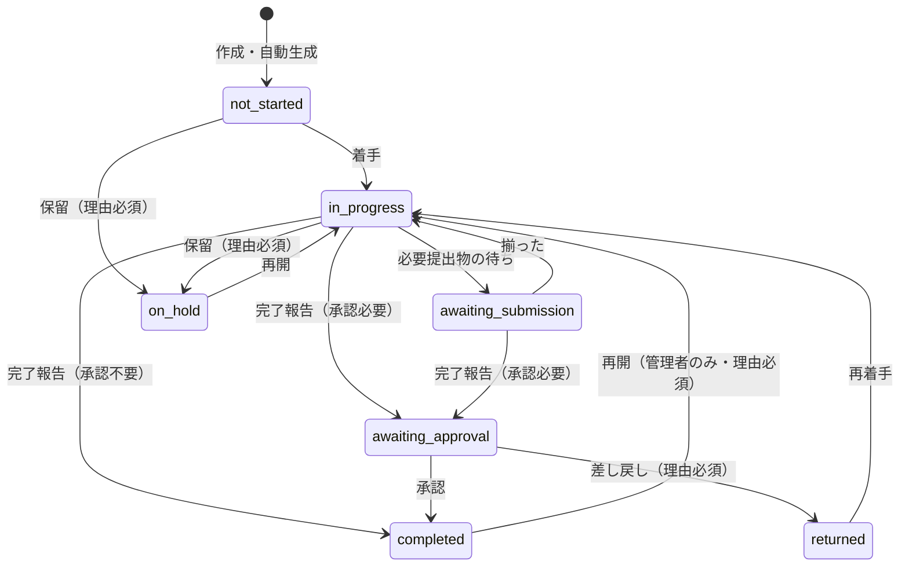
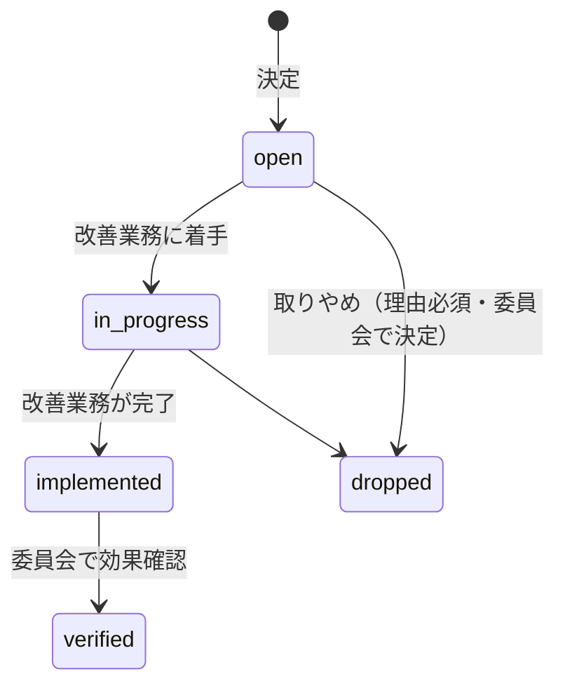

# モジュール仕様

各モジュールの「MVPで作る範囲」「作らない範囲」「状態遷移」「業務ルール」を定義する。
**【要確認】** は実証施設のヒアリングで確定する項目。

---

## 共通基盤

| 機能 | MVP | 内容 |
|---|---|---|
| 法人・施設登録 | ○ | 当社（SYSTEM_ADMIN）が法人・施設を作成し、施設長を招待。セルフ登録は PHASE 6 |
| 職員台帳 | ○ | 氏名、職員番号、所属（部署・役職・期間）、雇用形態、在籍状態。CSV取込 |
| ユーザー（ログイン） | ○ | 職員を招待してログイン可能にする。ログインしない職員も台帳登録可 |
| 役割・権限 | ○ | 標準6役割。カスタムロール作成は PHASE 3（構造は PHASE 2 で用意） |
| 設定 | ○ | 施設設定（年度開始月、週の開始曜日、通知タイミング、承認ルール） |
| 契約判定 | ○ | 構造と判定のみ。実証は「全機能有効」の実証プラン1件 |
| 操作履歴 | ○ | 記録は PHASE 2 から必須。閲覧画面は PHASE 3 |
| 通知 | ○ | アプリ内通知は PHASE 2、メール・通知タイミング設定画面は PHASE 3 |
| CSV | ○ | 職員・年間業務の取込（PHASE 2）、各種出力（PHASE 3） |

### 退職・異動時の処理

1. 管理者が職員の退職日（または異動）を登録
2. 退職日到来でユーザーを停止し、セッションを失効
3. 未完了業務・未承認の承認依頼・委員会の役割を一覧表示し、**引継ぎ先の指定を管理者に求める**（自動で付け替えない）
4. 過去の業務・提出物・承認履歴は退職者名のまま保存

---

## MODULE 02：業務・期限管理

### 範囲

| 機能 | MVP（PHASE 2） | 後続 |
|---|---|---|
| 業務の登録・編集・取消 | ○ | |
| 業務発生区分（毎日〜年次・臨時） | ○ | |
| 繰り返し業務の自動生成 | ○ | 「前回完了日から○か月後」型は PHASE 3 |
| 年間業務の登録（シリーズ） | ○ | |
| 業務テンプレート・翌年度作成 | ○ | 法人共通テンプレート編集は PHASE 7 |
| 業務依頼 | ○ | |
| 提出物回収 | ○ | 代理登録を含む |
| 完了承認（1段階） | ○ | 多段階承認は PHASE 3 |
| 年間カレンダー（月・週・年） | ○ | 外部カレンダー同期は将来 |
| リマインド | アプリ内 | メール・タイミング設定画面は PHASE 3 |
| 行政提出物の管理 | カテゴリ「行政提出」＋根拠情報で管理 | 提出先・提出方法の項目追加は要確認 |

### 業務のステータス遷移

| 状態 | 表示名 | 意味 |
|---|---|---|
| not_started | 未着手 | |
| in_progress | 進行中 | |
| awaiting_submission | 提出待ち | 必要提出物や他の職員からの提出がそろっていない。【要確認】施設での「提出待ち」の使い方 |
| awaiting_approval | 承認待ち | 完了報告済み、承認者の判断待ち |
| returned | 差し戻し | 承認者が差し戻した |
| completed | 完了 | |
| on_hold | 保留 | 一時停止。期限超過の集計からは除外せず「保留中」として別表示 |

取消は状態ではなく取消日時・理由として記録（取消した業務は一覧から除外、履歴は保存）。

### 業務ルール

| ルール | 内容 |
|---|---|
| 完了の条件 | 必須の必要提出物がそろっていない場合は完了報告できない（管理者は理由を記録して例外完了可能） |
| 承認者 | 業務ごとに指定。未指定ならシリーズ・テンプレート・施設設定の既定（例：施設長）を使用 |
| 自己承認 | 担当者と承認者が同一の場合の扱いは施設設定。既定は「許可するが自己承認として記録」【要確認】 |
| 期限超過 | 状態ではなく算出（期限 < 今日 かつ 未完了） |
| 担当者未設定 | 主担当者がいない業務はダッシュボードで警告 |
| 担当者が停止中 | 退職・停止した職員が担当の未完了業務は警告 |
| 根拠 | 行政提出・法令関連カテゴリの業務は根拠種別の入力を促し、未入力は「未確認」と表示 |
| 履歴 | 各回の業務は独立した記録。シリーズを変更しても過去の回は変更しない |

### 繰り返し生成

| 項目 | 仕様 |
|---|---|
| 生成方式 | 暦ベース（毎月10日など）。完了日ベースは PHASE 3 |
| 生成タイミング | 毎日深夜、各シリーズの「何日先まで作るか」（既定：毎日型は7日、毎週型は14日、毎月型以上は60日）の範囲 |
| 二重生成防止 | シリーズ×期間キーで一意。何回実行しても1件 |
| 土日祝 | シリーズごとに「そのまま／前営業日／翌営業日」を選択。祝日はシステムの祝日マスタ（年1回更新） |
| 毎日型の表示 | 一覧が埋まらないよう「今日のチェックリスト」としてまとめて表示 |
| シリーズ変更 | 未来の未着手分を新ルールで作り直すかを利用者が選択（作り直す場合、旧分は取消として記録） |

### 業務依頼

- 作成：依頼タイトル、依頼内容、担当者（複数可：主・副）、期限、添付、完了条件、承認要否
- 依頼された職員：自分の画面で確認 → 着手 → 進捗コメント → 完了報告（添付可）
- 依頼者：進捗確認、催促（確認後に通知送信）、承認・差し戻し
- 依頼の受領確認（既読）を記録

### 提出物回収

| 項目 | 仕様 |
|---|---|
| 対象者 | 全員／部署／役職／個別指定。**依頼作成時に対象者を確定して保存**（後から職員が増えても自動追加しない。追加は手動で記録付き） |
| 提出 | 本人がスマホで撮影・ファイル選択して提出。再提出は版を追加 |
| 代理登録 | 紙で受け取った場合などに、管理者が本人に代わって提出を記録（「代理登録」と表示、登録者を記録） |
| 期限後の提出 | 既定で受付（「遅延」と表示）。施設設定で締切後の受付停止も可 |
| 確認 | 確認者が承認・差し戻し（理由必須）。差し戻し後は再提出待ち |
| 対象外 | 休職者などを理由付きで対象外に設定 |
| 通知 | 既定：依頼時、期限3日前・1日前（未提出者のみ）、期限当日、期限超過翌日（本人と依頼者）。タイミングは設定で変更 |
| ログインしない職員 | 通知が届かないため、提出状況表で「アカウントなし」を表示し、紙での回収・代理登録を案内 |

### 年間カレンダー

- 月表示・週表示：業務・委員会・研修の予定と期限。状態を色＋文字で表示
- 年表示：12か月×カテゴリの件数一覧（未完了・完了・超過）
- 絞り込み：部署、カテゴリ、担当者

### 年度更新

1. 「翌年度の年間業務を作成」→ 今年度のシリーズから案を生成（日付を翌年度に移動）
2. 一覧で確認・修正（担当者、日程、不要な業務の除外）
3. 確定で新年度のシリーズを作成。今年度の記録は変更しない

---

## MODULE 03：書類・証拠管理

| 機能 | MVP（PHASE 2） | 後続 |
|---|---|---|
| アップロード（PDF・Word・Excel・JPEG・PNG） | ○ | マクロ付きファイル（.docm/.xlsm）は受け付けない |
| 書類カテゴリ・アクセスレベル | ○ | |
| 版管理（新しい版の追加） | ○ | |
| 業務・委員会・研修・提出物との紐付け | ○ | |
| 保存期限 | ○（入力・期限到来の通知） | 自動削除はしない（人が確認して削除） |
| 検索 | 書類名・カテゴリ・紐付け先・期間 | 本文検索・AI分類・抽出は PHASE 4 |
| プレビュー | PDF・画像 | Word・Excel はダウンロード |

### 書類のアクセスレベル

| レベル | 閲覧できる人 |
|---|---|
| all_staff | 施設の全職員（`document.read`） |
| managers | 管理職（`document.read_managers` を持つ人） |
| restricted | 個別に指定した人・役割・部署のみ（書類ごとの閲覧者リスト） |

### アップロードの流れ

1. ファイル選択 → 形式・サイズ確認
2. 保管領域へ直接アップロード（期限付きアップロードURL）
3. ウイルス検査が終わるまで「確認中」。問題があれば隔離して管理者に通知
4. 画像の位置情報（撮影場所）は既定で除去【判断事項：TD-024】
5. カテゴリ・紐付け先・保存期限を入力して登録

---

## MODULE 04：委員会・研修管理（PHASE 3）

### 委員会

| 機能 | 内容 |
|---|---|
| 委員会の定義 | 名称、目的、開催頻度、委員長・委員・書記、関連する要件（法令等の要件一覧） |
| 年間計画 | 開催予定を年間業務（シリーズ）として登録し、開催準備の業務を自動生成 |
| 開催記録 | 開催日、場所、出席者、議事録（版管理・承認） |
| 前回の決定事項 | 次回開催時に「前回までの未完了の決定事項」を自動で一覧表示 |
| 決定事項 | 内容、改善内容、改善担当者、改善期限 → 改善業務として MODULE 02 に作成 |
| 実施証拠 | 議事録・写真・資料を紐付け |

決定事項の状態（PDCA）：

委員会の実施状況の表示：
- 開催：予定 → 開催済み → 議事録承認済み
- 改善：決定事項の「未着手／進行中／実施済み／効果確認済み」の件数
- **開催しただけでは「完了」と表示しない**。決定事項が残っていれば「改善対応中」

### 研修

| 機能 | 内容 |
|---|---|
| 研修計画 | 年度、研修名、カテゴリ、対象者（全員・部署・職種）、予定月、関連要件 |
| 開催 | 日時、講師、形式（集合・動画・外部）、資料 |
| 出欠 | 出席・欠席・後日受講・対象外 |
| 受講確認 | 受講レポートや確認テストなどの証拠を紐付け、確認者が「受講確認済み」に |
| 未受講者 | 後日受講の業務を本人に作成（確認後） |

対象者は計画作成時に確定して保存。途中入職者の追加は手動（記録付き）。

### 法令等の要件一覧

- 施設が「法令上必要な委員会・研修・訓練・報告等」を一覧として管理
- 当社は**候補**として業態別の一覧を提供できるが、すべて「未確認」の状態で提供し、施設（権限者）が根拠を確認して「確認済み」にする
- 各要件に、根拠（法令名・条文・通知名・URL）、確認者、確認日を記録
- 当社が候補一覧を更新した場合（制度改正など）、施設に「変更あり・再確認が必要」と通知
- 要件ごとに、対応する委員会・研修・年間業務が登録されているかを表示（未登録は確認事項として表示）
- AI は確認状態を変更できない

---

## MODULE 01：施設運営AI（PHASE 4）

| 機能 | 内容 |
|---|---|
| 質問回答 | 「今週期限の行政提出物は？」「未提出の職員は？」等。根拠・対象期間・データ更新日時を表示 |
| 確認事項の提示 | 期限超過・根拠未確認・改善未完了などを根拠付きで提示 |
| 業務改善提案 | 集計データに基づく提案。参考情報として表示 |
| 下書き・抽出 | 議事録下書き、書類からの期限候補抽出、業務候補の抽出（すべて人が確定） |
| 利用状況 | 管理者が AI 利用量・推定費用・上限を確認 |

PHASE 4 より前のダッシュボードの「確認事項」は、**ルールによる自動チェック**として表示し、AI による表示とは区別する（実装していない AI 機能を AI と表示しない）。

---

## MODULE 05〜07（PHASE 7、構造のみ先に用意）

| モジュール | 先に用意する構造 |
|---|---|
| 05 職員・シフト | 職員台帳・所属履歴、提出物回収の仕組み（シフト希望回収に流用） |
| 06 会議・音声AI | 会議（meetings）・議事録・決定事項のテーブル、AI 接続層の用途追加 |
| 07 法人経営管理 | 法人範囲の権限、法人共通テンプレート、施設を横断する集計の前提（全データに法人ID） |
