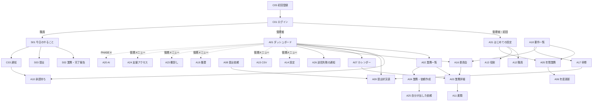

# 画面設計

- 版：v3（2026-11-21 他業界の製品リサーチを反映：`benchmark-research.md`、`design-guidelines.md`）
- 文字・色・ボタン・入力・状態の表示・文章の基準は `design-guidelines.md` に従う。本書は画面の構成と流れを定める
- 下の画面図は構成を示す見取り図で、見た目の確定ではない

## 1. 方針

| 項目 | 方針 |
|---|---|
| 画面の分離 | 管理者用（施設全体）と職員用（自分に関係するもの）を分ける。役割でログイン後の画面を自動選択、管理者は職員用表示にも切替可 |
| 端末 | 管理者用は PC・タブレット優先（スマホでも閲覧・承認可能）。職員用はスマホ優先。共用タブレットの方式は D-2 |
| 最初の画面 | 職員は「今日のやること」、管理者は「要対応」から始まる（原則①） |
| 職員の操作 | 1画面に1つのこと（原則②）。主ボタンは画面下に固定、高さ56px |
| 状態表示 | 状態の種類は少なく、言葉＋アイコン＋色（原則③）。赤は期限超過とエラーだけ。表示の言葉は `design-guidelines.md` 第3.3節 |
| 通知 | 受け口は1つ（C03）。職員への通知はまとめて送る（原則④） |
| その場で完了 | 通知一覧・承認待ちからその場で承認・差し戻し。提出物はまとめて承認（原則⑤） |
| データなし | 「0件」と「未登録」を区別。未実装の機能は表示しない |
| AI 表示 | 「AIの回答／AI下書き」のラベル、根拠のカード（原則⑥）。ルールによる自動チェックは「自動チェック」と表示し AI と区別。外部の画像・リンクは表示しない |
| 確認 | 確認ダイアログは削除・一括操作・多数への送信・取消・権限変更だけ（原則⑦）。差し戻し・取消・保留・例外完了は理由必須 |
| 入力の保護 | 通信失敗時は端末に下書きを保持して自動で再送。時間切れでログアウトしても入力中の内容を保持 |
| 印刷 | 未提出者一覧、年間行事表、委員会の記録（A4 縦、白黒でも状態が分かる） |
| アクセシビリティ | JIS X 8341-3:2016 AA を目標（`design-guidelines.md` 第6章） |

## 2. 画面一覧

| ID | 画面 | 利用者 | フェーズ |
|---|---|---|---|
| C01 | ログイン・多要素認証・再認証 | 全員 | 2a |
| C02 | 施設の切替（複数施設に役割がある人） | 該当者 | 2a |
| C03 | 通知一覧（「要対応」「お知らせ」。承認依頼はその場で承認・差し戻し） | 全員 | 2b-1 |
| C04 | マイページ（パスワード・パスキー・多要素認証・通知の受信時間帯・まとめ送信の設定） | 全員 | 2a |
| C05 | 初回登録（招待の受け取り：メールのリンクまたは**QRコード**、登録コード入力、パスワード・パスキーの設定。1画面1つ） | 招待された人 | 2a |
| A01 | 管理者ダッシュボード（施設運営コントロールセンター）。部署管理者は自部署の範囲、スマホでは縦並び | 施設長・事務長・部署管理者 | 2b-1 |
| A02 | 業務一覧（絞り込み・一括操作） | 管理者 | 2b-1 |
| A03 | 業務詳細・編集（状態、担当、提出物、根拠、行政提出の項目、コメント、書類、承認、履歴） | 全員（権限内） | 2b-1 |
| A04 | 業務作成・業務依頼作成 | 管理者 | 2b-1 |
| A05 | 年間業務（シリーズ）一覧・登録・ルール変更（境界日指定）・根拠の一括確認 | 施設長・事務長 | 2b-1 |
| A06 | 年度更新（**作業一覧の形**：テンプレート選択 → 担当者の確認 → 行政提出の期限の再確認 → 確定） | 施設長・事務長 | 2b-1 |
| A07 | カレンダー（週の帯・月×カテゴリ・年）・年間行事表の印刷 | 管理者 | 2b-2 |
| A08 | 提出依頼一覧・作成（データ区分・ファイルの受け取り方式・**督促の型**） | 管理者 | 2b-2 |
| A09 | 提出状況表（全体の数・絞り込み・1人1行・まとめて承認・催促・代理登録・対象外・未提出者一覧の印刷） | 管理者 | 2b-2 |
| A10 | 承認待ち一覧（その場で承認・差し戻し、まとめて承認、承認者の付け替え） | 承認者・管理者 | 2b-1 |
| A11 | 書類一覧・検索・登録・詳細（版・紐付け・閲覧者リスト・データ区分） | 全員（権限内） | 2b-2 |
| A12 | 職員台帳・所属・招待（QRコード・登録コードの発行）・停止（即時停止）・引継ぎ | 施設長・事務長 | 2a |
| A13 | 役割の割当 | 施設長・事務長 | 2a（カスタムロール作成は3） |
| A14 | 施設設定（年度、週開始、承認の既定、受信時間帯の既定） | 施設長・事務長 | 2a（通知タイミングの設定画面は3） |
| A15 | CSV 取込（プレビュー→確定）・出力 | 施設長・事務長 | 2b-1（取込）〜3（出力） |
| A16 | 委員会一覧・詳細・開催記録（**その場で改善業務を作成**）・議事録・決定事項（前回の未完了の決定事項） | 管理者・委員長・書記 | 3 |
| A17 | 研修計画・対象者・開催・出欠・受講確認 | 管理者 | 3 |
| A18 | 法令等の要件一覧（確認状態・根拠・対応状況）・未確認の一括確認 | 施設長・事務長 | 3 |
| A19 | 操作履歴・ログイン履歴 | 施設長・事務長 | 3 |
| A20 | AI アシスタント（根拠のカード付き） | 権限者 | 4 |
| A21 | AI 利用状況・AI 事業者の条件 | 施設長・事務長 | 4 |
| A22 | 契約・プラン（閲覧） | 施設長・事務長・法人管理者 | 3 |
| A23 | 権限の棚卸し（割当・最終ログイン・長期未使用） | 施設長・事務長 | 3 |
| A24 | 支援アクセスの承認（当社からの申請） | 施設長・事務長 | 2a |
| A25 | 自分が出した依頼（進捗・催促） | 依頼者 | 2b-1 |
| A26 | 送信に失敗した通知（`notification.manage`） | 施設長・事務長 | 2b-1 |
| A27 | 運営指導への備え（期間を指定した記録の一覧・PDF 出力） | 施設長・事務長 | D-7 |
| A29 | 施設の利用状況（日次の利用者数、画面別の利用、職員のログイン率、代理登録率。`usage.view`） | 施設長・事務長 | 2b-2 |
| A30 | 削除依頼（混入・保存期限）・承認・実行結果 | 施設長・事務長 | 2b-2 |
| A31 | **はじめての設定**（作業一覧の形：部署・役職 → 職員 → 役割 → 年間業務 → 根拠の確認 → 通知の受け取り方） | 施設長・事務長 | 2a（職員・役割まで）〜2b-1（全体） |
| S01 | 職員ホーム「今日のやること」（差し戻し → 期限超過 → 今日まで → 依頼 → 今週の予定） | 職員 | 2b-1 |
| S02 | 自分の業務一覧・詳細・完了報告（1画面1ボタン） | 職員 | 2b-1 |
| S03 | 提出（内容の確認 → 撮影・選択 → 送信。1画面1つ）・再提出 | 職員 | 2b-2 |
| S04 | 研修（自分の受講予定・レポート提出） | 職員 | 3 |
| S05 | 共用タブレットの職員選択・暗証番号入力 | 職員 | D-2 |
| H01 | 法人ダッシュボード・理事長向け月次レポート | 法人本部 | D-6 |
| X01 | 当社の管理画面：法人・施設の作成、施設長の招待、支援アクセスの申請 | 当社のみ（別入口・別認証・IP制限） | 2a |
| X02 | 当社の管理画面：要件候補・既定テンプレート | 当社のみ | 3 |
| X03 | 当社の管理画面：プラン・オプション | 当社のみ | 6（それまではマイグレーションで登録） |

## 3. 管理者ダッシュボード（A01）

PC 表示（数値・名称は架空の例）：

```
┌────────────────────────────────────────────────────────────────┐
│ ○○ホーム                     11月20日(木) 9:02 更新  [通知 3]  │
├────────────────────────────────────────────────────────────────┤
│ 要対応                                                         │
│ ┌──────────────┐┌──────────────┐┌──────────────┐┌──────────────┐│
│ │! 期限超過     ││承認待ち       ││未提出         ││担当者未設定   ││
│ │  4件          ││  6件          ││  12名（3件）  ││  2件          ││
│ │ うち保留 1件  ││ あなた宛て 4件││               ││               ││
│ └──────────────┘└──────────────┘└──────────────┘└──────────────┘│
├───────────────────────────────┬────────────────────────────────┤
│ 今日まで（5件）                │ 期限が近い（3日以内・7件）       │
│ ○○の点検  山田  進行中        │ （行政提出）○○の届出  あと2日   │
│ …                  すべて見る │  根拠：未確認 ⚠  控え：未登録    │
├───────────────────────────────┼────────────────────────────────┤
│ 今後30日の委員会・研修          │ 自動チェック（AI ではありません） │
│ 11/25 ○○委員会               │ ・根拠が未確認の行政提出 3件     │
│ 11/28 ○○研修（対象42名）     │ ・退職した職員の担当が残る 1件   │
├───────────────────────────────┴────────────────────────────────┤
│ 今月完了 21件（うち例外完了 1件）          今週 14件 / 今月 38件  │
└────────────────────────────────────────────────────────────────┘
```

- 最上段の「要対応」は4つまで。数字は32px、単位と短い説明を添える。期限超過だけ赤（「!」付き）
- 各数字・各行をタップすると、同じ条件の一覧を開く
- 「完了」は色を付けず、下の段に小さく（落ち着いた画面にする）
- スマホでは「要対応」→「今日まで」→「期限が近い」→「予定」→「自動チェック」の縦並び（介護主任のスマホ利用を想定）
- 部署管理者は自部署の範囲で表示。集計は表示時点の実データで、更新時刻を表示

## 4. 職員ホーム「今日のやること」（S01、スマホ）

```
┌─────────────────────────┐
│ 山田さん    11月20日(木)  │
│ 今日のやること（4件）     │
├─────────────────────────┤
│ ! 差し戻し                │
│ ┌─────────────────────┐ │
│ │健康診断の受診報告     │ │
│ │「日付が違います」佐藤 │ │
│ │ [ もう一度提出する ]  │ │
│ └─────────────────────┘ │
│ 今日まで                  │
│ ┌─────────────────────┐ │
│ │○○研修レポート        │ │
│ │今日まで               │ │
│ │ [ 提出する ]          │ │
│ └─────────────────────┘ │
│ 今日のチェックリスト       │
│ ○ 居室の温度の確認 [完了] │
│ ○ 物品の補充     [完了]  │
│ 今週の予定                │
│ 月 火 水 木 金 土 日       │
│ ・    ・  ●  ・            │
├─────────────────────────┤
│ ホーム 業務  提出  通知(2) │
└─────────────────────────┘
```

- 並び順：差し戻し → 期限超過 → 今日まで → 依頼（未読） → 今週の予定。各カードに主な操作1つ（目立つ色のボタンは一番上のカードだけ。TD-083）
- 「今週の予定」は週の帯で、予定のある日に印（「・」）。今日は塗りの丸
- 各区分は5件まで表示し、それ以上は「すべて見る」
- 他の職員の情報は表示しない
- 下部のタブは文字付き（ホーム・業務・提出・通知）

## 5. 提出（S03）：1画面に1つ

```
① 内容の確認              ② 撮影・選択             ③ 確認して送信            完了
┌──────────────┐        ┌──────────────┐        ┌──────────────┐        ┌──────────────┐
│← 戻る         │        │← 戻る         │        │← 戻る         │        │ 提出しました  │
│○○研修レポート │        │レポートの写真を│        │この内容で      │        │ 佐藤さんが    │
│を提出する      │        │撮ってください  │        │提出しますか    │        │ 確認します    │
│期限：今日まで  │        │              │        │[写真の縮小表示]│        │              │
│依頼：佐藤主任  │        │ [ 写真を撮る ] │        │コメント ※任意 │        │ 今日のやること │
│必要なもの：    │        │ [ ファイルを   │        │[            ] │        │ はあと3件です │
│ 研修レポート1枚│        │   選ぶ ]      │        │              │        │              │
│[ 次へ ]       │        │              │        │[ 提出する ]   │        │[ ホームへ戻る ]│
└──────────────┘        └──────────────┘        └──────────────┘        └──────────────┘
```

- ホームの「提出する」から3回のタップで送信（写真の撮影を除く）
- 進み具合の表示（①②③）は画面に出さない（まず無しで試す）
- 途中の内容は自動で保存。通信できないときは端末に保存して自動で再送
- データ区分が C4 の依頼は②を「受診しました（はい・いいえ）」のような質問に置き換え、ファイルを受け取らない
- 差し戻し後の再提出も同じ流れ（①に差し戻しの理由を表示）

## 6. 完了報告（S02）

- 業務詳細の下に主ボタン「完了を報告する」1つ
- 押すと1画面：「完了を報告します」＋コメント（任意）＋写真・ファイル（任意）＋［報告する］
- 必要な書類が足りないときはボタンの代わりに「必要な書類があと1件です［提出する］」を表示（押せないボタンを出さない）
- 承認が必要な業務は「佐藤さんが確認します」と表示

## 7. 承認：その場で終わらせる（C03・A10）

```
承認待ち（6件）                          │ 健康診断の受診報告（山田 花子）
┌──────────────────────────────┐       │ 提出：11月19日(水) 18:20
│□ 健康診断の受診報告  山田 花子 │ ───→ │ [ファイル・内容の表示]
│□ 健康診断の受診報告  鈴木 一郎 │       │ 関連：提出依頼「健康診断の受診報告」
│□ ○○の点検（業務）  田中      │       │
│ [ 選んだ2件を承認する ]       │       │ [ 承認する ]   [ 差し戻す ]
└──────────────────────────────┘       │  差し戻す場合は理由を入力 ※必須
```

- PC は右側、スマホは下から出る画面に内容と証拠を表示。一覧に戻らず次の件へ進める
- 1件の承認は確認ダイアログなし。**まとめて承認**は「2件を承認します」と件数を確認
- 差し戻しは理由必須。理由は本人の画面にそのまま表示される
- 通知一覧（C03）の「要対応」からも同じ画面を開く

## 8. 提出状況表（A09）

```
健康診断の受診報告   期限：11月30日(日)        [ 催促を送る ] [ 印刷 ]
42名中 28名が提出（承認済み 20名・確認待ち 8名）
[すべて 42] [未提出 12] [差し戻し 2] [確認待ち 8] [承認済み 20] [対象外 2]
┌───┬─────────────┬───────────────────┬────────────┬──────────┐
│□ │職員          │状態                 │提出         │操作       │
├───┼─────────────┼───────────────────┼────────────┼──────────┤
│□ │山田 花子 介護 │提出済み（確認待ち）  │11/19 18:20 │確認する   │
│□ │鈴木 一郎 看護 │未提出                │            │代理登録   │
│  │高橋 次郎 介護 │未提出 アカウントなし │            │代理登録   │
└───┴─────────────┴───────────────────┴────────────┴──────────┘
[ 選んだ人を承認する ]（確認待ちの人だけ選べる）
```

- 最初に全体の数。絞り込みボタンで状態ごとに切替。状態で並べ替え
- 「催促を送る」は未提出・差し戻しの人にだけ届く。送る前に「12名に催促を送ります。アカウントのない3名には届きません（印刷して渡してください）」と確認
- 督促を既定の回数送っても未提出の人には、依頼者に「直接声をかけてください（3名）」と表示
- データ区分が C4 の依頼では「ファイルなし（提出済みの記録のみ）」と表示

## 9. はじめての設定（A31）・年度更新（A06）：作業一覧

```
はじめての設定                                    6件中 2件完了
┌──────────────────────────────────────────────┬──────────────────┐
│ 1 部署と役職を登録する                          │ 完了              │
│ 2 職員を登録する                                │ 完了              │
│ 3 役割を割り当てる                              │ [未完了]          │
│ 4 年間業務を登録する（標準テンプレートから選ぶ） │ [未完了]          │
│ 5 行政提出・委員会・研修の根拠を確認する         │ まだ始められない   │
│ 6 職員への通知の受け取り方を決める               │ [未完了]          │
└──────────────────────────────────────────────┴──────────────────┘
```

- 状態は「完了」（色なし）／「未完了」（青のラベル）／「まだ始められない」（灰色、押せない。前の作業が終わると開く）
- 各作業の中は1画面1つの手続き。終わると一覧に戻る
- 年度更新（A06）も同じ形：「翌年度の案を作る → 担当者を確認する → 行政提出の期限を確認する → 確定する」
- 当社が登録を代行する場合（D-9）も、同じ一覧で進み具合を施設と共有する

## 10. 業務詳細（A03）の構成

1. 見出し：業務名、状態、期限（相対表示）、優先度、カテゴリ
2. 担当：主担当・副担当（職員または部署）・担当部署・承認者・依頼者・既読
3. 内容：説明、完了条件、必要提出物（そろっているか）
4. 根拠：根拠種別（法令／行政通知／法人規程／施設ルール／未確認）、根拠メモ、確認者・確認日
5. 行政提出（該当カテゴリのみ）：提出先、提出方法、受付番号、提出日、控え
6. 関連書類（証拠）：紐付いた書類、追加
7. コメント・進捗・完了報告
8. 履歴：状態変更・承認・編集の履歴（誰が・いつ・何を・理由）。「承認後に変更あり」「例外完了」「自己承認」の表示
9. 主な操作：状態と権限に応じて主ボタン1つ（他は副ボタン）

## 11. 画面遷移



## 12. 未確定のデザイン事項

- 施設で使う呼び方（`design-guidelines.md` 第5.2節の用語）【要確認】
- 施設のロゴ・色の設定は PHASE 6 以降（MVP は共通デザイン）
- 共用タブレットの画面（S05）は D-2 の決定後に設計
- ダークモードは PHASE 5 以降に検討（夜勤者の声で判断）
- 見た目の確定は、デザイン見本（動かない画面の見本）を施設に見ていただいてから行う。見本 v1：https://claude.ai/artifact/8eohqFYSGNpd4iDZBn6Mk2 （ソースの控えは `../../design/mockup-v1/`）
