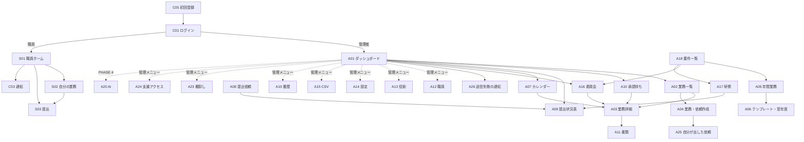

# 画面設計

- 版：v2（2026-11-17 設計レビューの指摘を反映：抜けていた画面・状態の追加、フェーズの整合、画面例の修正）

## 1. 方針

| 項目 | 方針 |
|---|---|
| 画面の分離 | 管理者用（施設全体）と職員用（自分に関係するもの）を分ける。役割でログイン後の画面を自動選択、管理者は職員用表示にも切替可 |
| 端末 | 管理者用は PC・タブレット優先（スマホでも閲覧・承認可能）。職員用はスマホ優先。共用タブレットの方式は D-2 |
| 文字・操作 | 本文16px以上、ボタン高さ44px以上、1画面1目的、専門用語は施設の呼び方に合わせる【要確認】 |
| 状態表示 | 色＋文字＋アイコン（色覚に頼らない）。期限は「あと3日」「2日超過」を併記 |
| データなし | 「0件」と「未登録（まだデータがない）」を区別。未実装の機能は表示しない |
| AI 表示 | AI の生成物には「AIの回答／AI下書き」ラベル。ルールによる自動チェックは「自動チェック」と表示し AI と区別。AI の回答では外部の画像・リンクを表示しない |
| 確認 | 削除・取消・送信・承認・差し戻しは確認ダイアログ。差し戻し・取消・保留・例外完了は理由必須 |
| 入力の保護 | 通信失敗時は端末に下書きを保持して再送。セッションが切れても入力中の内容を保持し、再ログイン後に復元 |
| 印刷 | 未提出者一覧、年間行事表は印刷用レイアウトを用意（掲示・朝礼用） |
| アクセシビリティ | キーボード操作、読み上げ対応（WCAG 2.2 AA を目標） |

## 2. 画面一覧

| ID | 画面 | 利用者 | フェーズ |
|---|---|---|---|
| C01 | ログイン・多要素認証・再認証 | 全員 | 2a |
| C02 | 施設の切替（複数施設に役割がある人） | 該当者 | 2a |
| C03 | 通知一覧 | 全員 | 2b-1 |
| C04 | マイページ（パスワード・パスキー・多要素認証・通知の受信時間帯） | 全員 | 2a |
| C05 | 初回登録（招待の受け取り、メールのない職員の登録コード入力、パスワード・パスキーの設定） | 招待された人 | 2a |
| A01 | 管理者ダッシュボード（施設運営コントロールセンター）。部署管理者は自部署の範囲、スマホでは縦並び | 施設長・事務長・部署管理者 | 2b-1 |
| A02 | 業務一覧（絞り込み・一括操作） | 管理者 | 2b-1 |
| A03 | 業務詳細・編集（状態、担当、提出物、根拠、行政提出の項目、コメント、書類、承認、履歴） | 全員（権限内） | 2b-1 |
| A04 | 業務作成・業務依頼作成 | 管理者 | 2b-1 |
| A05 | 年間業務（シリーズ）一覧・登録・ルール変更（境界日指定）・**根拠の一括確認** | 施設長・事務長 | 2b-1 |
| A06 | テンプレート選択・翌年度作成（行政提出の期限の再確認） | 施設長・事務長 | 2b-1 |
| A07 | カレンダー（月・週・年）・年間行事表の印刷 | 管理者 | 2b-2 |
| A08 | 提出依頼一覧・作成（データ区分・ファイルの受け取り方式） | 管理者 | 2b-2 |
| A09 | 提出状況表（職員×状態、代理登録、対象外、確認）・未提出者一覧の印刷 | 管理者 | 2b-2 |
| A10 | 承認待ち一覧（承認者の付け替えを含む） | 承認者・管理者 | 2b-1 |
| A11 | 書類一覧・検索・登録・詳細（版・紐付け・閲覧者リスト・データ区分） | 全員（権限内） | 2b-2 |
| A12 | 職員台帳・所属・招待・停止（即時停止）・引継ぎ | 施設長・事務長 | 2a |
| A13 | 役割の割当 | 施設長・事務長 | 2a（カスタムロール作成は3） |
| A14 | 施設設定（年度、週開始、承認の既定、受信時間帯の既定） | 施設長・事務長 | 2a（通知タイミングの設定画面は3） |
| A15 | CSV 取込（プレビュー→確定）・出力 | 施設長・事務長 | 2b-1（取込）〜3（出力） |
| A16 | 委員会一覧・詳細・開催記録・議事録・決定事項（前回の未完了の決定事項） | 管理者・委員長・書記 | 3 |
| A17 | 研修計画・対象者・開催・出欠・受講確認 | 管理者 | 3 |
| A18 | 法令等の要件一覧（確認状態・根拠・対応状況）・未確認の一括確認 | 施設長・事務長 | 3 |
| A19 | 操作履歴・ログイン履歴 | 施設長・事務長 | 3 |
| A20 | AI アシスタント | 権限者 | 4 |
| A21 | AI 利用状況・AI 事業者の条件 | 施設長・事務長 | 4 |
| A22 | 契約・プラン（閲覧） | 施設長・事務長・法人管理者 | 3 |
| A23 | 権限の棚卸し（割当・最終ログイン・長期未使用） | 施設長・事務長 | 3 |
| A24 | 支援アクセスの承認（当社からの申請） | 施設長・事務長 | 2a |
| A25 | 自分が出した依頼（進捗・催促） | 依頼者 | 2b-1 |
| A26 | 送信に失敗した通知（`notification.manage`） | 施設長・事務長 | 2b-1 |
| A27 | 運営指導への備え（期間を指定した記録の一覧・PDF 出力） | 施設長・事務長 | D-7 |
| A29 | 施設の利用状況（日次の利用者数、画面別の利用、職員のログイン率、代理登録率。`usage.view`） | 施設長・事務長 | 2b-2 |
| A30 | 削除依頼（混入・保存期限）・承認・実行結果 | 施設長・事務長 | 2b-2 |
| S01 | 職員ホーム（今日やること・依頼・提出物・差し戻し） | 職員 | 2b-1 |
| S02 | 自分の業務一覧・詳細（完了報告） | 職員 | 2b-1 |
| S03 | 提出（撮影・ファイル選択・再提出） | 職員 | 2b-2 |
| S04 | 研修（自分の受講予定・レポート提出） | 職員 | 3 |
| S05 | 共用タブレットの職員選択・暗証番号入力 | 職員 | D-2 |
| H01 | 法人ダッシュボード・理事長向け月次レポート | 法人本部 | D-6 |
| X01 | 当社の管理画面：法人・施設の作成、施設長の招待、支援アクセスの申請 | 当社のみ（別入口・別認証・IP制限） | 2a |
| X02 | 当社の管理画面：要件候補・既定テンプレート | 当社のみ | 3 |
| X03 | 当社の管理画面：プラン・オプション | 当社のみ | 6（それまではマイグレーションで登録） |

## 3. 管理者ダッシュボード（A01）

PC 表示（数値は架空の例）：

```
┌──────────────────────────────────────────────────────────────┐
│ ○○ホーム  2026年11月17日(火)  更新 9:02  [施設切替] [通知3]   │
├──────────────────────────────────────────────────────────────┤
│ ■ 要対応（最上段に固定）                                       │
│ [期限超過 4（うち保留1）] [承認待ち 6] [担当者未設定 2]         │
│ [未提出 12名/3件]                                              │
├──────────────────────┬───────────────────────────────────────┤
│ 本日の業務 (5)        │ 期限が近い業務（3日以内）(7)           │
│ ・○○ 担当:山田 [進行中]│ ・（行政提出）○○の届出  あと2日       │
│ ・…                   │   根拠：未確認 ⚠  控え：未登録         │
├──────────────────────┼───────────────────────────────────────┤
│ 今週 (14) / 今月 (38) │ 委員会・研修予定（30日以内）           │
│ 部署別の未完了件数     │ ・11/20 ○○委員会                     │
│                       │ ・11/25 ○○研修（対象42名）           │
├──────────────────────┴───────────────────────────────────────┤
│ 自動チェック（AI ではありません）                               │
│ ・根拠が「未確認」の行政提出業務が3件あります → 一覧             │
│ ・退職・停止した職員が担当の未完了業務が1件あります → 引継ぎ     │
│ ・送信に失敗した通知が2件あります → 確認                        │
├──────────────────────────────────────────────────────────────┤
│ 今月完了した業務 21件（うち例外完了 1件）                        │
└──────────────────────────────────────────────────────────────┘
```

- 各数値をタップすると、同じ条件の一覧を開く
- スマホでは「要対応」→「本日」→「期限が近い」→「予定」→「自動チェック」の縦並び（介護主任のスマホ利用を想定）
- 部署管理者は自部署の範囲で表示
- 集計は表示時点の実データ。更新時刻を表示

## 4. 職員ホーム（S01、スマホ）

```
┌───────────────────────┐
│ 山田さん  11/17(火)    │
├───────────────────────┤
│ 今日やること (2)       │
│ ┌───────────────────┐ │
│ │ ○○研修レポート提出   │ │
│ │ 期限 今日  [提出する]│ │
│ └───────────────────┘ │
│ 今日のチェックリスト(3)│
│ □ ○○の確認 [完了]     │
│ 依頼されている業務 (1) │
│ ┌───────────────────┐ │
│ │ 物品棚卸し  あと3日  │ │
│ │ 依頼：佐藤主任 [開く]│ │
│ └───────────────────┘ │
│ 差し戻し (1)  ⚠        │
├───────────────────────┤
│ [ホーム][業務][提出][通知]│
└───────────────────────┘
```

- 「提出する」→ 撮影または選択 → 送信（ホームから3タップ以内）
- 業務の基本操作は「完了報告」の1つ
- 他の職員の情報は表示しない

## 5. 業務詳細（A03）の構成

1. 見出し：業務名、状態、期限（相対表示）、優先度、カテゴリ
2. 担当：主担当・副担当（職員または部署）・担当部署・承認者・依頼者・既読
3. 内容：説明、完了条件、必要提出物（そろっているか）
4. 根拠：根拠種別（法令／行政通知／法人規程／施設ルール／未確認）、根拠メモ、確認者・確認日
5. 行政提出（該当カテゴリのみ）：提出先、提出方法、受付番号、提出日、控え
6. 関連書類（証拠）：紐付いた書類、追加
7. コメント・進捗・完了報告
8. 履歴：状態変更・承認・編集の履歴（誰が・いつ・何を・理由）。「承認後に変更あり」「例外完了」「自己承認」の表示
9. 操作ボタン：状態と権限に応じて表示

## 6. 提出状況表（A09）

| 列 | 内容 |
|---|---|
| 職員 | 氏名・部署・「アカウントなし」表示 |
| 状態 | 未提出／提出済／承認済／差し戻し／対象外（遅延・代理登録は印） |
| 提出日時 | 最新の提出 |
| 操作 | 確認・承認・差し戻し・代理登録・対象外 |

上部に回収率（例：28/42名）、「未提出者に催促（送信内容を確認して送信）」「未提出者一覧を印刷」ボタン。データ区分が C4 の依頼では「ファイルなし（提出済みの記録のみ）」と表示。

## 7. 画面遷移



## 8. 未確定のデザイン事項

- 施設で使う呼び方（「業務」か「タスク」か、「提出物」か「書類」か）【要確認】
- 施設のロゴ・色の設定は PHASE 6 以降（MVP は共通デザイン）
- 共用タブレットの画面（S05）は D-2 の決定後に設計
