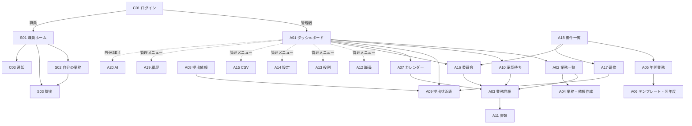

# 画面設計

## 1. 方針

| 項目 | 方針 |
|---|---|
| 画面の分離 | 管理者用（施設全体）と職員用（自分に関係するもの）を分ける。役割でログイン後の画面を自動選択、管理者は職員用表示にも切替可 |
| 端末 | 管理者用は PC・タブレット優先（スマホでも閲覧・承認可能）。職員用はスマホ優先 |
| 文字・操作 | 本文16px以上、ボタン高さ44px以上、1画面1目的、専門用語は施設の呼び方に合わせる【要確認】 |
| 状態表示 | 色＋文字＋アイコン（色覚に頼らない）。期限は「あと3日」「2日超過」を併記 |
| データなし | 「0件」と「未登録（まだデータがない）」を区別。未実装の機能は表示しない |
| AI 表示 | AI の生成物には「AIの回答／AI下書き」ラベル。ルールによる自動チェックは「自動チェック」と表示し AI と区別 |
| 確認 | 削除・取消・送信・承認・差し戻しは確認ダイアログ。差し戻し・取消・保留は理由必須 |
| アクセシビリティ | キーボード操作、読み上げ対応（WCAG 2.2 AA を目標） |

## 2. 画面一覧

| ID | 画面 | 利用者 | フェーズ |
|---|---|---|---|
| C01 | ログイン・多要素認証・パスワード再設定 | 全員 | 2 |
| C02 | 施設の切替（複数施設に所属する人） | 該当者 | 2 |
| C03 | 通知一覧 | 全員 | 2 |
| C04 | マイページ（パスワード・MFA・通知受信設定） | 全員 | 2 |
| A01 | 管理者ダッシュボード（施設運営コントロールセンター） | 施設長・事務長・部署管理者 | 2 |
| A02 | 業務一覧（絞り込み・一括操作） | 管理者 | 2 |
| A03 | 業務詳細・編集（状態、担当、提出物、根拠、コメント、書類、承認、履歴） | 全員（権限内） | 2 |
| A04 | 業務作成・業務依頼作成 | 管理者 | 2 |
| A05 | 年間業務（シリーズ）一覧・登録・編集 | 施設長・事務長 | 2 |
| A06 | テンプレート選択・翌年度作成 | 施設長・事務長 | 2 |
| A07 | カレンダー（月・週・年） | 管理者 | 2 |
| A08 | 提出依頼一覧・作成 | 管理者 | 2 |
| A09 | 提出状況表（職員×状態、代理登録、確認） | 管理者 | 2 |
| A10 | 承認待ち一覧 | 承認者 | 2 |
| A11 | 書類一覧・検索・登録・詳細（版・紐付け・閲覧者） | 全員（権限内） | 2 |
| A12 | 職員台帳・所属・招待・停止・引継ぎ | 施設長・事務長 | 2 |
| A13 | 役割・権限（割当） | 施設長・事務長 | 2（カスタムロール作成は3） |
| A14 | 施設設定（年度、週開始、承認ルール、通知タイミング） | 施設長・事務長 | 2（通知タイミング画面は3） |
| A15 | CSV 取込・出力 | 施設長・事務長 | 2〜3 |
| A16 | 委員会一覧・詳細・開催記録・議事録・決定事項 | 管理者 | 3 |
| A17 | 研修計画・開催・出欠・受講確認 | 管理者 | 3 |
| A18 | 法令等の要件一覧（確認状態・根拠・対応状況） | 施設長・事務長 | 3 |
| A19 | 操作履歴・ログイン履歴 | 施設長・事務長 | 3 |
| A20 | AI アシスタント | 権限者 | 4 |
| A21 | AI 利用状況・AI事業者の条件 | 施設長・事務長 | 4 |
| A22 | 契約・プラン（閲覧） | 施設長・法人管理者 | 3 |
| S01 | 職員ホーム（今日やること・依頼・提出物） | 職員 | 2 |
| S02 | 自分の業務一覧・詳細（着手・進捗・完了報告） | 職員 | 2 |
| S03 | 提出（撮影・ファイル選択・再提出） | 職員 | 2 |
| S04 | 研修（自分の受講予定・レポート提出） | 職員 | 3 |
| X01 | システム管理（法人・施設作成、プラン、業態、既定テンプレート、要件候補） | 当社のみ（別入口・IP制限） | 2 |
| H01 | 法人ダッシュボード | 法人本部 | 7 |

## 3. 管理者ダッシュボード（A01）

PC表示：

```
┌──────────────────────────────────────────────────────────────┐
│ ○○ホーム  2026年11月17日(火)           [施設切替] [通知3] [AI]│
├──────────────────────────────────────────────────────────────┤
│ ■ 要対応（最上段に固定）                                       │
│ [期限超過 4] [承認待ち 6] [担当者未設定 2] [未提出 12名/3件]  │
├──────────────────────┬───────────────────────────────────────┤
│ 本日の業務 (5)        │ 期限が近い業務（3日以内）(7)           │
│ ・○○ 担当:山田 [進行中]│ ・介護職員処遇改善 実績報告  あと2日   │
│ ・…                   │   根拠：未確認 ⚠                       │
├──────────────────────┼───────────────────────────────────────┤
│ 今週 (14) / 今月 (38) │ 委員会・研修予定（30日以内）           │
│ 部署別の未完了件数     │ ・11/20 身体拘束適正化委員会           │
│                       │ ・11/25 感染症研修（対象42名）         │
├──────────────────────┴───────────────────────────────────────┤
│ 自動チェック（AI ではありません）                               │
│ ・根拠が「未確認」の行政提出業務が3件あります → 一覧             │
│ ・退職予定者が担当の未完了業務が1件あります → 引継ぎ            │
├──────────────────────────────────────────────────────────────┤
│ 今月完了した業務 21件（先月同時点 18件）                        │
└──────────────────────────────────────────────────────────────┘
```

- 各数値をタップすると、同じ条件の業務一覧（A02）を開く
- スマホでは「要対応」→「本日」→「期限が近い」→「予定」→「自動チェック」の縦並び
- 部署管理者は自部署の範囲で表示
- データ更新時刻を表示。集計は表示時点の実データ

## 4. 職員ホーム（S01、スマホ）

```
┌───────────────────────┐
│ 山田さん  11/17(火)    │
├───────────────────────┤
│ 今日やること (2)       │
│ ┌───────────────────┐ │
│ │ 感染症研修レポート提出│ │
│ │ 期限 今日  [提出する]│ │
│ └───────────────────┘ │
│ 依頼されている業務 (1) │
│ ┌───────────────────┐ │
│ │ 物品棚卸し  あと3日  │ │
│ │ 依頼：佐藤主任 [開く]│ │
│ └───────────────────┘ │
│ 差し戻し (1)  ⚠        │
├───────────────────────┤
│ [ホーム][業務][提出][通知]│
└───────────────────────┘
```

- 1タップで提出画面（S03）。撮影 → 確認 → 送信の3ステップ
- 他の職員の情報は表示しない

## 5. 業務詳細（A03）の構成

1. 見出し：業務名、状態、期限（相対表示）、優先度、カテゴリ
2. 担当：主担当・副担当・部署・承認者・依頼者
3. 内容：説明、完了条件、必要提出物（チェック状況）
4. 根拠：根拠種別（法令／行政通知／法人規程／施設ルール／未確認）、根拠メモ、確認者・確認日
5. 関連書類（証拠）：紐付いた書類、追加
6. コメント・進捗・完了報告
7. 履歴：状態変更・承認・編集の履歴（誰が・いつ・何を）
8. 操作ボタン：状態に応じて表示（着手／完了報告／承認／差し戻し／保留）

## 6. 提出状況表（A09）

| 列 | 内容 |
|---|---|
| 職員 | 氏名・部署（アカウントなしの場合は表示） |
| 状態 | 未提出／提出済／承認済／差し戻し／対象外（遅延は印） |
| 提出日時 | 最新の提出 |
| 操作 | 確認・承認・差し戻し・代理登録・対象外 |

上部に回収率（例：28/42名）、「未提出者に催促（送信内容を確認して送信）」ボタン。

## 7. 画面遷移



## 8. 未確定のデザイン事項

- 施設で使う呼び方（「業務」か「タスク」か、「提出物」か「書類」か）【要確認】
- 施設のロゴ・色の設定は PHASE 6 以降（MVP は共通デザイン）
- 印刷用レイアウト（提出状況表、委員会記録）が必要か【要確認】
