# 業務の流れ（ユーザーフロー）

- 版：v2（2026-11-17 設計レビューの指摘を反映）

## 1. 導入（初期設定）

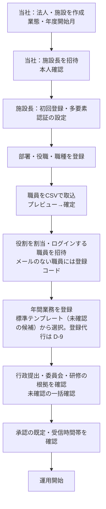

## 2. 年間業務の登録と自動生成

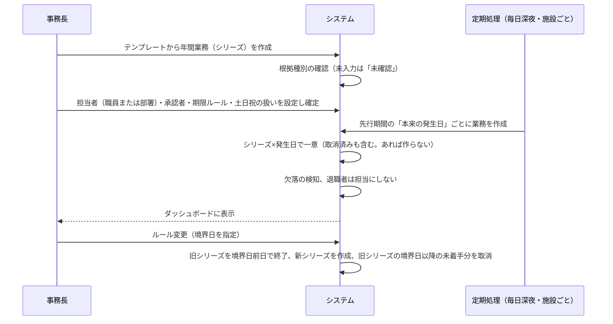

## 3. 業務依頼

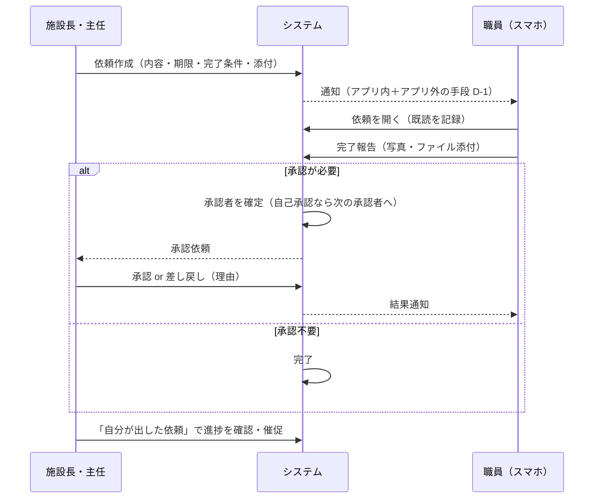

## 4. 提出物回収

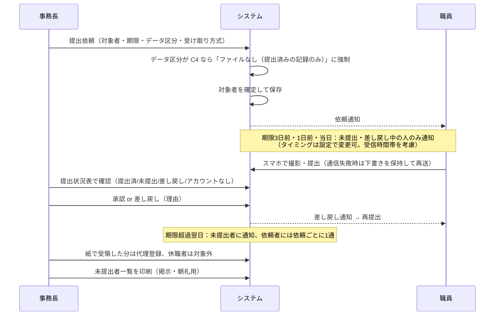

## 5. 委員会（開催から効果確認まで）

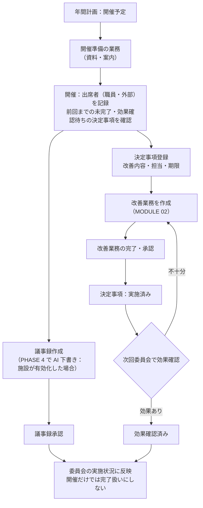

## 6. 研修

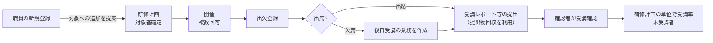

## 7. 承認（共通）

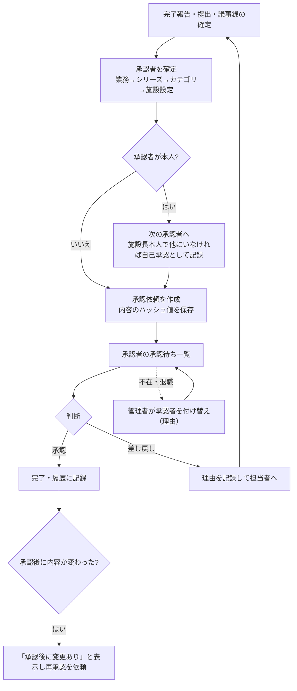

## 8. 書類の登録と証拠の紐付け

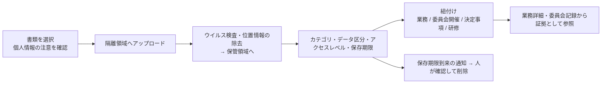

## 9. 年度更新

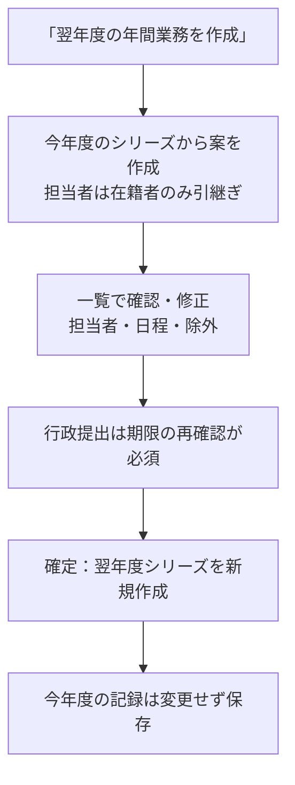

## 10. 退職・異動

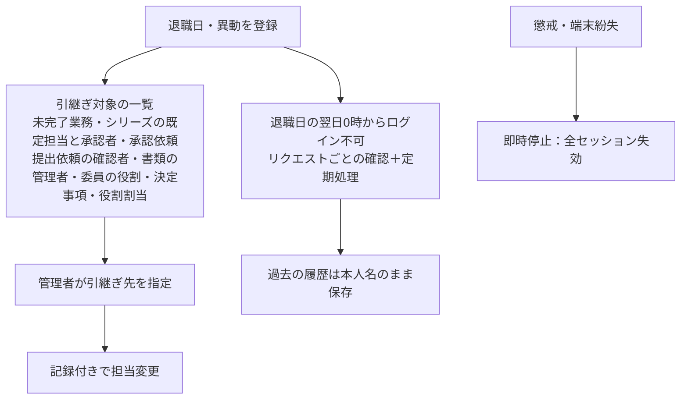

## 11. AI への質問（PHASE 4）

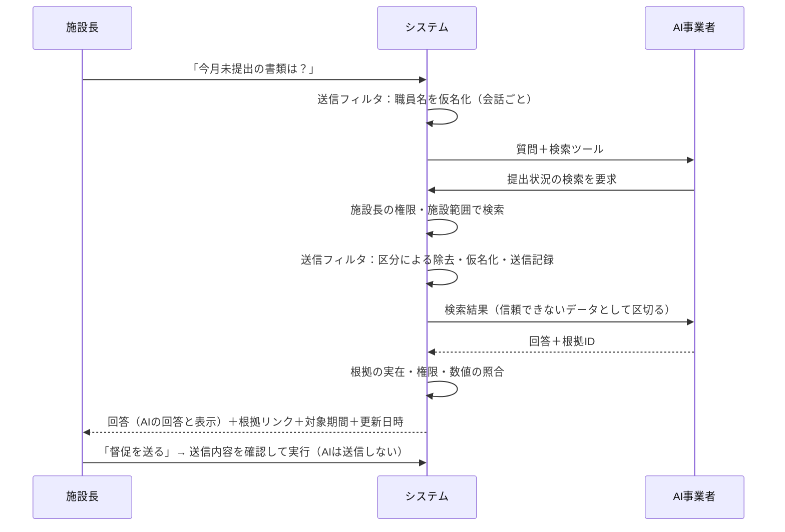
