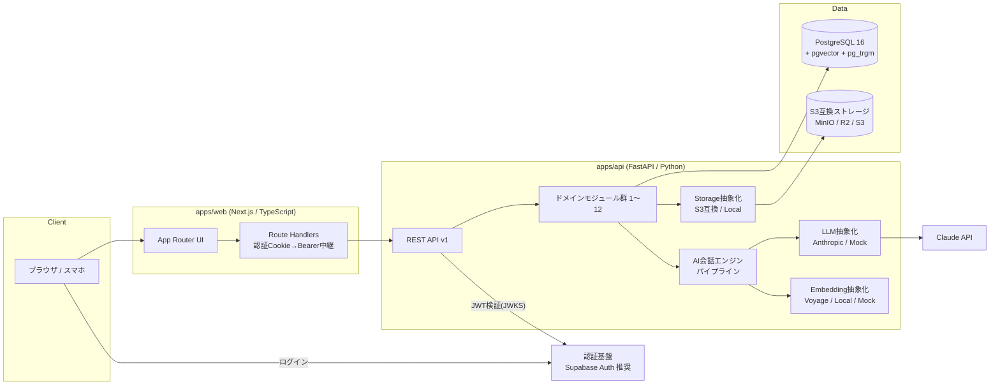
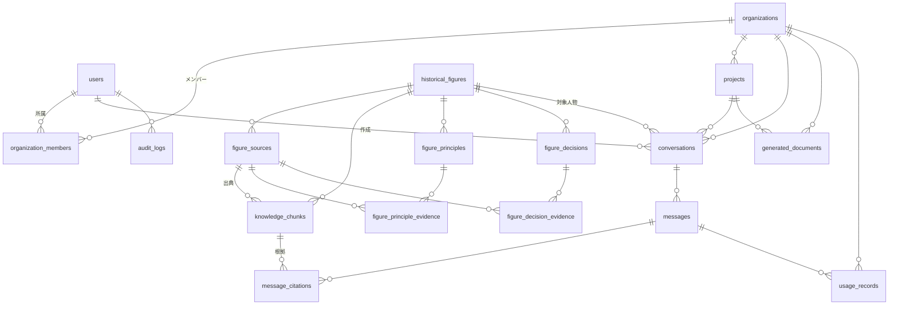
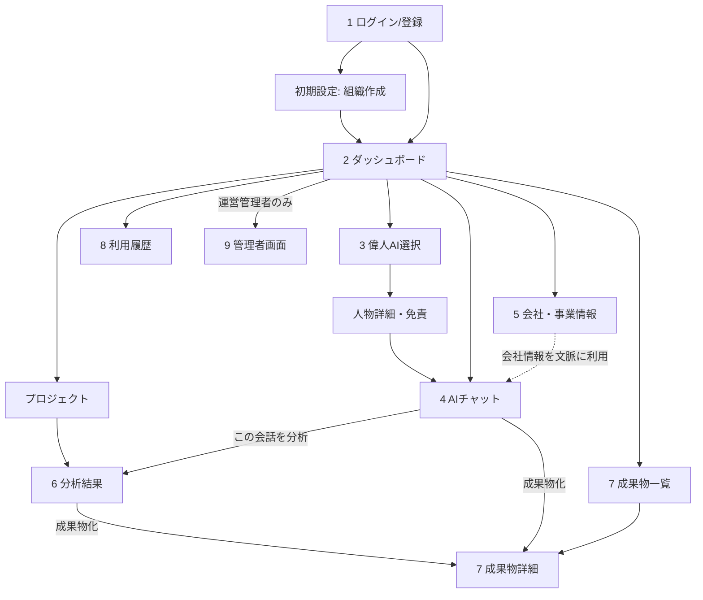

# HISTORIA AI（仮）設計書 v0.1 — レビュー用

- 作成日：2026-11-09
- ステータス：**レビュー待ち（未承認）** — 承認後に Phase 1 の実装を開始する
- 対象範囲：MVP（スティーブ・ジョブズ研究AI ／ 経営者・事業責任者向け）

---

## 0. 既存環境の調査結果

| 項目 | 結果 |
|---|---|
| リポジトリ `mao726/company` | `docs/` 配下に SNS 運用関連の Markdown のみ。**アプリケーションコードは存在しない** |
| 開発ツール（検証環境） | Node.js 22 / pnpm / Python 3.13 / uv / Docker / psql が利用可能 |
| 結論 | 既存コードとの互換性制約はなし。新規にモノレポを構築する。ただし本リポジトリは SNS 事業用のため、**別リポジトリに切り出すかどうかを確認したい（質問 Q1）** |

---

## 1. システム全体のアーキテクチャ

### 1.1 全体構成



### 1.2 設計方針

- **モジュラーモノリス**：FastAPI 1プロセス内で、12モジュールを `router / schemas / service / repository / models` に分離。モジュール間は service 経由でのみ呼び出し、他モジュールのテーブルを直接参照しない。将来マイクロサービス化やマルチエージェント化する際の境界になる。
- **AIパイプラインは単一フロー**：`Step` インターフェースの直列実行（意図分類 → 検索 → コンテキスト構築 → 生成 → 検証 → 保存）。将来の「複数偉人会議」は、この `Pipeline` を人物ごとに並列実行し、`Moderator Step` を追加する形で拡張できる構造にしておく（MVPでは実装しない）。
- **プロバイダ抽象化**：`LLMProvider`、`EmbeddingProvider`、`StorageProvider`、`AuthVerifier` をインターフェース化。環境変数で切替。`MOCK` 実装を必ず用意し、外部APIなしで画面・基本機能をテスト可能にする。
- **APIファースト**：FastAPI の OpenAPI から TypeScript クライアントを自動生成し、フロントと型を共有する。
- **非同期処理**：MVP では資料取込（分割・埋め込み）を FastAPI の BackgroundTasks＋DBのジョブ状態列で処理。負荷が増えたらジョブキュー（例：arq / Celery）へ移行できるよう `JobRunner` を抽象化する。

### 1.3 認証方式の比較（実装前に確定したい）

| 候補 | 長所 | 短所 | ローカル開発 |
|---|---|---|---|
| **Supabase Auth（推奨）** | メール・OAuth・MFA が揃う。JWT(JWKS)を FastAPI で検証するだけで済む。Postgres と親和性が高い | ベンダー依存（ただし JWT 検証のみなので差替え容易） | Supabase CLI（Docker）または **モック認証モード** |
| Clerk | UI 部品が豊富、組織機能あり | 月額が高め、データが外部に分散 | 外部接続必須 |
| Auth.js (NextAuth) | 無料、Next.js 標準的 | FastAPI 側との JWT 連携を自前設計、MFA 等は自前 | 可能 |
| 自前（FastAPI-Users 等） | 完全制御 | パスワード管理・リセット・MFA の実装と保守責任が重い | 可能 |

**推奨**：Supabase Auth を「認証（本人確認）」のみに使い、**ユーザー・組織・権限（認可）は自前の `users / organizations / organization_members` で管理**する。DB も Supabase に寄せるかは運用先次第（Q5）。ローカルでは `AUTH_MODE=mock` で固定ユーザーとしてログインできるようにする。

---

## 2. 推奨ディレクトリ構成

```
historia-ai/
├── apps/
│   ├── web/                          # Next.js (App Router) / TypeScript
│   │   ├── src/app/                  # 画面（(auth), (app)/dashboard, figures, chat, ...）
│   │   ├── src/components/           # UI部品（ui/ 基本部品, evidence/ 根拠表示 等）
│   │   ├── src/lib/api/              # OpenAPI 自動生成クライアント
│   │   ├── src/lib/auth/             # 認証クライアント（supabase / mock）
│   │   └── tests/                    # Vitest（単体）, Playwright（E2E）
│   └── api/                          # FastAPI / Python 3.12+
│       ├── app/
│       │   ├── main.py
│       │   ├── core/                 # config, logging, errors, security, tenancy, rate_limit
│       │   ├── db/                   # session, base, rls, migrations(alembic)
│       │   ├── modules/
│       │   │   ├── auth/             # 1 ユーザー・認証
│       │   │   ├── organizations/    # 2 組織・会社情報
│       │   │   ├── figures/          # 3 偉人プロフィール
│       │   │   ├── sources/          # 4 資料・出典
│       │   │   ├── knowledge/        # 5 分割・埋め込み・検索
│       │   │   ├── thinking_models/  # 6 原則・意思決定事例
│       │   │   ├── chat/             # 7 AI会話エンジン（APIの入口）
│       │   │   ├── conversations/    # 8 会話履歴
│       │   │   ├── analysis/         # 9 経営課題分析
│       │   │   ├── documents/        # 10 成果物生成
│       │   │   ├── usage/            # 11 利用量・コスト
│       │   │   └── admin/            # 12 管理者
│       │   │       （各モジュール：router.py / schemas.py / service.py / repository.py / models.py）
│       │   ├── ai/
│       │   │   ├── providers/        # llm_base.py, anthropic.py, mock.py, embeddings/*
│       │   │   ├── pipeline/         # steps/*.py, pipeline.py
│       │   │   ├── prompts/          # バージョン付きプロンプト（例: chat_v1.md）
│       │   │   └── guards/           # 出典検証・引用検証・発言捏造検知
│       │   └── storage/              # base.py, s3.py, local.py
│       ├── tests/                    # pytest（unit / integration / ai_eval）
│       └── pyproject.toml            # uv 管理
├── packages/
│   └── api-types/                    # OpenAPI から生成した型（web が参照）
├── data/
│   ├── seed/                         # 開発用シード（全て is_sample=true・「サンプル」明記）
│   └── curated/                      # 検証済み資料メタデータ（YAML、レビューを経て投入）
├── infra/
│   ├── docker-compose.yml            # postgres(pgvector), minio, api, web, (supabase or mock-auth)
│   └── postgres/init.sql             # 拡張: vector, pg_trgm, citext, pgcrypto
├── docs/                             # 本設計書, ADR, 資料取扱ポリシー
├── .env.example                      # 秘密情報は値を空で記載（.env は .gitignore）
├── Makefile                          # make up / test / lint / migrate / seed
└── README.md
```

---

## 3. データベースER設計

### 3.1 共通ルール

- 主キー：`id UUID DEFAULT gen_random_uuid()`
- 全テーブルに `created_at TIMESTAMPTZ NOT NULL DEFAULT now()`、`updated_at TIMESTAMPTZ NOT NULL DEFAULT now()`（トリガで自動更新）
- 論理削除が必要なテーブルは `deleted_at TIMESTAMPTZ NULL`
- 列挙値は PostgreSQL の `CHECK` 制約付き `TEXT`（enum 型は変更が重いため）
- **テナント所有データには `organization_id` を必ず持たせる**（子テーブルにも非正規化して保持し、RLS を単純化）
- 偉人・資料・知識データは**運営者が管理するグローバルデータ**（全テナント共通、読み取りは公開済みのみ）

### 3.2 ER図



### 3.3 テーブル定義（主要列）

※全テーブル共通の `id / created_at / updated_at` は省略。★＝必須指定テーブル以外に追加提案するもの。

#### users
| 列 | 型 | 備考 |
|---|---|---|
| auth_provider | text | `supabase` / `mock` |
| auth_subject | text | 認証基盤側のユーザーID |
| email | citext | UNIQUE |
| display_name | text | |
| is_system_admin | bool | 運営管理者フラグ（デフォルト false） |
| status | text | `active` / `suspended` |
| last_login_at, deleted_at | timestamptz | |
- INDEX：UNIQUE(auth_provider, auth_subject)、UNIQUE(email)

#### organizations
| 列 | 型 | 備考 |
|---|---|---|
| name, slug | text | slug UNIQUE |
| industry, employee_range, revenue_range | text | 会社情報 |
| business_description | text | 事業内容 |
| company_context | jsonb | 強み・課題・競合など構造化情報（AIのコンテキスト用） |
| plan | text | `trial` / `standard` 等 |
| monthly_budget_usd | numeric(10,2) | 月間AIコスト上限 |
| status, deleted_at | | |

#### organization_members
| 列 | 型 | 備考 |
|---|---|---|
| organization_id | uuid FK→organizations | ON DELETE CASCADE |
| user_id | uuid FK→users | |
| role | text | `owner` / `admin` / `member` / `viewer` |
- INDEX：UNIQUE(organization_id, user_id)、(user_id)

#### historical_figures
| 列 | 型 | 備考 |
|---|---|---|
| slug | text | UNIQUE（例 `steve-jobs`） |
| display_name, name_en | text | |
| born_on, died_on | date | |
| summary | text | 検証済み資料に基づく紹介文 |
| disclaimer | text | 「本人ではなく研究に基づく再構成」等の表示文 |
| portrait_storage_key | text NULL | **権利確認済みの画像のみ**。MVP は使用しない想定 |
| rights_notes | text | 氏名・肖像・商標の扱いメモ |
| status | text | `draft` / `in_review` / `published` / `archived` |
| published_at | timestamptz | |

#### figure_sources（資料・出典）
| 列 | 型 | 備考 |
|---|---|---|
| figure_id | uuid FK→historical_figures | |
| source_type | text | `book` / `speech` / `interview` / `article` / `video` / `official_record` / `other` |
| title, author, publisher | text | |
| published_on | date NULL | 公開日（不明時 NULL＋`published_on_precision`） |
| url, isbn, language | text | **出典URL** |
| reliability | text | `primary`（本人の発言記録） / `secondary` / `tertiary` |
| rights_status | text | `public_domain` / `licensed` / `quotation_only` / `metadata_only` / `unknown` / `prohibited` |
| license_name, license_terms | text | **利用許諾情報** |
| permission_reference | text | 許諾書番号・連絡記録など |
| permission_expires_at | timestamptz NULL | |
| allowed_uses | jsonb | `{store_fulltext, embed, quote, commercial}` の真偽 |
| verification_status | text | `unverified` / `in_review` / `verified` / `rejected`（**検証状態**） |
| verified_by | uuid FK→users NULL | |
| verified_at | timestamptz NULL | |
| storage_key, content_hash | text | 原本ファイル（保存が許される場合のみ） |
| is_sample | bool | 開発用ダミーなら true（本番では使用禁止） |
- INDEX：(figure_id)、(rights_status)、(verification_status)、UNIQUE(figure_id, url) WHERE url IS NOT NULL
- **ルール**：`rights_status IN ('unknown','prohibited')` または `verification_status <> 'verified'` の資料は検索対象外（アプリ層＋ビューで二重に除外）

#### knowledge_chunks（知識データ）
| 列 | 型 | 備考 |
|---|---|---|
| figure_id | uuid FK | 検索の絞込用 |
| source_id | uuid FK→figure_sources **NOT NULL** | **出典IDの紐づけ必須** |
| chunk_index | int | |
| content | text | |
| content_kind | text | `verbatim_excerpt`（原文抜粋） / `curator_summary`（運営者の要約） / `fact_statement`（事実記述） |
| locator | text | ページ・時刻など（例 `p.123`, `00:12:30`） |
| quotable | bool | 原文引用可（`verbatim_excerpt` かつ資料の引用権限あり） |
| token_count | int | |
| embedding | vector(1024) | 次元は埋め込みモデル確定後に決定 |
| embedding_model | text | モデル変更時の再計算管理 |
| is_sample | bool | |
- INDEX：HNSW(embedding vector_cosine_ops)、GIN(content gin_trgm_ops)（日本語キーワード検索）、(figure_id)、UNIQUE(source_id, chunk_index)

#### figure_principles（思考原則）
| 列 | 型 | 備考 |
|---|---|---|
| figure_id | uuid FK | |
| code | text | 例 `JOBS-P-001`、UNIQUE(figure_id, code) |
| title, description | text | |
| evidence_level | text | `A`（資料で確認できる行動・発言） / `B`（行動・発言からの推定） |
| applicability | text | 適用しやすい場面 |
| limitations | text | 反例・当てはまらない場面・批判的見解 |
| status, version | text / int | `draft`〜`published` |

#### figure_principle_evidence ★
| principle_id FK, source_id FK, chunk_id FK NULL, note |
- 原則が「どの資料のどの箇所」に基づくかを多対多で保持。`evidence_level='A'` の原則は最低1件の verified 資料が必須（アプリ層で検証）。

#### figure_decisions（意思決定事例）
| 列 | 型 | 備考 |
|---|---|---|
| figure_id | uuid FK | |
| title | text | |
| occurred_on | date NULL ＋ precision | |
| context | text | 当時の状況（史実） |
| decision | text | 何を決めたか（史実） |
| documented_rationale | text | 資料に記載された理由（A） |
| inferred_rationale | text | 推定される理由（B、推定である旨を明記） |
| outcome | text | 結果（史実） |
| status | text | |

#### figure_decision_evidence ★
| decision_id FK, source_id FK, chunk_id FK NULL, note |

#### projects
| organization_id FK, name, description, issue_statement（経営課題）, status, created_by FK→users, deleted_at |
- INDEX：(organization_id, updated_at DESC)

#### conversations
| 列 | 型 | 備考 |
|---|---|---|
| organization_id | uuid FK | |
| user_id | uuid FK | 作成者 |
| figure_id | uuid FK | |
| project_id | uuid FK NULL | |
| title | text | |
| mode | text | `chat` / `analysis` |
| visibility | text | `private`（作成者のみ） / `organization` |
| last_message_at, deleted_at | timestamptz | |
- INDEX：(organization_id, user_id, last_message_at DESC)

#### messages
| 列 | 型 | 備考 |
|---|---|---|
| conversation_id | uuid FK | |
| organization_id | uuid FK | RLS 用に非正規化 |
| role | text | `user` / `assistant` |
| content | text | 表示用テキスト（Markdown） |
| structured_content | jsonb | A/B/C 区分付きの主張リストなど |
| status | text | `pending` / `completed` / `failed` / `blocked` |
| model, prompt_version | text | 再現性・品質追跡 |
| guard_report | jsonb | 検証結果（降格した主張、警告） |
| error_code | text NULL | |
- INDEX：(conversation_id, created_at)

#### message_citations ★
| message_id FK, organization_id, chunk_id FK, source_id FK, claim_key（どの主張か）, label（`A`/`B`）, quoted_text NULL |
- 回答の根拠を正規化して保持し、出典表示・監査に使う。

#### generated_documents
| 列 | 型 | 備考 |
|---|---|---|
| organization_id | uuid FK | |
| project_id | uuid FK NULL | |
| conversation_id, source_message_id | uuid FK NULL | 生成元 |
| doc_type | text | `issue_analysis` / `business_plan` / `report` |
| title | text | |
| content_md | text | |
| content_json | jsonb | 構造化データ（セクション、A/B/C 区分、出典） |
| version | int | |
| status | text | `draft` / `final` |
| export_storage_key | text NULL | PDF 等の出力ファイル（将来） |
| created_by | uuid FK | |
- INDEX：(organization_id, project_id, updated_at DESC)

#### usage_records
| 列 | 型 | 備考 |
|---|---|---|
| organization_id, user_id | uuid FK | |
| conversation_id, message_id, document_id | uuid FK NULL | |
| feature | text | `chat` / `analysis` / `document` / `embedding` / `classify` |
| provider, model | text | |
| input_tokens, output_tokens, cache_read_tokens, cache_write_tokens | int | |
| cost_usd | numeric(12,6) | 料金表（設定ファイル）から算出 |
| provider_request_id | text | |
| latency_ms | int | |
| status | text | `success` / `error` |
- INDEX：(organization_id, created_at)、(user_id, created_at)
- 追記専用（更新しない）。月次集計はクエリまたはマテリアライズドビュー。

#### audit_logs ★
| actor_user_id, organization_id NULL, action, target_type, target_id, ip, user_agent, metadata jsonb |
- 資料の権利変更・検証・公開、権限変更、管理者操作を記録。

### 3.4 データ分離（必須要件への対応）

1. **アプリ層**：全リポジトリ関数が `TenantContext(org_id, user_id, role)` を必須引数に取り、`WHERE organization_id = :org_id` を強制（基底クラスで共通化、テストで検証）。
2. **DB層（多層防御）**：テナントテーブルに PostgreSQL **Row Level Security** を有効化。リクエストごとに `SET LOCAL app.org_id = '...'`、ポリシー `organization_id = current_setting('app.org_id')::uuid`。アプリの DB ロールは `BYPASSRLS` なし・テーブル所有者ではないロールを使う。
3. **テスト**：「組織Aのトークンで組織BのIDを指定したら404」を全エンドポイントで自動テスト（Phase 3 / 11 の完了条件）。

---

## 4. API一覧（`/api/v1`）

認可：🔓公開 / 👤ログイン / 🏢組織メンバー / 🛡️組織admin以上 / ⚙️運営管理者

| モジュール | メソッド・パス | 権限 | 概要 |
|---|---|---|---|
| ヘルス | GET `/health`, GET `/health/ready` | 🔓 | 死活・DB接続確認 |
| 1 認証 | GET `/me` | 👤 | 自分の情報・所属組織 |
| | PATCH `/me` | 👤 | 表示名等の更新 |
| | POST `/auth/session/sync` | 👤 | 初回ログイン時に users 作成（JWT から） |
| 2 組織 | POST `/organizations` | 👤 | 組織作成（作成者が owner） |
| | GET/PATCH `/organizations/{org_id}` | 🏢 / 🛡️ | 組織・会社情報の取得 / 更新 |
| | GET `/organizations/{org_id}/members` | 🏢 | メンバー一覧 |
| | POST/PATCH/DELETE `/organizations/{org_id}/members[/{user_id}]` | 🛡️ | 招待・権限変更・削除（招待メールはMVPでは簡易） |
| 3 偉人 | GET `/figures` | 👤 | 公開済み人物一覧 |
| | GET `/figures/{slug}` | 👤 | プロフィール・免責表示・主要原則 |
| 4 資料 | GET `/figures/{id}/sources` | 👤 | 公開可能な出典メタデータ一覧 |
| | GET `/sources/{id}` | 👤 | 出典詳細（権利上公開可能な範囲） |
| 5 検索 | POST `/figures/{id}/knowledge/search` | 👤 | 知識検索（デバッグ・根拠閲覧用、件数制限） |
| 6 思考モデル | GET `/figures/{id}/principles`, `/figures/{id}/decisions` | 👤 | 原則・意思決定事例（根拠付き） |
| 7/8 会話 | POST `/organizations/{org_id}/conversations` | 🏢 | 会話作成（人物・プロジェクト指定） |
| | GET `/organizations/{org_id}/conversations` | 🏢 | 会話一覧（ページング） |
| | GET/PATCH/DELETE `/organizations/{org_id}/conversations/{id}` | 🏢 | 詳細・タイトル変更・削除 |
| | GET `.../conversations/{id}/messages` | 🏢 | メッセージ（根拠付き） |
| | POST `.../conversations/{id}/messages` | 🏢 | 質問送信 → **SSE** で進捗・結果を返す |
| | GET `.../messages/{id}/citations` | 🏢 | 回答の出典一覧 |
| 9 分析 | POST `/organizations/{org_id}/projects` / GET 一覧 / GET・PATCH・DELETE `{id}` | 🏢 | プロジェクト（経営課題）管理 |
| | POST `.../projects/{id}/analyses` | 🏢 | 経営課題分析の実行（SSE） |
| 10 成果物 | POST `.../documents` | 🏢 | 分析結果・会話から成果物生成 |
| | GET `.../documents`, GET/PATCH/DELETE `.../documents/{id}` | 🏢 | 一覧・詳細・編集・削除 |
| | GET `.../documents/{id}/export?format=md` | 🏢 | Markdown 出力（PDF 等は将来） |
| 11 利用量 | GET `/organizations/{org_id}/usage/summary?month=` | 🛡️ | 月次サマリ（トークン・コスト・上限） |
| | GET `/organizations/{org_id}/usage/records` | 🛡️ | 明細（自分の分は member も可） |
| 12 管理 | CRUD `/admin/figures` | ⚙️ | 人物管理・公開状態変更 |
| | CRUD `/admin/sources`, POST `/admin/sources/{id}/upload` | ⚙️ | 資料登録・権利情報・ファイル |
| | POST `/admin/sources/{id}/verify` | ⚙️ | 検証状態の更新（監査ログ） |
| | POST `/admin/sources/{id}/ingest` | ⚙️ | 分割・埋め込みジョブ実行 |
| | CRUD `/admin/figures/{id}/principles`, `/decisions` | ⚙️ | 思考モデル管理（根拠紐づけ必須） |
| | GET `/admin/organizations`, `/admin/users`, `/admin/usage` | ⚙️ | テナント・利用状況 |
| | GET `/admin/audit-logs` | ⚙️ | 監査ログ |

共通仕様：エラーは `{"error": {"code", "message", "request_id"}}`、一覧は cursor ページング、全リクエストに `X-Request-ID`。

---

## 5. 画面一覧と画面遷移

| # | 画面 | パス | 主な内容 |
|---|---|---|---|
| 1 | ログイン・登録 | `/login`, `/signup` | メール＋パスワード（OAuthは任意）、利用規約・AI利用の注意への同意 |
| 1' | 初期設定 | `/onboarding` | 組織作成 → 会社情報入力（スキップ可） |
| 2 | ダッシュボード | `/dashboard` | 最近の会話・プロジェクト・成果物、今月の利用量 |
| 3 | 偉人AI選択 | `/figures`, `/figures/[slug]` | 人物カード、研究範囲・主要原則・**免責表示**・資料数 |
| 4 | AIチャット | `/chat/[conversationId]` | 回答を A/B/C で色分け表示、出典パネル（PC：右ペイン／スマホ：ボトムシート） |
| 5 | 会社・事業情報 | `/settings/company` | 業種・規模・事業内容・課題（AIに渡す範囲を明示） |
| 6 | 分析結果 | `/projects/[id]/analysis/[analysisId]` | 課題整理 → 人物の原則との対応 → 提案 → リスク → 次の一手 |
| 7 | 成果物一覧・詳細 | `/documents`, `/documents/[id]` | 一覧・プレビュー・編集・Markdown出力 |
| 8 | 利用履歴 | `/usage` | 月次トークン・コスト・上限、会話別明細 |
| 9 | 管理者 | `/admin/*` | 人物・資料（権利・検証）・思考モデル・取込ジョブ・テナント・監査ログ |



デザイン方針：濃紺／アイボリー／真鍮色系の落ち着いた配色、本文は明朝系見出し＋ゴシック本文で可読性重視、装飾は最小限。A/B/C ラベルは色だけでなく文字ラベルでも区別（アクセシビリティ）。モバイルファーストのレスポンシブ。

---

## 6. AI処理フロー

### 6.1 回答の区分定義

| 区分 | 意味 | 必要条件 | 表示 |
|---|---|---|---|
| **A：史実** | 資料で確認できる事実・発言・行動 | verified 資料のチャンクへの引用IDが必須 | 「史実」ラベル＋出典リンク |
| **B：推定** | 過去の行動・発言からの推定 | 推定の根拠（A のチャンク or 原則）を提示、断定表現禁止 | 「推定」ラベル＋根拠 |
| **C：応用提案** | 現在の課題への AI 独自の提案 | 人物の発言として表現しない | 「AIによる応用提案」ラベル |

### 6.2 処理ステップ

```mermaid
flowchart TD
  IN[ユーザー入力] --> G0[0. 前処理<br/>入力検証・権限・月間予算チェック]
  G0 --> S1[1. 意図分類<br/>軽量モデル / 構造化出力<br/>質問種別・必要知識・最新情報要否]
  S1 --> S2[2. 検索<br/>クエリ生成→ベクトル検索+キーワード検索<br/>verified かつ利用可能資料のみ→再順位付け]
  S2 --> S3[3. 思考モデル取得<br/>関連する原則・意思決定事例とその根拠]
  S3 --> S4[4. コンテキスト構築<br/>固定部: 品質ルール+人物モデル→キャッシュ<br/>可変部: 会社情報・検索結果(チャンクID付)・履歴要約]
  S4 --> S5[5. 生成<br/>構造化出力: claims[] each label A/B/C + chunk_ids]
  S5 --> S6[6. 検証ガード]
  S6 -->|OK| S7[7. 保存<br/>messages / message_citations / usage_records]
  S6 -->|違反| FIX[A→B降格・引用除去・警告付与<br/>重大なら1回だけ再生成]
  FIX --> S7
  S7 --> OUT[SSEで返却・画面表示]
```

**6. 検証ガードの内容**（ルールベース、LLMに依存しない）

- A の主張に、今回の検索結果に含まれる `chunk_id` が付いているか（無ければ B に降格）
- 引用された `chunk_id` の資料が `verified` かつ権利上利用可能か
- 「」付きの引用文が、`quotable=true` のチャンク本文と**完全一致**するか（不一致なら引用表記を除去し要約扱い）
- 「ジョブズは〜と言った／語った」等の発言帰属表現が、A 以外の主張に含まれていないか（パターン検出）
- 引用の分量上限（1回答あたりの引用文字数上限）を超えていないか — 引用は「従」の関係を保つ

**ストリーミング方針**：検証前の未確認テキストを表示しないため、SSE では「検索中→分析中→検証中」の進捗イベントを流し、検証後の回答を一括表示する（体感速度とのトレードオフ。将来は C 区分のみ先行ストリーミングも検討）。

**最新情報**：MVP では「最新の市場・企業情報が必要」と判定した場合、その旨を回答に明示し、推測で補わない。将来 `WebResearch Step`（Claude の web search ツール等）を追加し、取得情報は「外部調査（日付・URL付き）」として A/B/C とは別区分で表示する。

### 6.3 モデル構成（案、環境変数で切替）

| 用途 | 推奨（初期値） | 理由 |
|---|---|---|
| 意図分類・クエリ生成 | Claude Haiku 5.5 | 低コスト・高速 |
| チャット回答 | Claude Sonnet 5.5（または Opus 5.5） | 品質とコストのバランス（Q7で確定） |
| 経営課題分析・成果物 | Claude Opus 5.5 | 長文・高度な推論 |
| 埋め込み | Voyage AI 多言語モデル または OSS（multilingual-e5 等） | Claude は埋め込みAPIを提供しないため別途選定（Q6） |
| モック | MockProvider | 固定パターンの A/B/C 回答と疑似出典を返す（「モック回答」と画面表示） |

プロンプトはリポジトリ内でバージョン管理し、`messages.prompt_version` に記録する。品質回帰を防ぐため、評価用の質問セット（20〜50問）と自動チェック（出典の有無、捏造帰属の検出）を Phase 6 以降の CI に組み込む。

---

## 7. セキュリティ設計

| 領域 | 対策 |
|---|---|
| 認証 | Supabase Auth の JWT を FastAPI で JWKS 検証（署名・期限・audience）。Web はセッションを HttpOnly Cookie で保持し BFF 経由で API へ。MFA は管理者に必須化（推奨） |
| 認可 | RBAC（owner/admin/member/viewer＋運営管理者）。依存性注入で全エンドポイントに権限チェックを宣言的に付与、未指定はデフォルト拒否 |
| テナント分離 | 3.4 の通り（アプリ層強制＋RLS＋自動テスト）。他組織IDアクセスは 404 で存在を秘匿 |
| 入力検証 | Pydantic で型・長さ・列挙を検証（質問は最大文字数制限）。ファイルアップロードは MIME・サイズ・拡張子チェック、署名付きURL経由 |
| 出力 | Markdown は sanitize（rehype-sanitize）してから描画、生HTML禁止。外部リンクは `rel="noopener noreferrer"` |
| プロンプトインジェクション | 資料本文・ユーザー入力はデータとして区切って渡し、システム指示と分離。資料内の指示文は無視するよう明示。ガードはLLM外のルールで実施 |
| 秘密情報 | `.env`（Git除外）・`.env.example` のみコミット。本番はホスティングのシークレット管理。ログに API キー・JWT・個人情報を出さないマスキング |
| レート制限・コスト | ユーザー単位の分間リクエスト制限、組織の月間予算超過で AI 機能停止（管理者に通知） |
| ログ・監査 | 構造化 JSON ログ（request_id 付き）、監査ログ（権限変更・資料権利/検証変更・公開操作）、エラーは Sentry 等へ（任意） |
| 通信・ヘッダ | HTTPS 前提、CORS は Web オリジンのみ許可、CSP・HSTS・X-Frame-Options |
| 依存関係 | `pip-audit` / `pnpm audit`、Dependabot、シークレットスキャン |
| データ取扱い | 顧客の会社情報・会話はモデル学習に使わない旨を規約に明記。Claude API の商用利用規約・データ保持方針を確認し記載。退会時の削除手順を用意 |
| コンテンツ・権利 | 権利未確認資料は検索・表示から除外。肖像画像・音声は使わない。免責表示を人物ページ・チャット画面に常時表示 |

---

## 8. 開発フェーズと完了条件

各 Phase は「完了条件を満たし、テストが通り、レビュー承認を得てから次へ進む」。

| Phase | 内容 | 完了条件 |
|---|---|---|
| 1 土台 | モノレポ、docker-compose（Postgres+pgvector, MinIO）、FastAPI/Next.js 雛形、設定・ログ・エラー処理の基盤、Lint/Format/CI、README | `make up` で全サービス起動、`/health/ready` が DB 接続込みで 200、Web トップ表示、`make test` / `make lint` が CI でグリーン、`.env.example` 整備、秘密情報がコミットされていない |
| 2 DB | Alembic で全テーブル・インデックス・トリガ・RLS 作成、シード（サンプル明示） | `alembic upgrade head` / `downgrade base` が往復成功、ER 図と実スキーマの差分なし、RLS で他組織行が取れないことを SQL テストで確認 |
| 3 認証・ユーザー | Supabase Auth 連携＋モック認証、users/組織/メンバー/権限 API、ログイン・登録・初期設定・会社情報画面 | 登録→組織作成→ログアウト/ログイン E2E が通る、権限マトリクスのテスト、他組織アクセス 404 の自動テスト |
| 4 偉人・資料 | 人物・資料・権利・検証の管理 API/画面、ファイル保存、監査ログ | 権利情報・検証状態の必須項目が入力検証される、未検証資料が一般 API に出ない、監査ログ記録を確認 |
| 5 RAG | 分割・埋め込み（モック/本番）、ハイブリッド検索、取込ジョブ | 評価用質問で上位5件に正解チャンクが含まれる率を計測・記録、権利不可資料が検索に出ないテスト、モックで全テスト可能 |
| 6 ジョブズAI会話 | パイプライン、LLM 抽象化、構造化出力、会話履歴、SSE、チャット画面 | モック／実API 両方で会話可能、会話一覧・継続・削除、失敗時のエラー表示とリトライ、使用トークン記録 |
| 7 根拠・出典表示 | 検証ガード、message_citations、A/B/C 表示、出典パネル | 評価セットで「出典なしの A」「発言の捏造帰属」が 0 件、引用の完全一致検証テスト、スマホ表示確認 |
| 8 経営課題分析 | プロジェクト、分析テンプレート、分析結果画面 | 会社情報を踏まえた分析が規定セクション構成で出力、全主張に区分ラベル、再実行・履歴参照可能 |
| 9 成果物生成 | 分析・会話から成果物作成、編集、Markdown 出力 | 生成・編集・版管理・出力が E2E で通る、成果物にも出典と区分が保持される |
| 10 利用量・コスト | usage 集計、料金表、予算上限、利用履歴画面 | 実API呼び出しの記録値と Anthropic 側の usage 値が一致、予算超過時に停止・通知 |
| 11 テスト・セキュリティ | 総合テスト、脆弱性診断、負荷の簡易確認、運用手順書 | OWASP ASVS L1 相当のチェックリスト完了、依存脆弱性 High 以上 0、テナント分離テスト全エンドポイント網羅、README 最終化 |

---

## 9. 想定月額運用コストと変動要因

### 9.1 前提（2026-11 時点の公開単価、税別、1ドル=150円で試算、要再確認）

| モデル | 入力 $/100万トークン | 出力 $/100万トークン |
|---|---|---|
| Claude Opus 5.5 | 4.00 | 20.00 |
| Claude Sonnet 5.5 | 2.00 | 10.00 |
| Claude Haiku 5.5 | 0.10 | 0.50 |

1回あたりの想定トークン（思考トークンは出力に含めて概算）：

| 処理 | 入力 | 出力 | 単価試算 |
|---|---|---|---|
| チャット1往復（Sonnet 5.5、分類は Haiku） | 約1万 | 約2,000 | 約 $0.04（約6円）※キャッシュ適用で入力費は低減 |
| 同（Opus 5.5） | 約1万 | 約2,000 | 約 $0.08（約12円） |
| 経営課題分析1回（Opus 5.5） | 約2.5万 | 約8,000 | 約 $0.26（約39円） |
| 成果物生成1件（Opus 5.5） | 約3万 | 約1.2万 | 約 $0.36（約54円） |

### 9.2 月額シナリオ（概算）

| 項目 | 検証期（社内＋顧客10名） | 初期有料（100名） | 拡大期（1,000名） |
|---|---|---|---|
| チャット回数 / 月 | 1,500 | 30,000 | 300,000 |
| 分析＋成果物 / 月 | 100 | 2,000 | 20,000 |
| **AI API（Sonnet中心）** | 約 $100（1.5万円） | 約 $1,900（28万円） | 約 $19,000（285万円） |
| 埋め込み | ほぼ $0〜数ドル（資料量は数千チャンク規模） | 同左 | 同左 |
| DB・認証（Supabase Pro 等） | $25〜 | $25〜100 | $300〜 |
| Web ホスティング（Vercel 等） | $0〜20 | $20〜50 | $100〜 |
| API サーバ（Fly.io / Render / AWS 等） | $10〜30 | $50〜150 | $500〜 |
| ストレージ（R2 / S3） | $1 未満 | 数ドル | $10〜 |
| 監視（Sentry 等） | $0 | $0〜30 | $50〜 |
| **合計目安** | **約2〜3万円** | **約30〜35万円** | **約300万円〜** |

※インフラ費は各社の公開プランの概算であり、契約前に再確認する。

### 9.3 主な変動要因

- **利用回数×1回あたりトークン**（最大要因）。履歴が長い会話ほど入力が増える → 履歴要約・上限設定で抑制
- **モデル選択**：チャットを Opus にすると AI 費は約2倍。用途別に切替可能にする
- **思考の深さ（effort 設定）**：出力トークンに直結
- **プロンプトキャッシュ**：品質ルール・人物モデル等の固定部分をキャッシュし入力費を削減
- **検索結果の投入量**（何チャンク渡すか）
- **バッチ化**：即時性不要な成果物生成・資料の要約はバッチAPI（約半額）を検討
- **為替**、モデル単価改定、無料トライアル利用者の割合
- 価格設計：1ユーザー月 3,000〜5,000円規模なら、ヘビーユーザーに対して月間上限（回数またはコスト）を設けることが前提

---

## 10. 実装前に確認したい質問

**重要度：高（Phase 1 着手前に回答が必要）**

- **Q1 リポジトリ**：本リポジトリ `mao726/company` は SNS 運用資料用です。HISTORIA AI は (a) 本リポジトリの `historia-ai/` 配下に作る、(b) 新規リポジトリを作る、のどちらにしますか？（推奨：b。権限・CI・履歴を分離できる）
- **Q2 人物名の商用利用（法務確認）**：スティーブ・ジョブズは米カリフォルニア州で亡くなっており、同州法では死後も一定期間パブリシティ権が保護されます（Apple 等の商標も関係します）。製品名や画面で氏名を前面に出す商用利用について、**弁護士確認または権利者への確認**を行う予定はありますか？ 確認が済むまでの暫定表記（例：「ジョブズの経営判断を研究した AI」として氏名を説明文中のみで使い、写真・ロゴは使用しない）でよいですか？（本設計は法的助言ではありません）
- **Q3 資料の範囲と保存方針**：伝記・インタビュー記事の多くは著作物です。MVP では「**出典メタデータ＋運営者が書いた要約＋引用要件を満たす短い原文抜粋のみ**を保存し、書籍全文は保存しない」方針でよいですか？ また資料の収集・検証（verified 判定）は誰が担当しますか？
- **Q4 認証**：Supabase Auth 採用（ローカルはモック認証）でよいですか？
- **Q7 モデルと品質/コスト**：チャット回答は Sonnet 5.5（安価）と Opus 5.5（高品質・約2倍）のどちらを初期値にしますか？（推奨：チャット Sonnet 5.5、分析・成果物 Opus 5.5、いずれも設定で切替可能）

**重要度：中（Phase 3〜5 までに回答が必要）**

- **Q5 本番の運用先とデータ所在地**：日本リージョンでのデータ保管が必須ですか？（例：Supabase 東京リージョン＋AWS 東京 等）
- **Q6 埋め込みモデル**：外部 API（Voyage AI 等、追加契約が必要）と、自前でローカル実行する OSS モデル（追加費用なし、サーバ負荷あり）のどちらを優先しますか？
- **Q8 言語**：UI・回答とも日本語のみでよいですか？ 英語資料を日本語で要約・回答する前提でよいですか？
- **Q9 課金**：MVP では決済（Stripe 等）は実装せず、運営者が組織ごとに月間上限を設定する方式でよいですか？
- **Q10 成果物の形式**：MVP は画面表示＋Markdown 出力とし、PDF/Excel/PowerPoint は将来対応でよいですか？
- **Q11 最新情報調査**：MVP では Web 調査を行わず「最新情報が必要」と明示するだけでよいですか？
- **Q12 顧客による資料アップロード**：MVP では資料登録は運営者のみ（顧客は不可）でよいですか？ 顧客が自社資料（決算書等）を読み込ませる機能は将来でよいですか？

---

## 付録：本設計で意図的に MVP から外すもの

複数偉人会議・AI 同士の反論・統括 AI、Web 調査、PDF/Excel/PowerPoint 生成、決済、顧客の資料アップロード、SSO/SAML。いずれも上記モジュール境界とパイプライン構造のまま追加できるようにしておく。
